<div align="center">

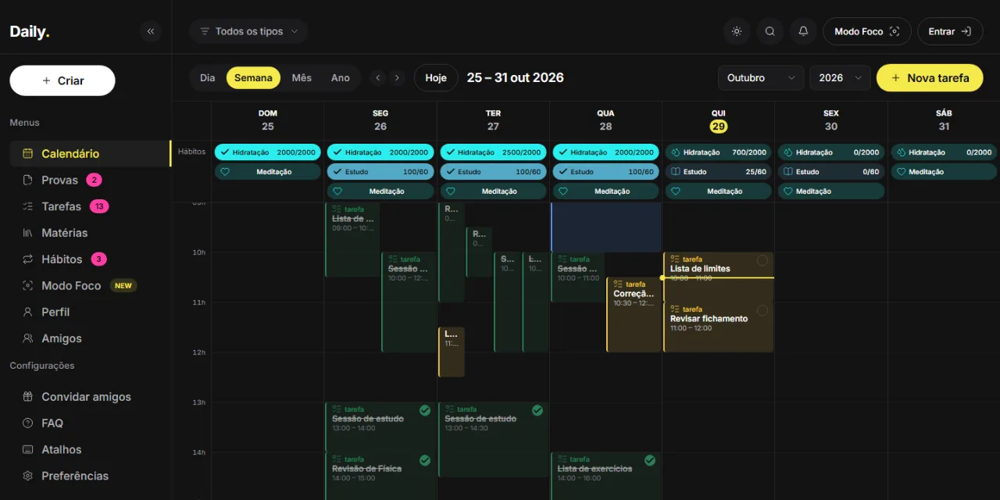

# Daily

**App de disciplina e desenvolvimento pessoal, feito para ficar aberto na segunda tela.**

Calendário em quatro visões, tarefas com subtarefas, provas com contagem regressiva, hábitos com heatmap, Modo Foco e perfil. Instala como app, funciona offline e guarda tudo no seu navegador.

[](https://github.com/Mateus-Fonseca847/daily-study-planner/actions/workflows/ci.yml)
[](CHANGELOG.md)
[](LICENSE)


### [▶ Abrir a demo: https://dailystudyplanner.vercel.app](https://dailystudyplanner.vercel.app)

[Documentação](docs/) · [Arquitetura](docs/architecture.md) · [Roadmap](#roadmap) · [Changelog](CHANGELOG.md)

</div>

---

## O que é

O **Daily** nasceu de uma necessidade pessoal: ter um painel que fique aberto o dia inteiro na segunda tela, lembrando constantemente das obrigações acadêmicas. Em vez de mais um to-do genérico, ele é pensado para a rotina de quem estuda:

- **Provas** com contagem regressiva e progresso calculado a partir dos conteúdos já estudados
- **Conteúdos como mini tarefas**: cada prova é dividida em matérias/assuntos que podem ser marcados como concluídos
- **Tarefas, provas e especiais** com subtarefas, prazo e status (pendente, concluído, cancelado)
- **Modo Foco**, uma visão em tela cheia para a segunda tela, com o que importa agora
- **Gratuito e hospedável**, sem dependência de serviços pagos

O projeto também é um estudo de engenharia de software: monorepo, TypeScript estrito, design system baseado em tokens, testes e documentação versionada.

## Status

A versão **1.0** está publicada em [https://dailystudyplanner.vercel.app](https://dailystudyplanner.vercel.app). Sem conta, os dados ficam só no navegador; com o login opcional do Google, eles são sincronizados na nuvem (Supabase) entre os seus dispositivos. O app é usável em **celular e tablet**, além do desktop.

| Marco                   | Escopo                                                       | Status    |
| ----------------------- | ------------------------------------------------------------ | --------- |
| **0. Fundação visual**  | Monorepo, design system, calendário mensal                   | Concluído |
| **1. Dados locais**     | `localStorage` versionado, CRUD, páginas, backup             | Concluído |
| **2. Estudos**          | Provas, conteúdos, hábitos, Perfil e Modo Foco               | Concluído |
| **2.1 Tarefas**         | Tipos e status novos, subtarefas, descansos, chamas e Perfil | Concluído |
| **3. App**              | Visões do calendário, PWA instalável e offline, deploy       | Concluído |
| **4. Nuvem**            | Login opcional com Google e sincronização (Supabase)         | Concluído |
| **5. Celular e tablet** | Layout responsivo, toque, sheets e gestos                    | Concluído |
| **6. Notificações**     | Lembretes de provas, blocos e hábitos                        | Planejado |

## Telas

|                                                                                                                                                                 |                                                                                                                                                               |
| --------------------------------------------------------------------------------------------------------------------------------------------------------------- | ------------------------------------------------------------------------------------------------------------------------------------------------------------- |
| **Calendário (Mês)**: tarefas, provas e especiais, com filtro por tipo.<br>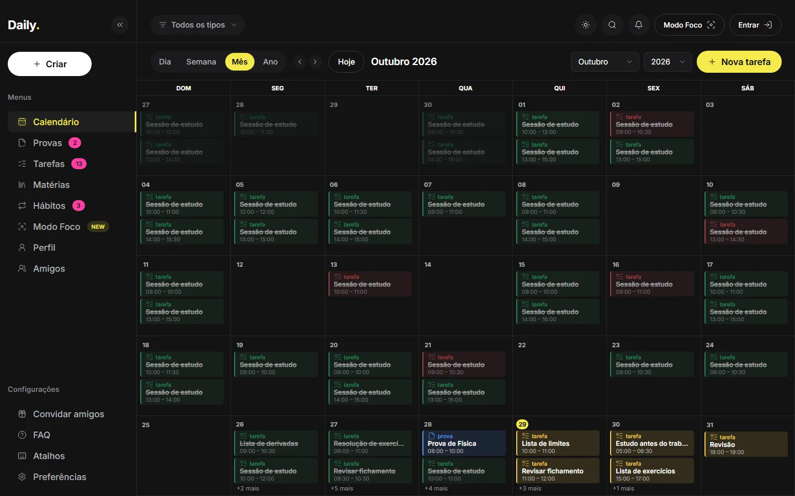                                              | **Semana**: grade de horas, eventos simultâneos lado a lado e faixa de hábitos.<br>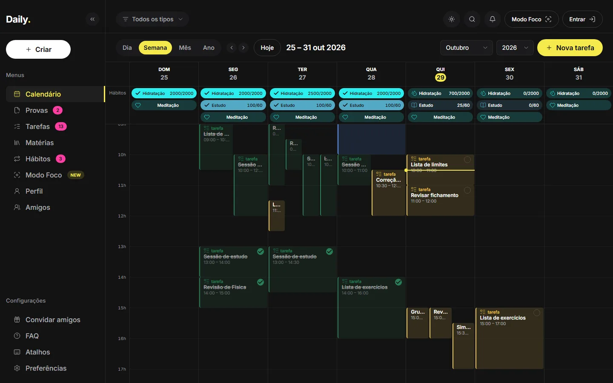                              |
| **Dia**: agenda com painel de hábitos, próxima prova e tarefas.<br>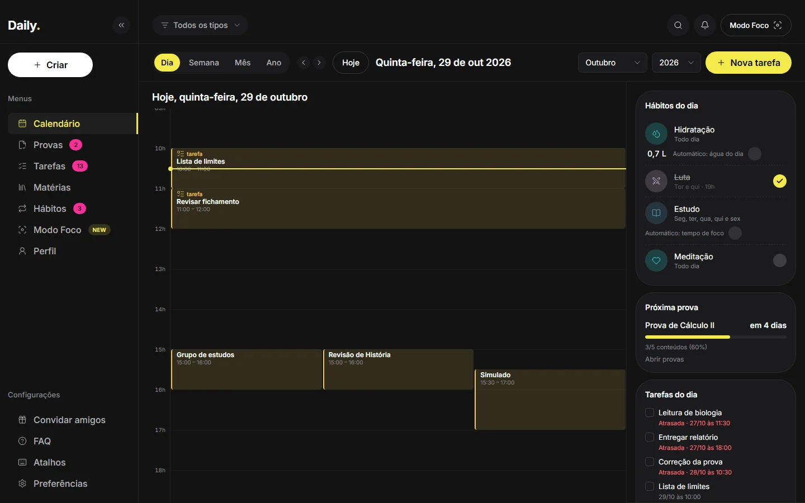                                                      | **Ano**: 12 mini-meses com a densidade de eventos de cada dia.<br>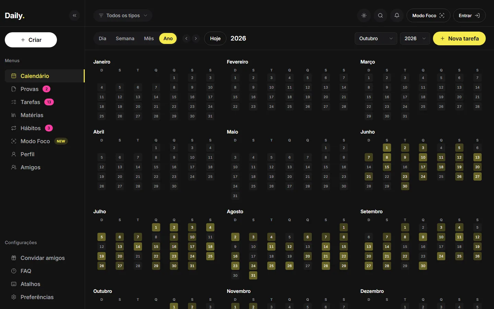                                                     |
| **Hábitos**: heatmap de contribuições, sequências e taxa por hábito.<br>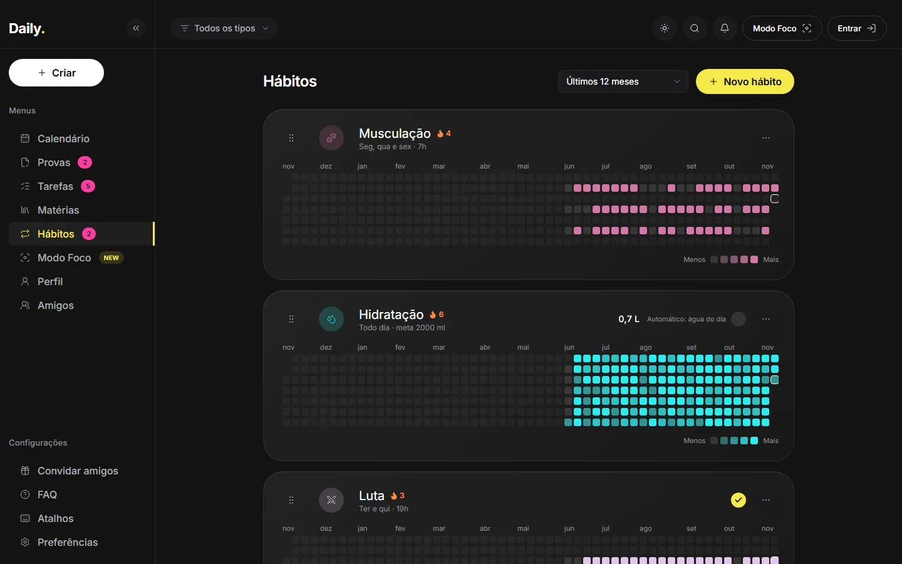                                                    | **Perfil** (antes Estatísticas): tempo de foco, preparação, água, hábitos de hoje e estatísticas pessoais.<br>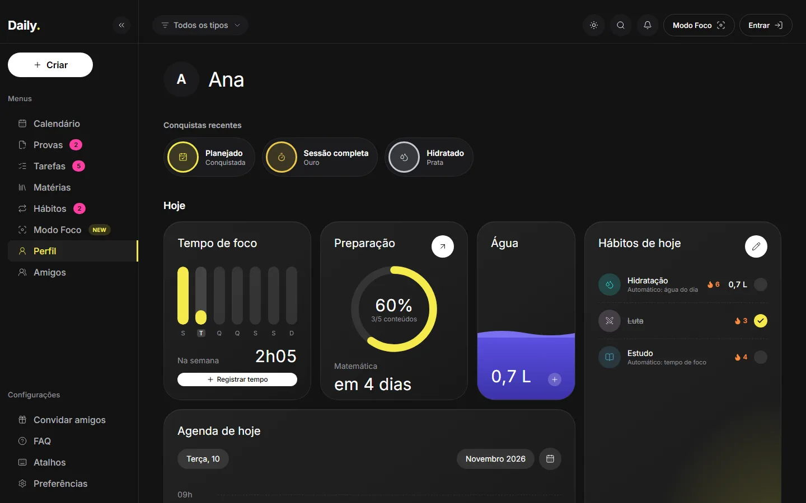              |
| **Tarefas**: resumo, Atrasadas, Hoje e todas as Próximas, com concluir em um clique.<br>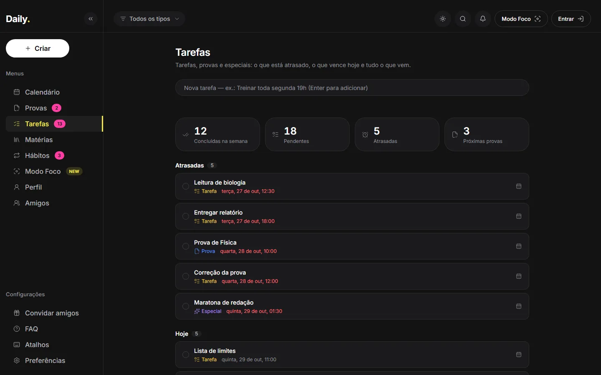                                    | **Painel de tarefa**: tipo, status em 3 opções, prazo, conteúdos/subtarefas e descrição.<br>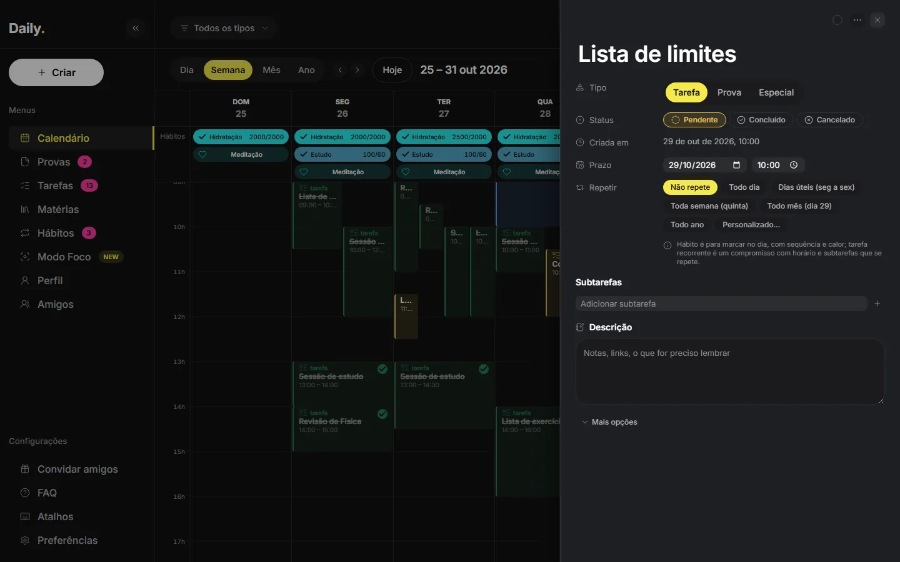               |
| **Tarefas recorrentes**: repetir com atalhos ou personalizado, resumo e prévia das próximas datas.<br>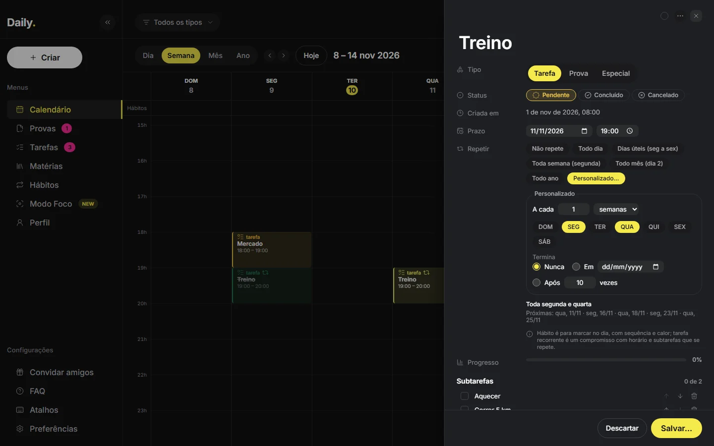 | **Escopo**: editar ou excluir só esta ocorrência, esta e as próximas, ou todas.<br>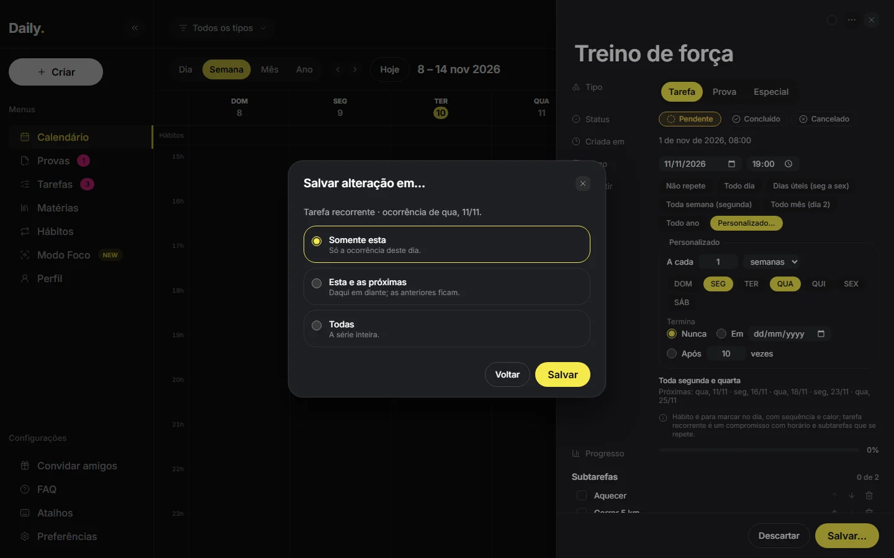                   |
| **Tema claro**: o mesmo app em fundo claro, com o seletor Sistema, Claro ou Escuro.<br>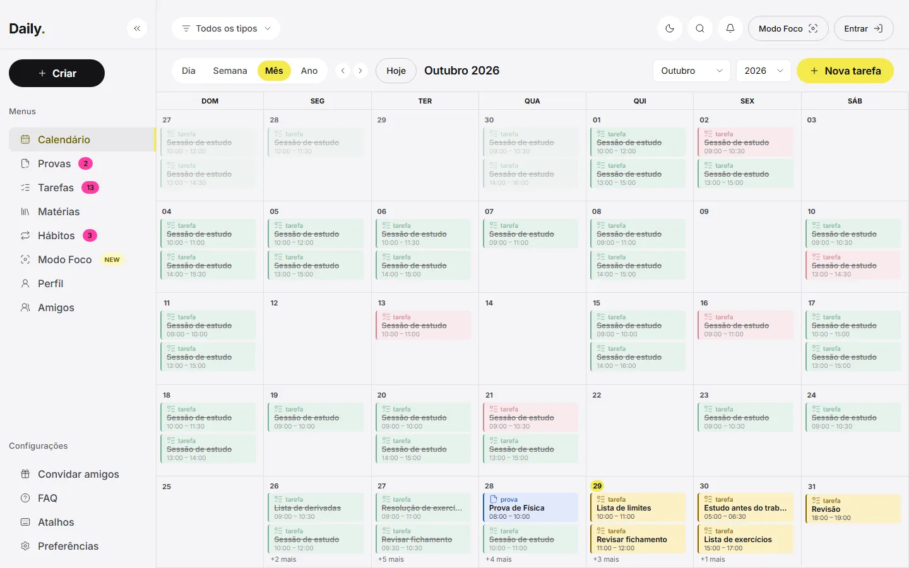                    | **Perfil no claro**: cartões brancos, tinta escura e as cores de significado com contraste AA.<br>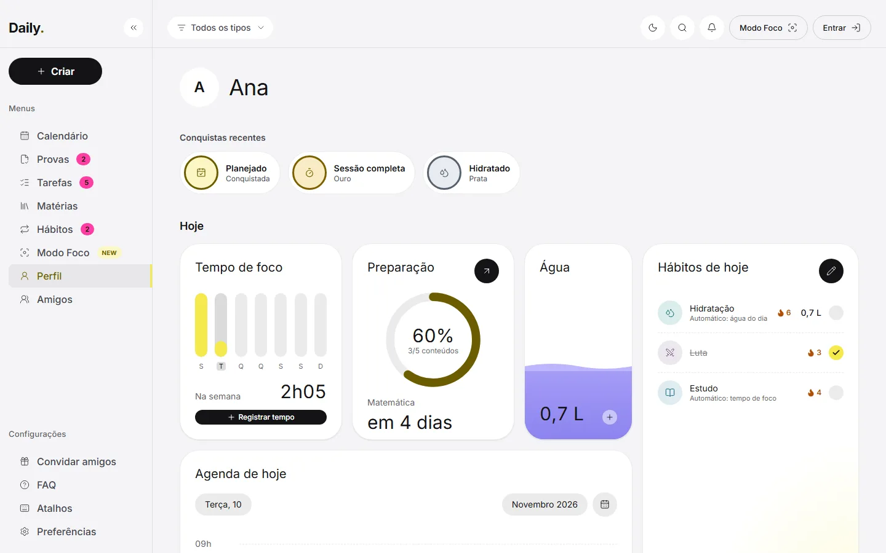 |
| **Conquistas**: medalhas com níveis, progresso e a data, agrupadas por categoria.<br>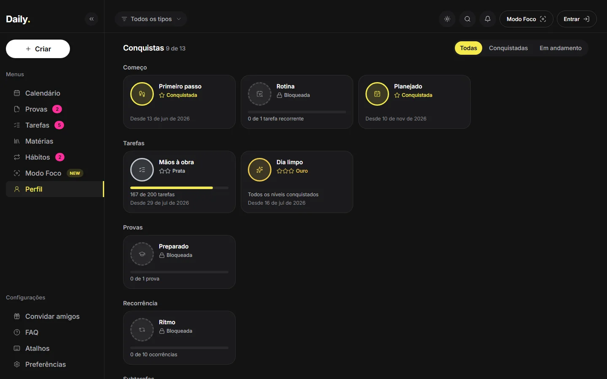                                 | **Detalhe da medalha**: critério, data de cada nível e "Destacar no perfil".<br>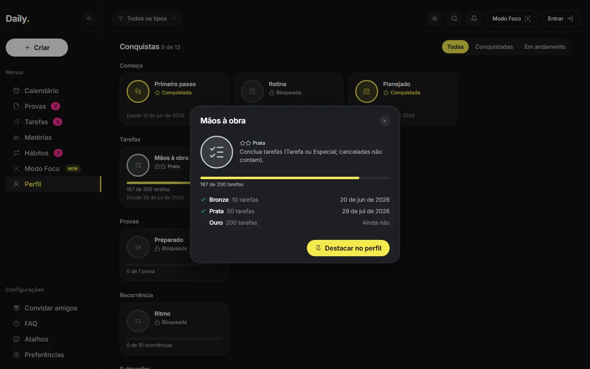                       |
| **Modo Foco**: dígitos grandes, duração digitada no próprio relógio.<br>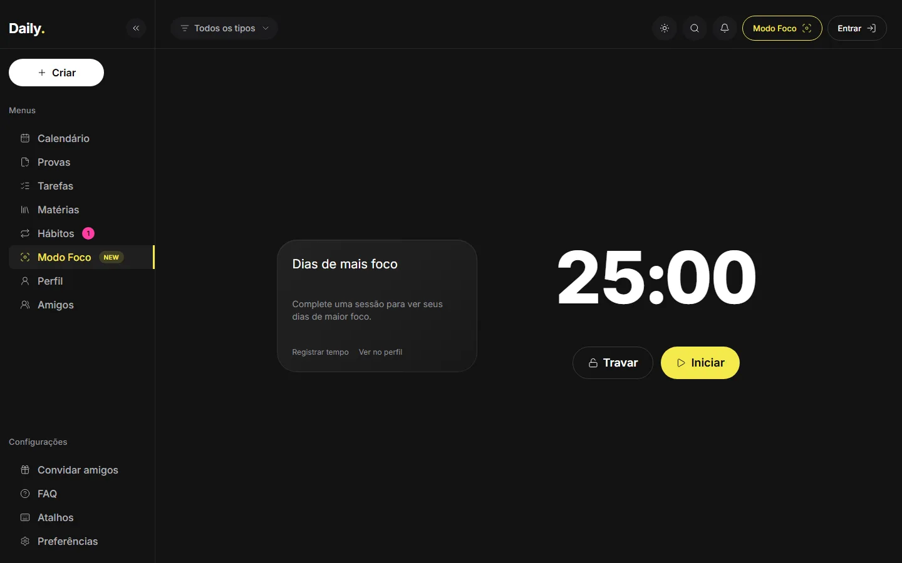                                                     | **Foco travado**: só o tempo e "Segurar para destravar".<br>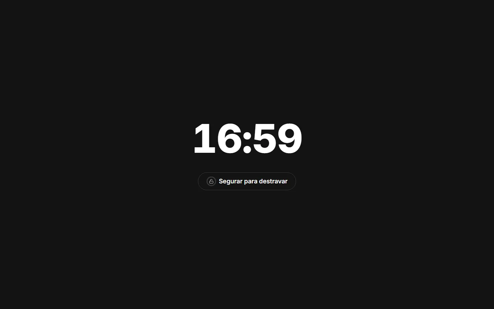                                               |

## Funcionalidades

### Já disponíveis

- [x] **Calendário com 4 visões — Dia, Semana, Mês e Ano** (`/calendario?visao=semana&data=2026-10-29`): visão e data na URL, botão "Hoje" ao lado das setas (volta ao período atual na visão em que se está), atalhos de teclado (`←` `→` `T` `D` `S` `M` `A`)
- [x] Dia atual destacado e dias de outros meses esmaecidos
- [x] Três tipos de compromisso (**Tarefa**, **Prova**, **Especial**) e três status (**Pendente**, **Concluído**, **Cancelado**) com cores reservadas: a tarefa fica amarela, verde ou vermelha; prova e especial mantêm a cor do tipo
- [x] **Painel de tarefa** único para criar, ver e editar (lateral no desktop, tela cheia no celular), com **subtarefas** em qualquer tipo, progresso e “Mais opções”; **concluir com um clique** em todo chip e linha, com “Desfazer”
- [x] **Tarefas recorrentes** (Tarefa e Especial): todo dia, dias úteis, dias da semana, a cada N dias/semanas/meses/anos, dia do mês ou último dia, até uma data ou N vezes; cada ocorrência se conclui sozinha (subtarefas recomeçam), e editar/excluir pergunta “Somente esta / Esta e as próximas / Todas”
- [x] **Entrada rápida em pt-BR** na página Tarefas (`Treinar toda segunda 19h`, `Aluguel todo dia 5`), mostrando o que entendeu antes de salvar
- [x] Checklist de conteúdos da prova com barra de progresso
- [x] **Filtro por tipo** (multisseleção) no calendário e na página Tarefas, salvo entre sessões
- [x] Sidebar recolhível e interface em pt-BR
- [x] Design system documentado, com tokens centralizados em CSS
- [x] **Dados salvos no navegador** (`localStorage` versionado, com validação, migração e backup)
- [x] **Criar, editar, duplicar e excluir** tarefas, provas, especiais e matérias, com "Desfazer" por 6 s
- [x] Conteúdos da prova como mini tarefas (adicionar, renomear, remover, reordenar, marcar) com progresso
- [x] Páginas **Provas** (contagem regressiva), **Tarefas** (resumo, Atrasadas, Hoje, Próximas sem limite de dias e Concluídas) e **Matérias** (cores)
- [x] Clique num dia vazio cria evento; "+N mais" abre a lista completa do dia
- [x] Exportar e importar dados em JSON (validado, com confirmação; aceita arquivos v1 a v5)
- [x] **Modo Foco** (`/foco`): anel minimalista com tempo editável por digitação (1 min a 3 h), histórico de sessões e **travamento do app** (veja abaixo)
- [x] Preferências do perfil: nome, meta de água, copo, duração padrão do foco e "travar por padrão"
- [x] Várias abas/janelas ficam sincronizadas (evento `storage`)
- [x] **Hábitos recorrentes** (`/habitos`): dias da semana ou a cada N dias, horário opcional, tipo check ou quantidade, fontes automáticas (água, foco, blocos de estudo), **calendário de contribuições** por hábito (estilo GitHub), sequência, melhor sequência e taxa; as antigas metas migram para hábitos; **reordene arrastando pela alça** (mouse, toque ou teclado) ou pelo menu "..."
- [x] **Água editável**: toque no valor da água (cartão e hábito) para editar, excluir (com Desfazer), definir o total do dia ou digitar uma quantidade (`300 ml`, `0,3 l`); dias anteriores pelo heatmap do hábito (até 366 dias)
- [x] **Estatísticas** (`/estatisticas`): painel “Hoje” (horas da semana, preparação para a próxima prova, sequência, água, hábitos de hoje e agenda) e “Análises” (semana, mês ou 90 dias) com cinco gráficos em SVG próprio e o heatmap de consistência dos hábitos

- [x] **PWA**: instala como app (janela própria, atalhos para Modo Foco, Hábitos e Estatísticas), funciona offline em todas as rotas e só oferece atualização quando não há sessão de foco em andamento
- [x] **Login opcional com Google e sincronização na nuvem** (Supabase): local-first, com tela de entrada, menu da conta, resolução de conflito e exclusão da conta
- [x] **Celular e tablet**: barra inferior com "Mais" e botão + no celular, trilho de ícones no tablet, popovers viram sheets, formulários em tela cheia, gestos (deslizar para mudar o dia ou o mês, toque longo para criar na grade) e alvos de toque de 44 px (veja "Usar no celular e no tablet")
- [x] Armazenamento persistente solicitado ao navegador, com situação e espaço usado em Preferências, e indicador "Offline" na topbar
- [x] **Medalhas e conquistas** no Perfil: 13 medalhas (tarefas, dias limpos, provas preparadas, recorrência, subtarefas, foco e hábitos) com bronze, prata e ouro, progresso, vitrine com até 3 destaques e aviso discreto, que espera o fim do Modo Foco; nada premia excesso e descanso não quebra sequência
- [x] **Tema claro e escuro**: Preferências → Aparência (Sistema, Claro ou Escuro) e atalho sol/lua na topbar e no "Mais"; "Sistema" acompanha o aparelho; a escolha vale por dispositivo e abre sem flash

### Em planejamento

- [ ] Notificações e lembretes periódicos
- [ ] Arrastar e redimensionar na grade, eventos de vários dias
- [ ] Página de atalhos de teclado

O detalhamento está nas [issues](https://github.com/Mateus-Fonseca847/daily-study-planner/issues) e nos [milestones](https://github.com/Mateus-Fonseca847/daily-study-planner/milestones).

## Usar no celular e no tablet

O Daily se adapta a quatro faixas de tela (definidas em um só lugar: `apps/web/src/lib/responsive/breakpoints.ts`, espelhadas no tema do Tailwind e cobertas por teste):

| Faixa            | Largura                          | Navegação                                                                                              |
| ---------------- | -------------------------------- | ------------------------------------------------------------------------------------------------------ |
| Celular          | < 768 px (e celular em paisagem) | Barra inferior (Calendário, Hábitos, Foco, Estatísticas e **Mais**) e botão **+** flutuante para criar |
| Tablet           | 768–1023 px                      | Trilho de ícones; ao expandir, o menu abre sobre o conteúdo e fecha ao tocar fora                      |
| Notebook pequeno | 1024–1279 px                     | Barra lateral (lembra se você a recolheu)                                                              |
| Desktop          | ≥ 1280 px                        | Como sempre foi                                                                                        |

**No toque:**

- Popovers viram **sheets** na borda inferior (arraste a alça ou use o botão voltar do aparelho para fechar); formulários ocupam a tela inteira, com as ações sempre visíveis acima do teclado.
- **Calendário:** no Mês, toque num dia para ver a agenda dele logo abaixo; na Semana, a grade rola para os lados (~3 dias por tela) começando em hoje; **deslize** na horizontal no Dia e no Mês para mudar de período. Para criar um evento numa hora da grade, use o **toque longo** (o horário fica realçado) ou o botão **+**; um toque simples só rola.
- **Hábitos:** toque numa célula do heatmap para abrir o dia, com ‹ › para navegar entre os dias.
- **Modo Foco:** os dígitos se ajustam à tela (inclusive em paisagem); para destravar, **segure o botão por 3 s**. O cronômetro é medido por horário, então continua exato com a tela apagada ou a aba em segundo plano. O áudio de fim é liberado no toque em "Iniciar".

**iPhone e iPad:** o Safari não oferece tela cheia para páginas e só mantém a tela ligada nas versões recentes do iOS; o Daily avisa isso na própria tela do Modo Foco. Para instalar, use **Compartilhar → Adicionar à Tela de Início**. O login com Google dentro do app instalado no iOS pode não concluir (veja as limitações).

<p align="center">
  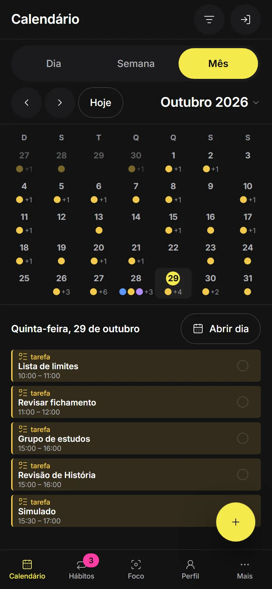
  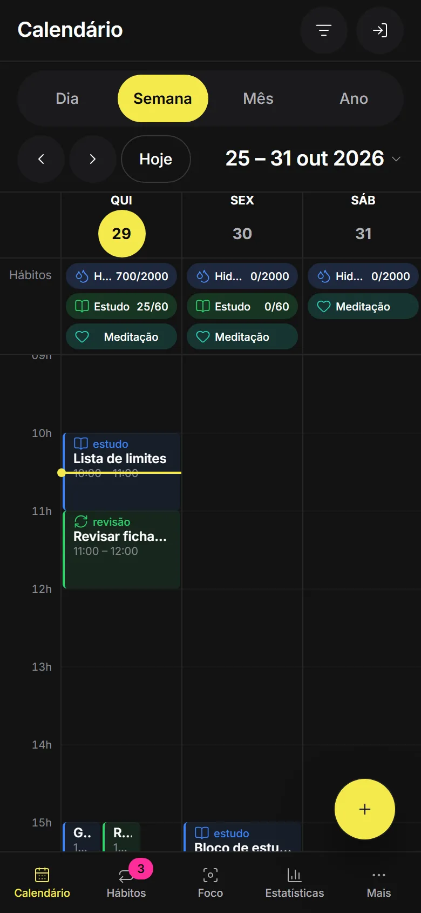
  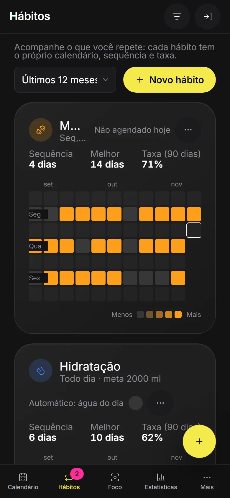
  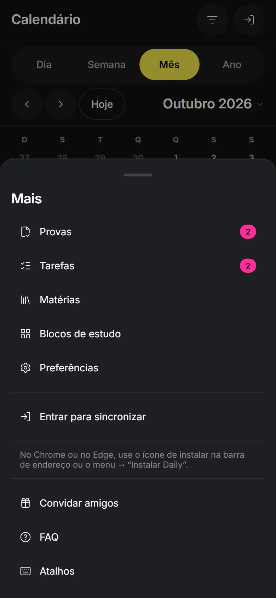
</p>
<p align="center">
  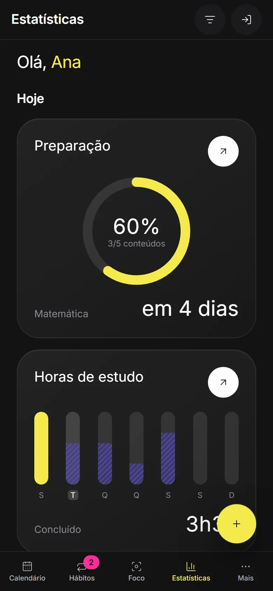
  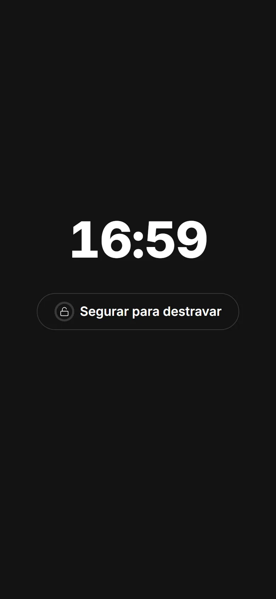
  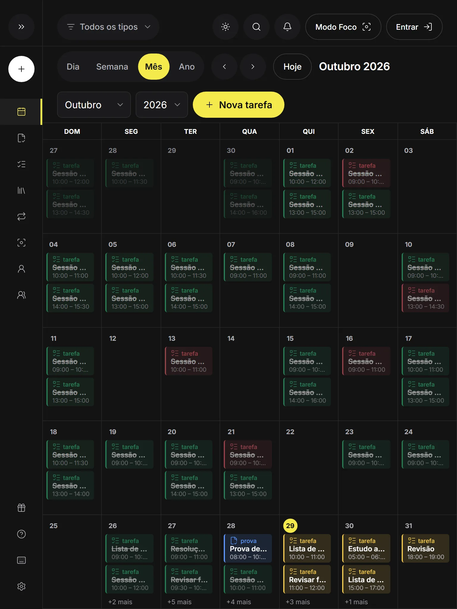
  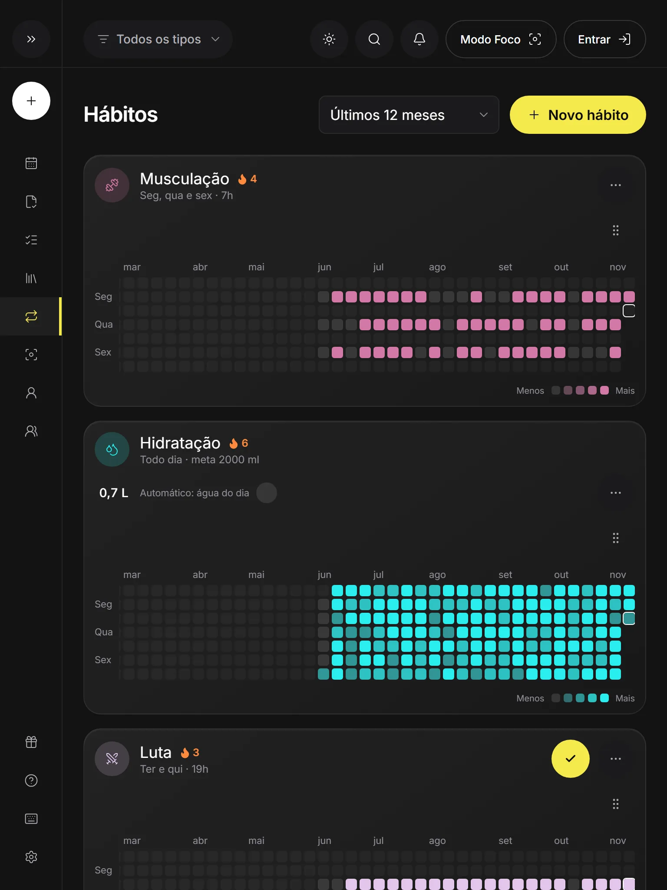
</p>

## Instalar como app

1. Abra [https://dailystudyplanner.vercel.app](https://dailystudyplanner.vercel.app) no **Chrome** ou no **Edge**.
2. Clique no ícone de instalar na barra de endereço (ou em **Instalar app** na sidebar do Daily, ou no menu ⋮ → _Instalar Daily_).
3. O Daily abre numa **janela própria**, sem barra de abas, e ganha um atalho no menu Iniciar.
4. Para **fixar na barra de tarefas** (Windows): com o app aberto, clique com o botão direito no ícone dele na barra → _Fixar na barra de tarefas_.
5. Clique com o botão direito no ícone do app para os atalhos **Modo Foco**, **Hábitos** e **Estatísticas**.

No Safari use _Compartilhar → Adicionar à Tela de Início_; no Firefox o Daily funciona normalmente na aba, sem a instalação. Depois do primeiro acesso o app abre **sem internet**.

## Stack

| Camada            | Tecnologia                                                                       |
| ----------------- | -------------------------------------------------------------------------------- |
| Front-end         | React, TypeScript, Vite, Tailwind CSS, React Router                              |
| Ícones e fonte    | lucide-react, Inter (`@fontsource`)                                              |
| Datas             | date-fns (locale `pt-BR`)                                                        |
| Tipos e validação | Zod, compartilhados em `packages/shared`                                         |
| Testes            | Vitest (unidade) e Playwright (e2e, inclusive contra o build com service worker) |
| PWA               | vite-plugin-pwa (Workbox)                                                        |
| Conta e nuvem     | Supabase (Auth com Google, PostgreSQL com RLS), opcional                         |
| Qualidade         | ESLint, Prettier, TypeScript `strict`                                            |
| Gerenciador       | pnpm workspaces                                                                  |
| CI                | GitHub Actions                                                                   |

**Hospedagem:** Vercel (front-end estático; cabeçalhos e CSP em `apps/web/vercel.json`, veja [`docs/deploy.md`](docs/deploy.md)). **Nuvem (opcional):** Supabase usado direto do front-end (login com Google e uma linha por usuário protegida por RLS); não há servidor próprio.

## Como rodar

### Pré-requisitos

- [Node.js](https://nodejs.org/) 20 ou superior
- [pnpm](https://pnpm.io/) (`npm install -g pnpm`)
- Git

### Instalação

```bash
git clone https://github.com/Mateus-Fonseca847/daily-study-planner.git
cd daily-study-planner
pnpm install
pnpm dev
```

O app sobe em **http://localhost:5173**. Viewport recomendado: 1440×900, com comportamento aceitável a partir de 1280px.

### Scripts

| Comando                                    | O que faz                                                                                                                                 |
| ------------------------------------------ | ----------------------------------------------------------------------------------------------------------------------------------------- |
| `pnpm dev`                                 | Servidor de desenvolvimento                                                                                                               |
| `pnpm build`                               | Build de produção                                                                                                                         |
| `pnpm lint`                                | ESLint em todo o monorepo                                                                                                                 |
| `pnpm typecheck`                           | Checagem de tipos                                                                                                                         |
| `pnpm test`                                | Testes com Vitest                                                                                                                         |
| `pnpm e2e`                                 | Testes e2e com Playwright (app em dev e build de produção) (na primeira vez: `pnpm --filter @daily/web exec playwright install chromium`) |
| `pnpm verify:prod`                         | Verifica o app publicado (rotas, manifest, service worker, offline e console)                                                             |
| `pnpm check:links`                         | Confere os links relativos dos arquivos `.md` versionados                                                                                 |
| `pnpm check:tokens`                        | Falha se aparecer cor literal (hex, `rgb()`, `bg-white`…) fora de `tokens.css`                                                            |
| `node apps/web/scripts/contrast-audit.mjs` | Mede o contraste (WCAG AA) do texto renderizado nas telas principais; grava em `apps/web/.reports/`                                       |
| `pnpm icons`                               | Regenera os ícones do PWA a partir do SVG                                                                                                 |

## Estrutura do repositório

```
daily-study-planner/
├── .github/
│   └── workflows/ci.yml        # lint, typecheck, testes e build
├── apps/
│   ├── web/                    # React + TS + Vite
│   │   └── src/
│   │       ├── components/
│   │       │   ├── ui/         # Button, Badge, SegmentedControl, Popover...
│   │       │   └── layout/     # Sidebar, Topbar, AppShell
│   │       ├── features/
│   │       │   └── calendar/   # grid mensal, chips, popover de evento
│   │       ├── mocks/          # dados gerados em relação à data atual
│   │       └── styles/         # tokens.css e estilos globais
│   └── api/                    # reservado (a nuvem usa o Supabase direto do front-end)
├── packages/
│   └── shared/                 # tipos e schemas Zod
├── docs/
│   ├── design/
│   │   └── design-system.md    # tokens, tipografia e componentes
│   ├── images/                 # imagens usadas neste README
│   ├── architecture.md, data-model.md, deploy.md
├── CLAUDE.md                   # contexto do projeto para o Claude Code
├── CHANGELOG.md
└── README.md
```

## Arquitetura

```text
UI (React) → useData (Zustand) → DataRepository → LocalStorageRepository → localStorage
                                       ↑
                     funções puras de domínio (hábitos, foco, calendário, estatísticas)
PWA: service worker (Workbox) pré-cacheia o app shell; a UI só conversa com o store.
```

Camadas, decisões e o diagrama completo em [`docs/architecture.md`](docs/architecture.md). O formato dos dados e a migração entre versões estão em [`docs/data-model.md`](docs/data-model.md).

## Design system

Toda decisão visual vive em `apps/web/src/styles/tokens.css` (cores, raios, bordas, sombras, espaçamentos, tipografia e dimensões de layout), mapeada no tema do Tailwind. **Nenhum valor visual é escrito direto nos componentes.** Isso permite ajustar o visual inteiro em um só lugar.

Resumo da identidade:

- **Tema escuro**, com fundo quase preto e superfícies em camadas
- **Destaque amarelo** com texto preto sobre ele
- **Cores por tipo de evento**: prova (vermelho), estudo (azul), entrega (laranja), revisão (verde) e especial (magenta)
- **Chips** com fundo tingido e borda lateral na cor do tipo
- **Tipografia**: Inter

A especificação completa, incluindo quais valores são estimados, está em [`docs/design/design-system.md`](docs/design/design-system.md).

## Desenvolvimento assistido por IA

Este projeto é construído em ciclos com o [Claude Code](https://www.anthropic.com/claude-code): cada etapa começa com um prompt detalhado, o Claude Code implementa e entrega um relatório do que fez, e eu testo, reviso e aprovo ou peço ajustes. Os prompts e os relatórios são material de trabalho e ficam fora deste repositório; o que fica é o resultado: código, testes, CI e a documentação do produto. O arquivo [`CLAUDE.md`](CLAUDE.md) guarda as convenções do projeto entre as sessões.

## Decisões técnicas

| Decisão                      | Motivo                                                                                                                       |
| ---------------------------- | ---------------------------------------------------------------------------------------------------------------------------- |
| Monorepo com pnpm            | Compartilhar tipos e schemas entre front e API                                                                               |
| TypeScript 5.9 fixado        | O `typescript-eslint` ainda não suporta o TS 7                                                                               |
| Mocks relativos à data atual | O calendário nunca aparece vazio, em qualquer mês                                                                            |
| Tokens CSS obrigatórios      | Fidelidade visual e manutenção em um único lugar                                                                             |
| PWA em vez de app nativo     | Um código só para "app de PC" e versão online; funciona offline e instala em janela própria                                  |
| `Repository` + Zustand       | A UI não conhece o `localStorage`; trocar por uma API é trocar o adaptador (veja [`docs/data-model.md`](docs/data-model.md)) |

Mais decisões (CSP sem `unsafe-eval`, atualização do service worker que respeita o Modo Foco, hábitos com regras versionadas) em [`docs/architecture.md`](docs/architecture.md).

## Modo Foco e travamento

O **Modo Foco** (`/foco`) mostra só **dígitos grandes**. **Digite a duração** no próprio relógio (`25` = 25 min, `25:30`, `1:30:00`, `90` = 1 h 30; mínimo 1 min, máximo 3 h; ↑/↓ ajustam 1 min, Shift 5 min) e use as pílulas **Travar** e **Iniciar**. A última duração confirmada vira o padrão (guardada em segundos). Rodando, uma fração de milésimos aparece em cinza ao lado dos dígitos (some com movimento reduzido, que também atualiza o relógio só uma vez por segundo); pausado, os dígitos piscam de leve e aparecem **Reiniciar**, **Encerrar** e **Retomar**; ao fim há um som curto (Web Audio, só na aba que iniciou), o título da aba vira "Sessão concluída" e a tela mostra "Concluído · 25 min", **Nova sessão** e **Ver estatísticas**. O tempo restante é sempre calculado por **timestamps** (fim − agora): fica exato com a aba em segundo plano e a sessão **sobrevive a recarregamentos**. Sessões com mais de 1 minuto entram no histórico (usado nas Estatísticas).

À esquerda fica o painel **Dias de mais foco**: os 7 dias com mais tempo focado em todo o histórico (concluídas e interrompidas; a sessão conta no dia local em que **começou**; empate: o mais recente primeiro). Ele atualiza quando uma sessão termina e some enquanto a tela está travada.

A pílula **Travar** (visível só com o cronômetro parado) liga a trava para a próxima sessão; ela guarda a última escolha. Com a **trava** ligada e o cronômetro rodando ou pausado:

- só ficam na tela os dígitos e **"Segurar para destravar"** (sem pausar, reiniciar, encerrar nem a tecla Espaço);
- somem a barra lateral, o topo, o painel e os links; a navegação interna é bloqueada e qualquer rota digitada volta para `/foco`;
- o app pede **tela cheia** (se você sair com Esc, continua travado; **Esc nunca destrava**), mantém a tela ligada (**Wake Lock**, quando houver suporte) e mostra o aviso do navegador ao recarregar ou fechar a aba;
- para destravar, **segure o botão por 3 segundos** (mouse, toque ou Enter/Espaço); um anel em volta do cadeado enche. Destravar **não encerra** a sessão.

**O que ela NÃO pode fazer.** É um travamento _do aplicativo_, para evitar distração acidental, **não uma medida de segurança**. Navegadores não permitem bloquear Alt+Tab, Ctrl+W, fechar a janela, trocar de aba/janela nem o sistema operacional; quem quiser sair sempre consegue. O Wake Lock e a tela cheia também dependem do navegador (e a tela cheia não pode ser reaberta depois de um Esc: a tela fica travada, mas em janela normal).

**Ideia futura:** instalar o Daily como PWA e abri-lo em **janela própria** (modo standalone/kiosk), o que reduz as distrações da barra de abas e dá mais controle sobre a tela cheia.

## Dados e privacidade

- Os dados ficam no **navegador de cada endereço**: `http://localhost:5173` e o endereço publicado têm armazenamentos separados. Para levar o que você criou em `localhost` para o app publicado, use **Preferências → Exportar dados (JSON)** em um e **Importar dados (JSON)** no outro.
- Não há analytics nem rastreamento. Sem conta, nenhuma requisição sai do navegador; com conta Google (opcional), os dados são sincronizados com o Supabase — veja a **política de privacidade** em `/privacidade` e a seção **Conta e sincronização** abaixo.

- **Sem conta (modo visitante):** seus dados ficam **somente no seu navegador**, no `localStorage` deste site; nada é enviado a servidores.
- **Com conta (Entrar com Google):** uma cópia fica na nuvem (Supabase, uma linha por usuário protegida por RLS) e é sincronizada entre dispositivos. Ao sair da conta, os dados do dispositivo são removidos; é possível excluir a conta e os dados da nuvem em Preferências.
- No modo visitante, **limpar os dados do site, trocar de navegador ou de computador faz os dados "sumirem"**. Para guardar uma cópia, use **Preferências → Exportar dados (JSON)**; para restaurar ou levar a outro lugar, **Importar dados (JSON)**.
- O Daily mantém automaticamente uma cópia do último estado válido e, se o dado salvo ficar corrompido, avisa e oferece restaurá-la (detalhes em [`docs/data-model.md`](docs/data-model.md)).
- Em navegação anônima/privada os dados podem não persistir; o app avisa quando não consegue salvar.

## Limitações conhecidas

- **Medalhas:** o app não guarda quando uma tarefa foi concluída, então a data de uma medalha conquistada **antes** desta versão é aproximada pelo dia da tarefa (nunca depois de hoje); daqui em diante, é o momento da conquista. "Preparado" só sabe que os conteúdos estavam prontos antes da prova a partir desta versão (provas antigas com 100 % contam, com a data aproximada). As medalhas ficam no perfil local; o perfil público vem depois
- **Tema e app instalado:** a tela de abertura do PWA instalado (splash) usa as cores fixas do manifest, que são as do escuro; o tema escolhido vale assim que o app abre. A cor das barras do sistema segue o tema (metas `theme-color`)
- **Tema por dispositivo:** a escolha de tema não sincroniza com a conta (de propósito: um celular claro e um PC escuro não brigam)
- **Testado apenas no Chromium** (Playwright e uso manual); Firefox e Safari não foram verificados, e os campos nativos de data e hora variam entre navegadores
- Sem conta, os dados vivem **só neste navegador**: limpar os dados do site apaga tudo. Use Preferências → Exportar para guardar uma cópia (com conta Google, a nuvem guarda uma cópia sincronizada)
- Com várias abas abertas, **a última escrita vence** (o evento `storage` recarrega a aba que não gravou; não há mesclagem de edições simultâneas)
- O `Repository` é síncrono (adequado ao `localStorage`); uma API exigirá torná-lo assíncrono
- Busca e notificações ainda são apenas visuais
- Atalhos, FAQ e Convidar amigos são páginas placeholder
- Calendário: nas visões Dia e Semana não dá para arrastar nem redimensionar eventos, não há eventos de vários dias (os que cruzam a meia-noite são cortados em cada dia); clicar num espaço vazio é uma ação de mouse (o teclado cria pelo botão do dia no cabeçalho da Semana e pelo "Nova Prova")
- Hábitos: os registros ficam no navegador (e na nuvem, com conta); correções retroativas só para hábitos manuais e até 366 dias atrás; mudar repetição, meta ou horário vale a partir de hoje (o histórico não muda)
- Estatísticas: a água é registrada no navegador (e na nuvem, com conta); as análises usam os blocos de estudo e as sessões de foco registradas (sem dados, mostram “Ainda não há dados neste período”)
- Matérias sem cor própria no calendário: os chips usam a cor do **tipo** de evento, e a cor da matéria aparece nas listas
- Os chips têm ~44 px em vez dos ~56 px do design de referência: ele equivale a 1440×1080, e em 900 px de altura só assim cabem 2 chips completos mais o "+N mais" (detalhes em [`design-system.md`](docs/design/design-system.md))
- Em janelas baixas (por exemplo 1280×720) ou meses com 6 semanas, o grid rola verticalmente em vez de encolher as linhas
- PWA testado no Chromium (Chrome e Edge); a instalação em Safari e Firefox segue o fluxo manual de cada navegador
- Criar evento direto na grade: mouse (clique) e toque (toque longo); por teclado use o botão do dia na Semana ou "Nova Prova"
- **Celular e tablet:** testado em emulação do Chromium (celular, tablet e paisagem) e no Chrome; Safari/iOS não foi testado em aparelho real. No iPhone não há tela cheia e o login com Google no app instalado pode não voltar para o app (a sessão do Safari não é a do app instalado); use o Daily numa aba do Safari para entrar
- Modo Foco no toque: o teclado numérico não tem ":", então a duração digitada vale em minutos (`25`); para `1:30:00` use um teclado completo
- Na Semana e no Dia, os blocos de eventos simultâneos ficam estreitos no celular (toque no bloco para abrir os detalhes, ou use a agenda do Mês)
- Tarefas recorrentes: Prova não repete; mudar a lista de subtarefas de uma ocorrência muda o modelo da série (marcar é por ocorrência); “Somente esta” vale para título, horário e notas (tipo, matéria e repetição mudam a série); as ocorrências perdidas aparecem em Atrasadas só por 7 dias; o calendário mostra até 1000 ocorrências por janela e a busca da próxima ocorrência vai até 2 anos à frente
- A fixture `?fixture=reference` só existe em desenvolvimento (`pnpm dev`) e usa dados em memória, sem tocar nos seus dados

## Roadmap

- [x] **Marco 0:** monorepo, design system e calendário mensal
- [x] **Marco 1:** dados locais versionados, CRUD, backup e páginas
- [x] **Marco 2:** provas, conteúdos, blocos de estudo, hábitos, Estatísticas e Modo Foco
- [x] **Marco 3:** visões Dia, Semana e Ano, PWA instalável e offline, deploy na Vercel
- [x] **Marco 4 (nuvem):** login opcional com Google e sincronização (Supabase)
- [x] **Marco 5:** celular e tablet (layout responsivo, toque, sheets e gestos)
- [ ] **Marco 6:** notificações e lembretes
- [ ] **Depois:** arrastar e redimensionar, eventos de vários dias, testes em Firefox e Safari, teste visual automatizado

O acompanhamento detalhado fica nas [issues](https://github.com/Mateus-Fonseca847/daily-study-planner/issues) e nos [milestones](https://github.com/Mateus-Fonseca847/daily-study-planner/milestones). Histórico de versões no [CHANGELOG](CHANGELOG.md).

## Contribuindo

Este é um projeto pessoal de portfólio, mas sugestões são bem-vindas via [issues](https://github.com/Mateus-Fonseca847/daily-study-planner/issues/new/choose) (veja o [guia de contribuição](CONTRIBUTING.md)). Se for abrir um pull request:

1. Faça um fork e crie uma branch (`feat/minha-ideia`)
2. Use [Conventional Commits](https://www.conventionalcommits.org/pt-br/) (`feat:`, `fix:`, `docs:`, `chore:`)
3. Garanta que `pnpm lint`, `pnpm typecheck`, `pnpm test`, `pnpm build` e `pnpm e2e` passam
4. Não escreva valores visuais fora de `tokens.css`

## Licença

Distribuído sob a licença MIT. Veja o arquivo [`LICENSE`](LICENSE).

## Autores

Feito por Mateus de Souza Fonseca ([@Mateus-Fonseca847](https://github.com/Mateus-Fonseca847)) & Pedro Henrique Toraldo([ph1007](https://github.com/ph1007)).

Mateus: [GitHub](https://github.com/Mateus-Fonseca847) · LinkedIn: [https://www.linkedin.com/in/mateus-souza-fonseca/]
Pedro Henrique: [GitHub](https://github.com/ph1007) · LinkedIn: [https://www.linkedin.com/in/pedro-henrique-toraldo/]
