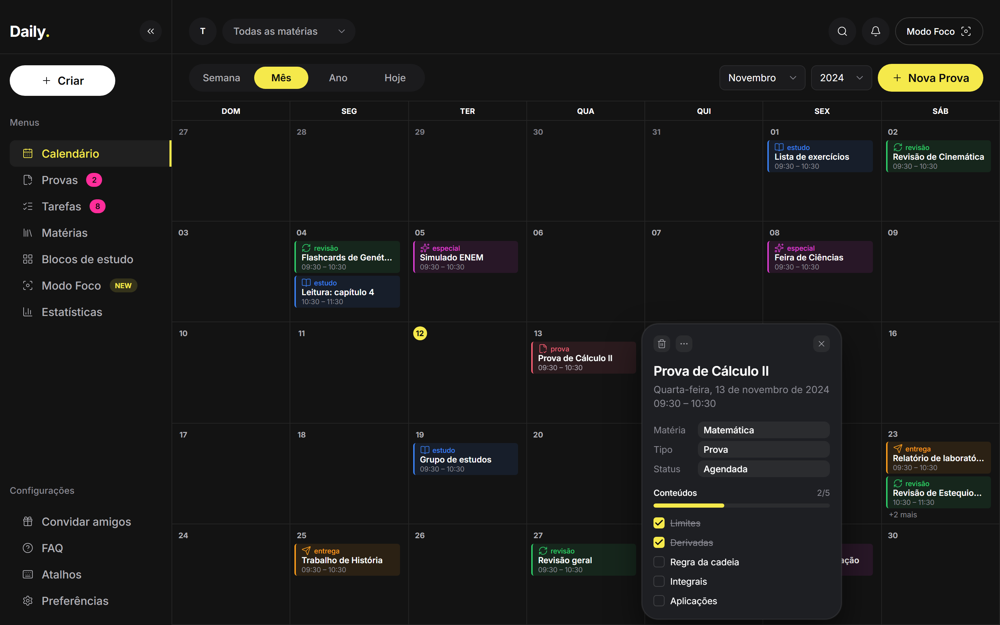

<div align="center">

# Daily

**Organizador de estudos para estudantes, feito para ficar aberto na segunda tela.**

Provas com contagem regressiva, conteúdos como mini tarefas, blocos de estudo e um calendário claro, escuro e sempre à vista.




[Demo online](#) · [Documentação](docs/) · [Roadmap](#roadmap) · [Changelog](CHANGELOG.md)

</div>

---

## Sobre o projeto

O **Daily** nasceu de uma necessidade pessoal: ter um painel que fique aberto o dia inteiro na segunda tela, lembrando constantemente das obrigações acadêmicas. Em vez de mais um to-do genérico, ele é pensado para a rotina de quem estuda:

- **Provas** com contagem regressiva e progresso calculado a partir dos conteúdos já estudados
- **Conteúdos como mini tarefas**: cada prova é dividida em matérias/assuntos que podem ser marcados como concluídos
- **Blocos de estudo** com horário marcado
- **Modo Foco**, uma visão em tela cheia para a segunda tela, com o que importa agora
- **Gratuito e hospedável**, sem dependência de serviços pagos

O projeto também é um estudo de engenharia de software: monorepo, TypeScript estrito, design system baseado em tokens, testes e documentação versionada, incluindo o histórico dos prompts usados no desenvolvimento assistido por IA.

## Status

O projeto está em desenvolvimento, organizado em marcos.

| Marco                  | Escopo                                                        | Status    |
| ---------------------- | ------------------------------------------------------------- | --------- |
| **0. Fundação visual** | Monorepo, design system, calendário mensal com dados mockados | Concluído |
| **1. Base**            | Login, CRUD de tarefas, matérias, back-end e deploy           | Planejado |
| **2. Estudos**         | Provas com contagem regressiva, conteúdos, blocos de estudo   | Planejado |
| **3. Segunda tela**    | Modo Foco, notificações, lembretes, PWA instalável            | Planejado |
| **4. Acabamento**      | Documentação final, GIFs, post no LinkedIn                    | Planejado |

## Funcionalidades

### Já disponíveis

- [x] Calendário mensal com navegação por mês e ano e botão "Hoje"
- [x] Dia atual destacado e dias de outros meses esmaecidos
- [x] Chips de evento por tipo (prova, estudo, entrega, revisão, especial) com "+N mais" em dias cheios
- [x] Popover de evento com data, horário, matéria, tipo e status
- [x] Checklist de conteúdos da prova com barra de progresso
- [x] Filtro do calendário por matéria
- [x] Sidebar recolhível e interface em pt-BR
- [x] Design system documentado, com tokens centralizados em CSS

### Em planejamento

- [ ] Persistência real (hoje o estado é local e some ao recarregar)
- [ ] Autenticação (e-mail/senha ou Google)
- [ ] Criação, edição e exclusão de provas, tarefas e blocos de estudo
- [ ] Visões Semana e Ano
- [ ] Modo Foco para segunda tela
- [ ] Notificações e lembretes periódicos
- [ ] PWA instalável (manifest e service worker)
- [ ] Estatísticas de estudo
- [ ] Atalhos de teclado e entrada rápida de tarefas

## Stack

| Camada            | Tecnologia                                                       |
| ----------------- | ---------------------------------------------------------------- |
| Front-end         | React, TypeScript, Vite, Tailwind CSS, React Router              |
| Ícones e fonte    | lucide-react, Inter (`@fontsource`)                              |
| Datas             | date-fns (locale `pt-BR`)                                        |
| Tipos e validação | Zod, compartilhados em `packages/shared`                         |
| Testes            | Vitest (unidade) e Playwright (e2e de fumaça e capturas visuais) |
| Qualidade         | ESLint, Prettier, TypeScript `strict`                            |
| Gerenciador       | pnpm workspaces                                                  |
| CI                | GitHub Actions                                                   |

**Planejado para o Marco 1:** Node.js com Fastify, PostgreSQL com Prisma, deploy com Vercel (front), Render ou Railway (API) e Neon ou Supabase (banco).

## Como rodar

### Pré-requisitos

- [Node.js](https://nodejs.org/) 20 ou superior
- [pnpm](https://pnpm.io/) (`npm install -g pnpm`)
- Git

### Instalação

```bash
git clone https://github.com/<seu-usuario>/daily-study-planner.git
cd daily-study-planner
pnpm install
pnpm dev
```

O app sobe em **http://localhost:5173**. Viewport recomendado: 1440×900, com comportamento aceitável a partir de 1280px.

### Scripts

| Comando               | O que faz                                                                                                                      |
| --------------------- | ------------------------------------------------------------------------------------------------------------------------------ |
| `pnpm dev`            | Servidor de desenvolvimento                                                                                                    |
| `pnpm build`          | Build de produção                                                                                                              |
| `pnpm lint`           | ESLint em todo o monorepo                                                                                                      |
| `pnpm typecheck`      | Checagem de tipos                                                                                                              |
| `pnpm test`           | Testes com Vitest                                                                                                              |
| `pnpm e2e`            | Teste e2e de fumaça com Playwright (na primeira vez: `pnpm --filter @daily/web exec playwright install chromium`)              |
| `pnpm visual:capture` | Screenshots (1440×900 em 1x e 2x, 1280×720, 1280×800) e comparações lado a lado com a referência em `docs/design/screenshots/` |

## Estrutura do repositório

```
daily-study-planner/
├── .github/
│   └── workflows/ci.yml        # lint, typecheck, testes e build
├── apps/
│   ├── web/                    # React + TS + Vite
│   │   └── src/
│   │       ├── components/
│   │       │   ├── ui/         # Button, Badge, SegmentedControl, Popover...
│   │       │   └── layout/     # Sidebar, Topbar, AppShell
│   │       ├── features/
│   │       │   └── calendar/   # grid mensal, chips, popover de evento
│   │       ├── mocks/          # dados gerados em relação à data atual
│   │       └── styles/         # tokens.css e estilos globais
│   └── api/                    # back-end (Marco 1)
├── packages/
│   └── shared/                 # tipos e schemas Zod
├── docs/
│   ├── design/
│   │   ├── reference/          # imagem de referência visual
│   │   └── design-system.md    # tokens, tipografia e componentes
│   └── prompts/                # prompts e relatórios de cada etapa
├── CLAUDE.md                   # contexto do projeto para o Claude Code
├── CHANGELOG.md
└── README.md
```

## Design system

Toda decisão visual vive em `apps/web/src/styles/tokens.css` (cores, raios, bordas, sombras, espaçamentos, tipografia e dimensões de layout), mapeada no tema do Tailwind. **Nenhum valor visual é escrito direto nos componentes.** Isso permite ajustar o visual inteiro em um só lugar.

Resumo da identidade:

- **Tema escuro**, com fundo quase preto e superfícies em camadas
- **Destaque amarelo** com texto preto sobre ele
- **Cores por tipo de evento**: prova (vermelho), estudo (azul), entrega (laranja), revisão (verde) e especial (magenta)
- **Chips** com fundo tingido e borda lateral na cor do tipo
- **Tipografia**: Inter

A especificação completa, incluindo quais valores são estimados, está em [`docs/design/design-system.md`](docs/design/design-system.md).

## Desenvolvimento assistido por IA

Este projeto é construído em ciclos com o [Claude Code](https://www.anthropic.com/claude-code):

1. Um prompt detalhado é escrito para cada etapa
2. O Claude Code implementa e entrega um relatório
3. Eu testo, comparo com a referência e aprovo ou peço ajustes

Cada ciclo fica registrado em [`docs/prompts/`](docs/prompts/) (`NN-prompt.md` e `NN-report.md`). O arquivo [`CLAUDE.md`](CLAUDE.md) mantém as convenções do projeto entre as sessões.

## Decisões técnicas

| Decisão                      | Motivo                                            |
| ---------------------------- | ------------------------------------------------- |
| Monorepo com pnpm            | Compartilhar tipos e schemas entre front e API    |
| TypeScript 5.9 fixado        | O `typescript-eslint` ainda não suporta o TS 7    |
| Mocks relativos à data atual | O calendário nunca aparece vazio, em qualquer mês |
| Tokens CSS obrigatórios      | Fidelidade visual e manutenção em um único lugar  |
| PWA em vez de app nativo     | Um código só para "app de PC" e versão online     |

Decisões maiores serão registradas em `docs/adr/`.

## Limitações conhecidas

- Os dados são mockados e o estado é local: checklist e exclusões somem ao recarregar
- "+ Nova Prova", busca, notificações e o menu do popover são apenas visuais
- Visões Semana e Ano são placeholders
- Os chips têm ~44 px em vez dos ~56 px da referência: ela equivale a 1440×1080, e em 900 px de altura só assim cabem 2 chips completos mais o "+N mais" (detalhes em [`design-system.md`](docs/design/design-system.md))
- Em janelas baixas (por exemplo 1280×720) ou meses com 6 semanas, o grid rola verticalmente em vez de encolher as linhas
- Ainda não há manifest nem service worker (PWA)
- A comparação com a referência é lado a lado, a olho (sem diff de pixels automatizado)
- A fixture `?fixture=reference` só existe em desenvolvimento (`pnpm dev`)

## Roadmap

- [x] **Marco 0:** monorepo, design system e calendário mensal
- [ ] **Marco 1:** autenticação, API, banco de dados, CRUD e deploy
- [ ] **Marco 2:** provas com contagem regressiva, conteúdos e blocos de estudo
- [ ] **Marco 3:** Modo Foco, notificações e PWA instalável
- [ ] **Marco 4:** acabamento, documentação final e divulgação

O acompanhamento detalhado fica nas [issues](../../issues) e [milestones](../../milestones) do repositório.

## Contribuindo

Este é um projeto pessoal de portfólio, mas sugestões são bem-vindas via issues. Se for abrir um pull request:

1. Faça um fork e crie uma branch (`feat/minha-ideia`)
2. Use [Conventional Commits](https://www.conventionalcommits.org/pt-br/) (`feat:`, `fix:`, `docs:`, `chore:`)
3. Garanta que `pnpm lint`, `pnpm typecheck`, `pnpm test`, `pnpm build` e `pnpm e2e` passam
4. Não escreva valores visuais fora de `tokens.css`

## Licença

Distribuído sob a licença MIT. Veja o arquivo `LICENSE`.

## Autor

Feito por **<seu nome>**.

[LinkedIn](https://www.linkedin.com/in/<seu-perfil>) · [GitHub](https://github.com/<seu-usuario>)
