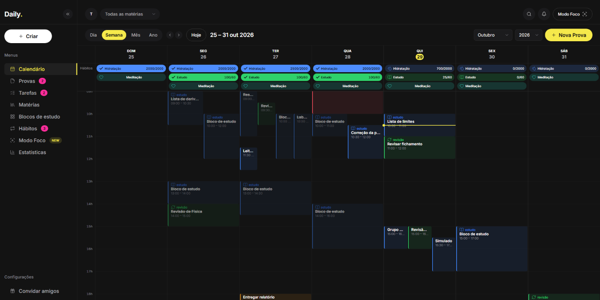
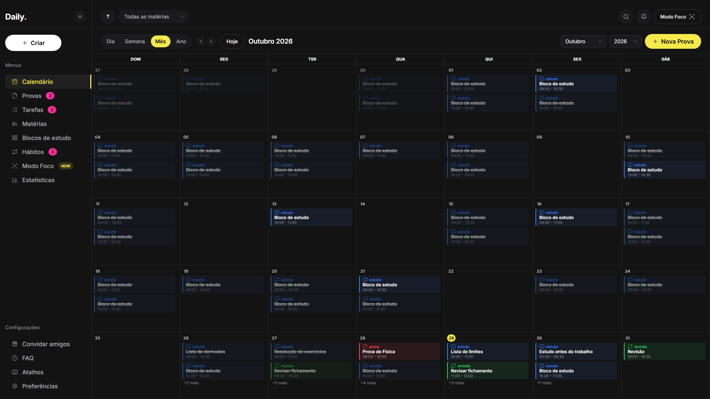
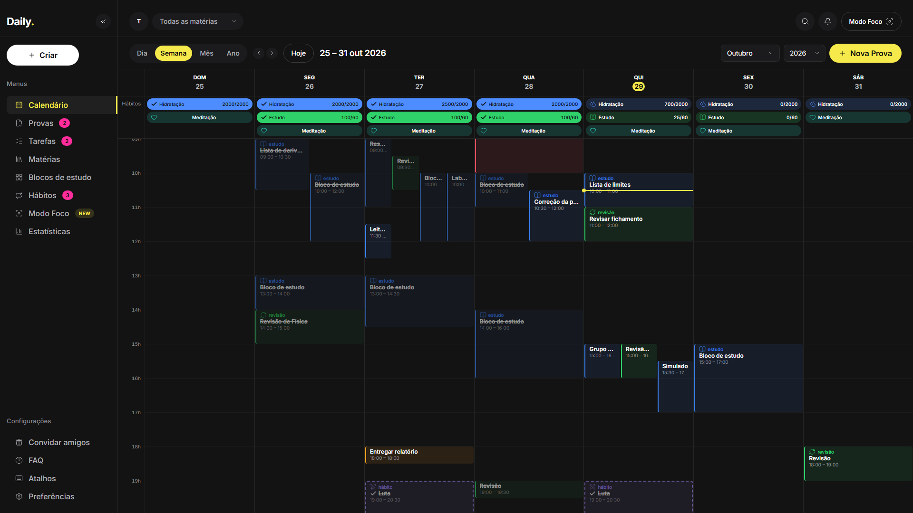
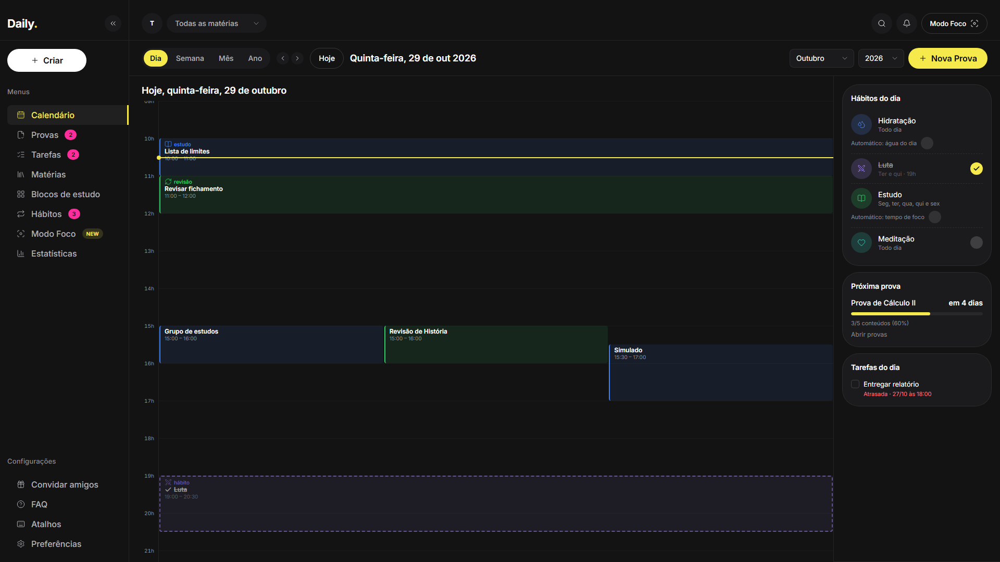
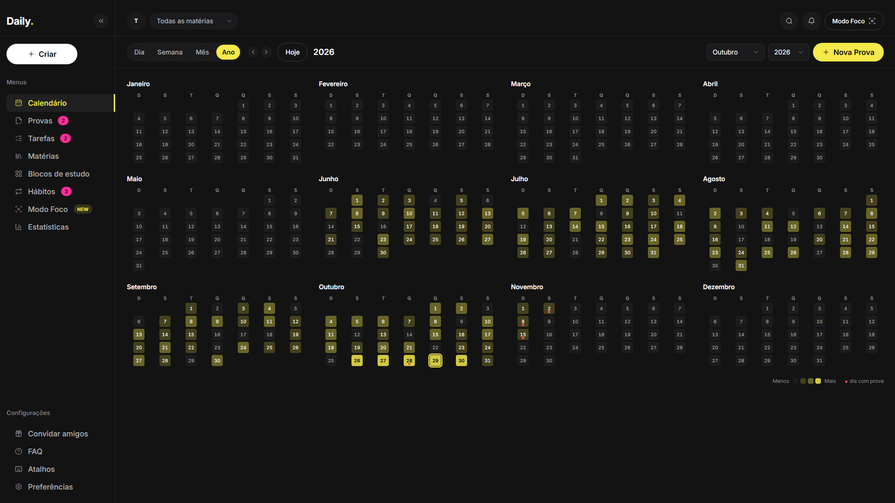
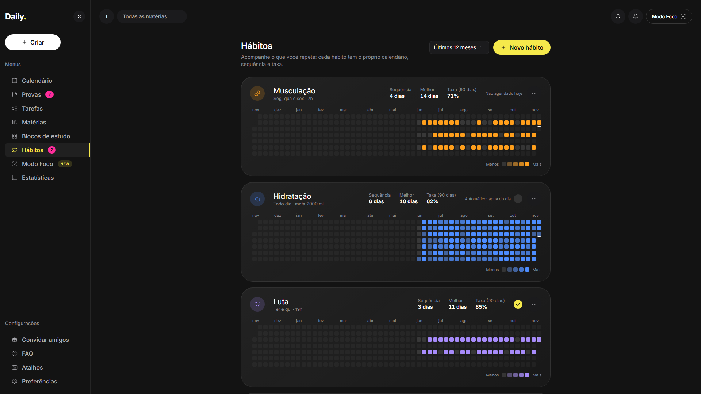
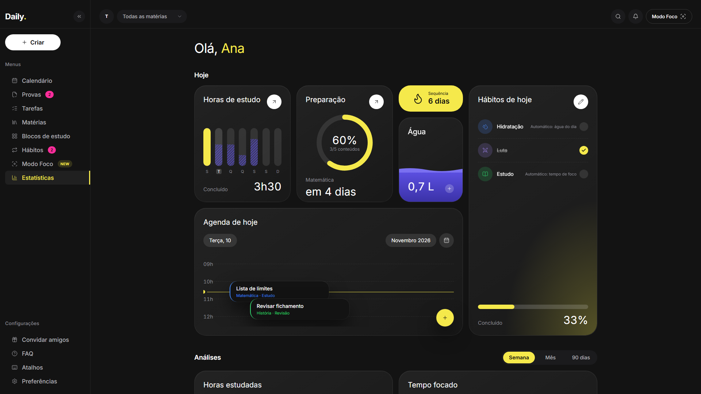
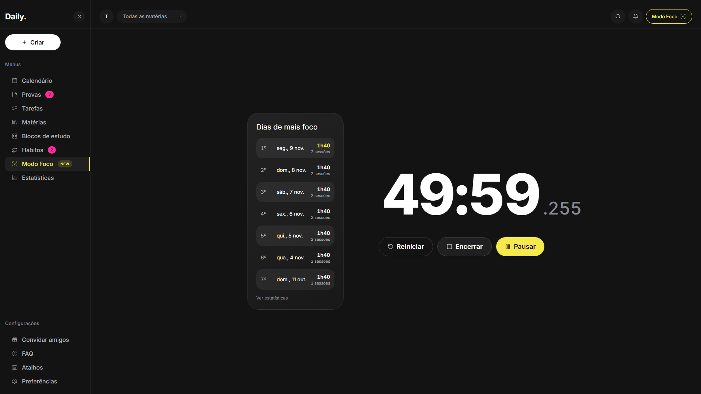
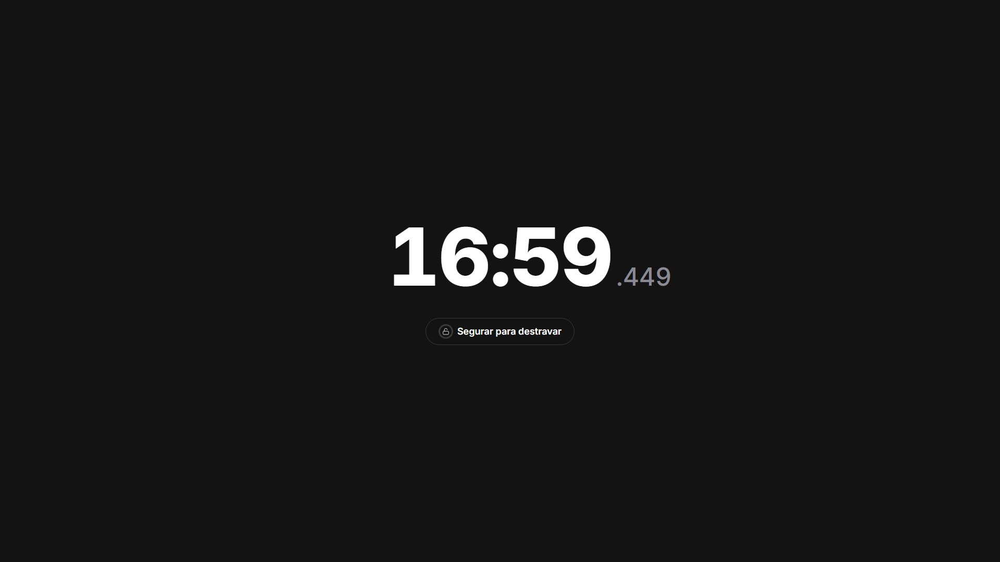

<div align="center">



# Daily

**Organizador de estudos para estudantes, feito para ficar aberto na segunda tela.**

Calendário em quatro visões, provas com contagem regressiva, hábitos com heatmap, Modo Foco e estatísticas. Instala como app, funciona offline e guarda tudo no seu navegador.

[](https://github.com/Mateus-Fonseca847/daily-study-planner/actions/workflows/ci.yml)
[](CHANGELOG.md)
[](LICENSE)


### [▶ Abrir a demo: https://dailystudyplanner.vercel.app](https://dailystudyplanner.vercel.app)

[Documentação](docs/) · [Arquitetura](docs/architecture.md) · [Roadmap](#roadmap) · [Changelog](CHANGELOG.md)

</div>

---

## O que é

O **Daily** nasceu de uma necessidade pessoal: ter um painel que fique aberto o dia inteiro na segunda tela, lembrando constantemente das obrigações acadêmicas. Em vez de mais um to-do genérico, ele é pensado para a rotina de quem estuda:

- **Provas** com contagem regressiva e progresso calculado a partir dos conteúdos já estudados
- **Conteúdos como mini tarefas**: cada prova é dividida em matérias/assuntos que podem ser marcados como concluídos
- **Blocos de estudo** com horário marcado
- **Modo Foco**, uma visão em tela cheia para a segunda tela, com o que importa agora
- **Gratuito e hospedável**, sem dependência de serviços pagos

O projeto também é um estudo de engenharia de software: monorepo, TypeScript estrito, design system baseado em tokens, testes e documentação versionada, incluindo o histórico dos prompts usados no desenvolvimento assistido por IA.

## Status

A versão **1.0** está publicada em [https://dailystudyplanner.vercel.app](https://dailystudyplanner.vercel.app). Os dados ficam só no navegador; back-end, login e sincronização são o próximo marco.

| Marco                  | Escopo                                                                 | Status    |
| ---------------------- | ---------------------------------------------------------------------- | --------- |
| **0. Fundação visual** | Monorepo, design system, calendário mensal                             | Concluído |
| **1. Dados locais**    | `localStorage` versionado, CRUD, páginas, backup                       | Concluído |
| **2. Estudos**         | Provas, conteúdos, blocos de estudo, hábitos, Estatísticas e Modo Foco | Concluído |
| **3. App**             | Visões do calendário, PWA instalável e offline, deploy                 | Concluído |
| **4. Nuvem**           | Back-end, login, sincronização e notificações                          | Planejado |

## Telas

|                                                                                                                                                          |                                                                                                                                                       |
| -------------------------------------------------------------------------------------------------------------------------------------------------------- | ----------------------------------------------------------------------------------------------------------------------------------------------------- |
| **Calendário (Mês)**: provas, estudos e entregas, com popover de evento e filtro por matéria.<br> | **Semana**: grade de horas, eventos simultâneos lado a lado e faixa de hábitos.<br>      |
| **Dia**: agenda com painel de hábitos, próxima prova e tarefas.<br>                               | **Ano**: 12 mini-meses com a densidade de eventos de cada dia.<br>                             |
| **Hábitos**: heatmap de contribuições, sequências e taxa por hábito.<br>                             | **Estatísticas**: horas, preparação para provas, água, hábitos e dias de mais foco.<br> |
| **Modo Foco**: dígitos grandes, duração digitada no próprio relógio.<br>                           | **Foco travado**: só o tempo e "Segurar para destravar".<br>                            |

Vídeos curtos (WebM) em [`docs/media/videos/`](docs/media/videos/): [Modo Foco](docs/media/videos/modo-foco.webm), [criar um hábito e marcar hoje](docs/media/videos/habito-heatmap.webm) e [Dia → Semana → Mês → Ano](docs/media/videos/visoes-calendario.webm).

## Funcionalidades

### Já disponíveis

- [x] **Calendário com 4 visões — Dia, Semana, Mês e Ano** (`/calendario?visao=semana&data=2026-10-29`): visão e data na URL, botão "Hoje" ao lado das setas (volta ao período atual na visão em que se está), atalhos de teclado (`←` `→` `T` `D` `S` `M` `A`)
- [x] Dia atual destacado e dias de outros meses esmaecidos
- [x] Chips de evento por tipo (prova, estudo, entrega, revisão, especial) com "+N mais" em dias cheios
- [x] Popover de evento com data, horário, matéria, tipo e status
- [x] Checklist de conteúdos da prova com barra de progresso
- [x] Filtro do calendário por matéria
- [x] Sidebar recolhível e interface em pt-BR
- [x] Design system documentado, com tokens centralizados em CSS
- [x] **Dados salvos no navegador** (`localStorage` versionado, com validação, migração e backup)
- [x] **Criar, editar, duplicar e excluir** provas, tarefas, blocos de estudo e matérias, com "Desfazer" por 6 s
- [x] Conteúdos da prova como mini tarefas (adicionar, renomear, remover, reordenar, marcar) com progresso
- [x] Páginas **Provas** (contagem regressiva), **Tarefas** (filtros e criação rápida), **Matérias** (cores) e **Blocos de estudo** (semana)
- [x] Estados do evento: pendente, em andamento, concluído e cancelado
- [x] Clique num dia vazio cria evento; "+N mais" abre a lista completa do dia
- [x] Exportar e importar dados em JSON (validado, com confirmação; aceita arquivos v1, v2 e v3)
- [x] **Modo Foco** (`/foco`): anel minimalista com tempo editável por digitação (1 min a 3 h), histórico de sessões e **travamento do app** (veja abaixo)
- [x] Preferências do perfil: nome, meta de água, copo, duração padrão do foco e "travar por padrão"
- [x] Várias abas/janelas ficam sincronizadas (evento `storage`)
- [x] **Hábitos recorrentes** (`/habitos`): dias da semana ou a cada N dias, horário opcional, tipo check ou quantidade, fontes automáticas (água, foco, blocos de estudo), **calendário de contribuições** por hábito (estilo GitHub), sequência, melhor sequência e taxa; as antigas metas migram para hábitos
- [x] **Estatísticas** (`/estatisticas`): painel “Hoje” (horas da semana, preparação para a próxima prova, sequência, água, hábitos de hoje e agenda) e “Análises” (semana, mês ou 90 dias) com cinco gráficos em SVG próprio e o heatmap de consistência dos hábitos

- [x] **PWA**: instala como app (janela própria, atalhos para Modo Foco, Hábitos e Estatísticas), funciona offline em todas as rotas e só oferece atualização quando não há sessão de foco em andamento
- [x] Armazenamento persistente solicitado ao navegador, com situação e espaço usado em Preferências, e indicador "Offline" na topbar

### Em planejamento

- [ ] Autenticação, back-end e sincronização
- [ ] Notificações e lembretes periódicos
- [ ] Recorrência de eventos, arrastar e redimensionar na grade, eventos de vários dias
- [ ] Página de atalhos de teclado

O detalhamento está nas [issues](https://github.com/Mateus-Fonseca847/daily-study-planner/issues) e nos [milestones](https://github.com/Mateus-Fonseca847/daily-study-planner/milestones).

## Instalar como app

1. Abra [https://dailystudyplanner.vercel.app](https://dailystudyplanner.vercel.app) no **Chrome** ou no **Edge**.
2. Clique no ícone de instalar na barra de endereço (ou em **Instalar app** na sidebar do Daily, ou no menu ⋮ → _Instalar Daily_).
3. O Daily abre numa **janela própria**, sem barra de abas, e ganha um atalho no menu Iniciar.
4. Para **fixar na barra de tarefas** (Windows): com o app aberto, clique com o botão direito no ícone dele na barra → _Fixar na barra de tarefas_.
5. Clique com o botão direito no ícone do app para os atalhos **Modo Foco**, **Hábitos** e **Estatísticas**.

No Safari use _Compartilhar → Adicionar à Tela de Início_; no Firefox o Daily funciona normalmente na aba, sem a instalação. Depois do primeiro acesso o app abre **sem internet**.

## Stack

| Camada            | Tecnologia                                                                       |
| ----------------- | -------------------------------------------------------------------------------- |
| Front-end         | React, TypeScript, Vite, Tailwind CSS, React Router                              |
| Ícones e fonte    | lucide-react, Inter (`@fontsource`)                                              |
| Datas             | date-fns (locale `pt-BR`)                                                        |
| Tipos e validação | Zod, compartilhados em `packages/shared`                                         |
| Testes            | Vitest (unidade) e Playwright (e2e, inclusive contra o build com service worker) |
| PWA               | vite-plugin-pwa (Workbox)                                                        |
| Qualidade         | ESLint, Prettier, TypeScript `strict`                                            |
| Gerenciador       | pnpm workspaces                                                                  |
| CI                | GitHub Actions                                                                   |

**Hospedagem:** Vercel (front-end estático; cabeçalhos e CSP em `apps/web/vercel.json`, veja [`docs/deploy.md`](docs/deploy.md)). **Planejado:** Node.js com Fastify, PostgreSQL com Prisma, API no Render ou Railway e banco no Neon ou Supabase.

## Como rodar

### Pré-requisitos

- [Node.js](https://nodejs.org/) 20 ou superior
- [pnpm](https://pnpm.io/) (`npm install -g pnpm`)
- Git

### Instalação

```bash
git clone https://github.com/Mateus-Fonseca847/daily-study-planner.git
cd daily-study-planner
pnpm install
pnpm dev
```

O app sobe em **http://localhost:5173**. Viewport recomendado: 1440×900, com comportamento aceitável a partir de 1280px.

### Scripts

| Comando               | O que faz                                                                                                                                 |
| --------------------- | ----------------------------------------------------------------------------------------------------------------------------------------- |
| `pnpm dev`            | Servidor de desenvolvimento                                                                                                               |
| `pnpm build`          | Build de produção                                                                                                                         |
| `pnpm lint`           | ESLint em todo o monorepo                                                                                                                 |
| `pnpm typecheck`      | Checagem de tipos                                                                                                                         |
| `pnpm test`           | Testes com Vitest                                                                                                                         |
| `pnpm e2e`            | Testes e2e com Playwright (app em dev e build de produção) (na primeira vez: `pnpm --filter @daily/web exec playwright install chromium`) |
| `pnpm media:capture`  | Gera telas, imagens sociais e vídeos em `docs/media/` (fixtures de desenvolvimento)                                                       |
| `pnpm verify:prod`    | Verifica o app publicado (rotas, manifest, service worker, offline e console)                                                             |
| `pnpm icons`          | Regenera os ícones do PWA a partir do SVG                                                                                                 |
| `pnpm visual:capture` | Screenshots (1440×900 em 1x e 2x, 1280×720, 1280×800) e comparações lado a lado com a referência em `docs/design/screenshots/`            |

## Estrutura do repositório

```
daily-study-planner/
├── .github/
│   └── workflows/ci.yml        # lint, typecheck, testes e build
├── apps/
│   ├── web/                    # React + TS + Vite
│   │   └── src/
│   │       ├── components/
│   │       │   ├── ui/         # Button, Badge, SegmentedControl, Popover...
│   │       │   └── layout/     # Sidebar, Topbar, AppShell
│   │       ├── features/
│   │       │   └── calendar/   # grid mensal, chips, popover de evento
│   │       ├── mocks/          # dados gerados em relação à data atual
│   │       └── styles/         # tokens.css e estilos globais
│   └── api/                    # back-end (Marco 1)
├── packages/
│   └── shared/                 # tipos e schemas Zod
├── docs/
│   ├── design/
│   │   ├── reference/          # imagem de referência visual
│   │   └── design-system.md    # tokens, tipografia e componentes
│   └── prompts/                # prompts e relatórios de cada etapa
├── CLAUDE.md                   # contexto do projeto para o Claude Code
├── CHANGELOG.md
└── README.md
```

## Arquitetura

```text
UI (React) → useData (Zustand) → DataRepository → LocalStorageRepository → localStorage
                                       ↑
                     funções puras de domínio (hábitos, foco, calendário, estatísticas)
PWA: service worker (Workbox) pré-cacheia o app shell; a UI só conversa com o store.
```

Camadas, decisões e o diagrama completo em [`docs/architecture.md`](docs/architecture.md). O formato dos dados e a migração entre versões estão em [`docs/data-model.md`](docs/data-model.md).

## Design system

Toda decisão visual vive em `apps/web/src/styles/tokens.css` (cores, raios, bordas, sombras, espaçamentos, tipografia e dimensões de layout), mapeada no tema do Tailwind. **Nenhum valor visual é escrito direto nos componentes.** Isso permite ajustar o visual inteiro em um só lugar.

Resumo da identidade:

- **Tema escuro**, com fundo quase preto e superfícies em camadas
- **Destaque amarelo** com texto preto sobre ele
- **Cores por tipo de evento**: prova (vermelho), estudo (azul), entrega (laranja), revisão (verde) e especial (magenta)
- **Chips** com fundo tingido e borda lateral na cor do tipo
- **Tipografia**: Inter

A especificação completa, incluindo quais valores são estimados, está em [`docs/design/design-system.md`](docs/design/design-system.md).

## Desenvolvimento assistido por IA

Este projeto é construído em ciclos com o [Claude Code](https://www.anthropic.com/claude-code):

1. Um prompt detalhado é escrito para cada etapa
2. O Claude Code implementa e entrega um relatório
3. Eu testo, comparo com a referência e aprovo ou peço ajustes

Cada ciclo fica registrado em [`docs/prompts/`](docs/prompts/) (`NN-prompt.md` e `NN-report.md`). O arquivo [`CLAUDE.md`](CLAUDE.md) mantém as convenções do projeto entre as sessões.

## Decisões técnicas

| Decisão                      | Motivo                                                                                                                       |
| ---------------------------- | ---------------------------------------------------------------------------------------------------------------------------- |
| Monorepo com pnpm            | Compartilhar tipos e schemas entre front e API                                                                               |
| TypeScript 5.9 fixado        | O `typescript-eslint` ainda não suporta o TS 7                                                                               |
| Mocks relativos à data atual | O calendário nunca aparece vazio, em qualquer mês                                                                            |
| Tokens CSS obrigatórios      | Fidelidade visual e manutenção em um único lugar                                                                             |
| PWA em vez de app nativo     | Um código só para "app de PC" e versão online; funciona offline e instala em janela própria                                  |
| `Repository` + Zustand       | A UI não conhece o `localStorage`; trocar por uma API é trocar o adaptador (veja [`docs/data-model.md`](docs/data-model.md)) |

Mais decisões (CSP sem `unsafe-eval`, atualização do service worker que respeita o Modo Foco, hábitos com regras versionadas) em [`docs/architecture.md`](docs/architecture.md).

## Modo Foco e travamento

O **Modo Foco** (`/foco`) mostra só **dígitos grandes**. **Digite a duração** no próprio relógio (`25` = 25 min, `25:30`, `1:30:00`, `90` = 1 h 30; mínimo 1 min, máximo 3 h; ↑/↓ ajustam 1 min, Shift 5 min) e use as pílulas **Travar** e **Iniciar**. A última duração confirmada vira o padrão (guardada em segundos). Rodando, uma fração de milésimos aparece em cinza ao lado dos dígitos (some com movimento reduzido, que também atualiza o relógio só uma vez por segundo); pausado, os dígitos piscam de leve e aparecem **Reiniciar**, **Encerrar** e **Retomar**; ao fim há um som curto (Web Audio, só na aba que iniciou), o título da aba vira "Sessão concluída" e a tela mostra "Concluído · 25 min", **Nova sessão** e **Ver estatísticas**. O tempo restante é sempre calculado por **timestamps** (fim − agora): fica exato com a aba em segundo plano e a sessão **sobrevive a recarregamentos**. Sessões com mais de 1 minuto entram no histórico (usado nas Estatísticas).

À esquerda fica o painel **Dias de mais foco**: os 7 dias com mais tempo focado em todo o histórico (concluídas e interrompidas; a sessão conta no dia local em que **começou**; empate: o mais recente primeiro). Ele atualiza quando uma sessão termina e some enquanto a tela está travada.

A pílula **Travar** (visível só com o cronômetro parado) liga a trava para a próxima sessão; ela guarda a última escolha. Com a **trava** ligada e o cronômetro rodando ou pausado:

- só ficam na tela os dígitos e **"Segurar para destravar"** (sem pausar, reiniciar, encerrar nem a tecla Espaço);
- somem a barra lateral, o topo, o painel e os links; a navegação interna é bloqueada e qualquer rota digitada volta para `/foco`;
- o app pede **tela cheia** (se você sair com Esc, continua travado; **Esc nunca destrava**), mantém a tela ligada (**Wake Lock**, quando houver suporte) e mostra o aviso do navegador ao recarregar ou fechar a aba;
- para destravar, **segure o botão por 3 segundos** (mouse, toque ou Enter/Espaço); um anel em volta do cadeado enche. Destravar **não encerra** a sessão.

**O que ela NÃO pode fazer.** É um travamento _do aplicativo_, para evitar distração acidental, **não uma medida de segurança**. Navegadores não permitem bloquear Alt+Tab, Ctrl+W, fechar a janela, trocar de aba/janela nem o sistema operacional; quem quiser sair sempre consegue. O Wake Lock e a tela cheia também dependem do navegador (e a tela cheia não pode ser reaberta depois de um Esc: a tela fica travada, mas em janela normal).

**Ideia futura:** instalar o Daily como PWA e abri-lo em **janela própria** (modo standalone/kiosk), o que reduz as distrações da barra de abas e dá mais controle sobre a tela cheia.

## Dados e privacidade

- Os dados ficam no **navegador de cada endereço**: `http://localhost:5173` e o endereço publicado têm armazenamentos separados. Para levar o que você criou em `localhost` para o app publicado, use **Preferências → Exportar dados (JSON)** em um e **Importar dados (JSON)** no outro.
- Não há analytics, rastreamento nem requisições a terceiros (a política de segurança do site só aceita recursos do próprio domínio).

- Seus dados (matérias, provas, tarefas, blocos de estudo, conteúdos e hábitos) ficam **somente no seu navegador**, no `localStorage` deste site. Nada é enviado a servidores, não há conta nem rastreamento.
- Por isso, **limpar os dados do site, trocar de navegador ou de computador faz os dados "sumirem"**. Para guardar uma cópia, use **Preferências → Exportar dados (JSON)**; para restaurar ou levar a outro lugar, **Importar dados (JSON)**.
- O Daily mantém automaticamente uma cópia do último estado válido e, se o dado salvo ficar corrompido, avisa e oferece restaurá-la (detalhes em [`docs/data-model.md`](docs/data-model.md)).
- Em navegação anônima/privada os dados podem não persistir; o app avisa quando não consegue salvar.

## Limitações conhecidas

- **Testado apenas no Chromium** (Playwright e uso manual); Firefox e Safari não foram verificados, e os campos nativos de data e hora variam entre navegadores
- Os dados vivem **só neste navegador** (sem conta nem sincronização): limpar os dados do site apaga tudo. Use Preferências → Exportar para guardar uma cópia
- Com várias abas abertas, **a última escrita vence** (o evento `storage` recarrega a aba que não gravou; não há mesclagem de edições simultâneas)
- O `Repository` é síncrono (adequado ao `localStorage`); uma API exigirá torná-lo assíncrono
- Busca e notificações ainda são apenas visuais
- Atalhos, FAQ e Convidar amigos são páginas placeholder
- Calendário: nas visões Dia e Semana não dá para arrastar nem redimensionar eventos, não há eventos de vários dias (os que cruzam a meia-noite são cortados em cada dia) nem recorrência de eventos; clicar num espaço vazio é uma ação de mouse (o teclado cria pelo botão do dia no cabeçalho da Semana e pelo "Nova Prova")
- Hábitos: os registros ficam só neste navegador; correções retroativas só para hábitos manuais e até 366 dias atrás; a regra de repetição ainda não vale para eventos do calendário (recorrência de eventos fica para depois); mudar repetição, meta ou horário vale a partir de hoje (o histórico não muda)
- Estatísticas: a água é registrada só neste navegador; as análises usam os blocos de estudo e as sessões de foco registradas (sem dados, mostram “Ainda não há dados neste período”)
- Matérias sem cor própria no calendário: os chips usam a cor do **tipo** de evento, e a cor da matéria aparece nas listas
- Os chips têm ~44 px em vez dos ~56 px da referência: ela equivale a 1440×1080, e em 900 px de altura só assim cabem 2 chips completos mais o "+N mais" (detalhes em [`design-system.md`](docs/design/design-system.md))
- Em janelas baixas (por exemplo 1280×720) ou meses com 6 semanas, o grid rola verticalmente em vez de encolher as linhas
- PWA testado no Chromium (Chrome e Edge); a instalação em Safari e Firefox segue o fluxo manual de cada navegador
- Criar evento clicando na grade é uma ação de mouse; por teclado use o botão do dia na Semana ou "Nova Prova"
- A comparação com a referência é lado a lado, a olho (sem diff de pixels automatizado)
- A fixture `?fixture=reference` só existe em desenvolvimento (`pnpm dev`) e usa dados em memória, sem tocar nos seus dados

## Roadmap

- [x] **Marco 0:** monorepo, design system e calendário mensal
- [x] **Marco 1:** dados locais versionados, CRUD, backup e páginas
- [x] **Marco 2:** provas, conteúdos, blocos de estudo, hábitos, Estatísticas e Modo Foco
- [x] **Marco 3:** visões Dia, Semana e Ano, PWA instalável e offline, deploy na Vercel
- [ ] **Marco 4 (nuvem):** back-end com login e sincronização, notificações
- [ ] **Depois:** recorrência de eventos, arrastar e redimensionar, eventos de vários dias, testes em Firefox e Safari, teste visual automatizado

O acompanhamento detalhado fica nas [issues](https://github.com/Mateus-Fonseca847/daily-study-planner/issues) e nos [milestones](https://github.com/Mateus-Fonseca847/daily-study-planner/milestones). Histórico de versões no [CHANGELOG](CHANGELOG.md).

## Contribuindo

Este é um projeto pessoal de portfólio, mas sugestões são bem-vindas via [issues](https://github.com/Mateus-Fonseca847/daily-study-planner/issues/new/choose) (veja o [guia de contribuição](CONTRIBUTING.md)). Se for abrir um pull request:

1. Faça um fork e crie uma branch (`feat/minha-ideia`)
2. Use [Conventional Commits](https://www.conventionalcommits.org/pt-br/) (`feat:`, `fix:`, `docs:`, `chore:`)
3. Garanta que `pnpm lint`, `pnpm typecheck`, `pnpm test`, `pnpm build` e `pnpm e2e` passam
4. Não escreva valores visuais fora de `tokens.css`

## Licença

Distribuído sob a licença MIT. Veja o arquivo [`LICENSE`](LICENSE).

## Autor

Feito por **[PREENCHER: seu nome]** ([@Mateus-Fonseca847](https://github.com/Mateus-Fonseca847)).

[GitHub](https://github.com/Mateus-Fonseca847) · LinkedIn: [PREENCHER: link do perfil]
