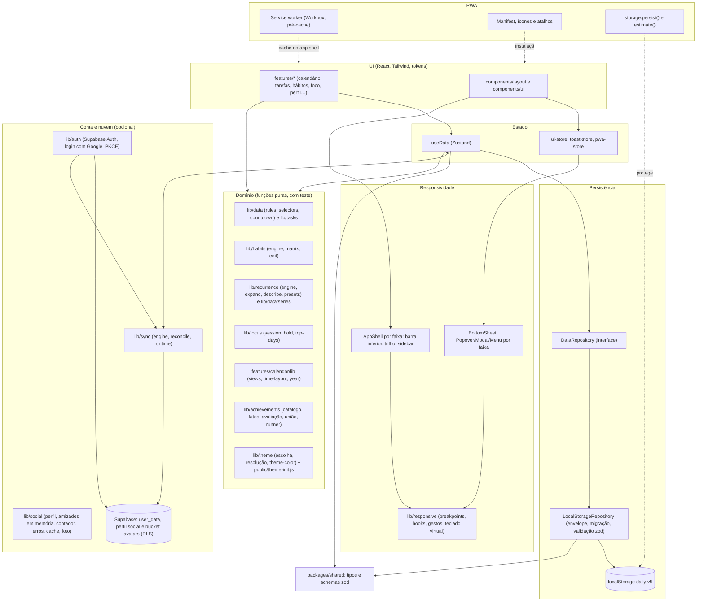

# Arquitetura

O Daily é um front-end estático (React + Vite) que guarda os dados no navegador (local-first). Opcionalmente, quem entra com Google tem uma cópia sincronizada no Supabase; não há servidor próprio. A UI nunca fala com o `localStorage` diretamente, e sim com um store que usa um repositório.

## Camadas

## Fluxo de uma ação

1. O componente chama uma ação do store (`useData.getState().createEvent(...)`).
2. O store valida a regra de domínio (funções puras), grava pelo `DataRepository` e atualiza o estado.
3. O `LocalStorageRepository` serializa num envelope versionado (`daily:v4`), mantém uma cópia do último estado válido e, se a gravação falhar, o estado continua em memória e a UI avisa.
4. O evento `storage` mantém várias abas sincronizadas (a última escrita vence).
5. Com conta, o `lib/sync` observa o store: `reconcile()` (puro) decide enviar, baixar, adotar ou pedir ao usuário que resolva um conflito; o envio usa concorrência otimista (`revision`) e a comparação é pelo hash do JSON canônico. Sem conta (ou sem as variáveis `VITE_SUPABASE_*`) nada disso roda.

## Decisões principais

| Decisão                                                  | Motivo                                                                                                                                                                                                                                                                                                                                                                                                                  |
| -------------------------------------------------------- | ----------------------------------------------------------------------------------------------------------------------------------------------------------------------------------------------------------------------------------------------------------------------------------------------------------------------------------------------------------------------------------------------------------------------- |
| Dados só no navegador atrás de um `Repository`           | Zero custo de hospedagem e privacidade total; a troca por uma API é trocar o adaptador. O `Repository` é síncrono hoje; uma API exigirá torná-lo assíncrono.                                                                                                                                                                                                                                                            |
| Lógica de domínio em funções puras com relógio injetável | Testável sem mocks de tempo; as fixtures e os testes e2e usam datas fixas.                                                                                                                                                                                                                                                                                                                                              |
| Regras de hábito versionadas                             | Editar repetição, meta ou horário vale a partir de hoje; o histórico nunca é reescrito.                                                                                                                                                                                                                                                                                                                                 |
| Tokens de design obrigatórios (`tokens.css`)             | Nenhum valor visual fora de um arquivo; o tema do Tailwind apenas mapeia os tokens.                                                                                                                                                                                                                                                                                                                                     |
| Classes do Tailwind sempre literais                      | O Tailwind só gera o que aparece por extenso no código; cores e densidades usam mapas literais ou variáveis CSS.                                                                                                                                                                                                                                                                                                        |
| Visão e data do calendário na URL                        | Recarregar, voltar e compartilhar preservam o estado.                                                                                                                                                                                                                                                                                                                                                                   |
| Grade de horas em porcentagem do intervalo               | O layout acompanha a altura disponível; `layoutSobreposicoes` distribui simultâneos em colunas.                                                                                                                                                                                                                                                                                                                         |
| Altura numa camada só (`--ds-viewport-h`)                | O AppShell preenche a janela e é o único que rola; o documento nunca rola (corrigido na v0.5.1).                                                                                                                                                                                                                                                                                                                        |
| PWA com `registerType: 'prompt'`                         | O usuário decide quando atualizar, e a oferta some enquanto há sessão de foco rodando, pausada ou travada.                                                                                                                                                                                                                                                                                                              |
| CSP sem `unsafe-inline` e sem `unsafe-eval`              | Superfície mínima; o JIT do zod é desligado porque usa `new Function`.                                                                                                                                                                                                                                                                                                                                                  |
| Um painel para criar, ver e editar compromissos          | Menos telas e um só lugar para subtarefas, status e tipo; no celular vira tela cheia.                                                                                                                                                                                                                                                                                                                                   |
| Migração v3 → v4 em chave nova (`daily:v4`)              | Uma aba antiga nunca lê um formato que não entende (e não envia um estado vazio à nuvem).                                                                                                                                                                                                                                                                                                                               |
| Rebase do ponto de sincronia após migrar                 | Atualizar o app não vira conflito falso; a nuvem só é reescrita numa edição real.                                                                                                                                                                                                                                                                                                                                       |
| Recorrência como regra + exceções por ocorrência         | Nada é materializado: a série guarda a regra e só o que difere em cada dia; o calendário expande só a janela visível e o passado nunca é reescrito.                                                                                                                                                                                                                                                                     |
| Tema por atributo (`data-theme`) e tokens por papel      | Os mesmos nomes de token valem nos dois temas; `theme-init.js` aplica o tema antes da 1ª pintura sem script inline (CSP intacta); a escolha é por dispositivo.                                                                                                                                                                                                                                                          |
| Amizades só por funções, dados de outros só em memória   | O cliente não lê nem escreve `friend_requests`, `friendships`, `blocks` e `reports`: tudo passa por funções `social_*` com limite de taxa, que respondem com códigos e nunca revelam existência, idade, bloqueio ou recusa (sempre `nao_encontrado`). Listas, fotos de amigos (`blob:` de links assinados de 120 s, baixados sem cache) e o contador ficam no store `useFriends`, em memória, e somem ao sair da conta. |
| Perfil social só no Supabase, com segurança no banco     | RLS, CHECKs, gatilhos e funções SECURITY DEFINER impõem as regras (@, idade, limites); o cliente só antecipa as mensagens. Nada do social no `daily:v6`; migrações versionadas que o dono aplica, testadas com pgTAP num Supabase local.                                                                                                                                                                                |
| Medalhas gravadas, progresso calculado                   | A conquista é permanente, com data e nível estáveis (perfil público no futuro); o progresso sai dos dados a cada vez e nunca é gravado.                                                                                                                                                                                                                                                                                 |
| Fixtures só em desenvolvimento                           | `import.meta.env.DEV` vira `false` no build e remove as fixtures do bundle de produção.                                                                                                                                                                                                                                                                                                                                 |

## Testes

- **Unidade (Vitest):** domínio, repositório, migrações, layout do calendário, política de atualização.
- **e2e (Playwright):** fluxos por feature e o projeto "pwa", que roda o build de produção com as regras de `vercel.json` (manifest, service worker, offline, CSP, fixtures sem efeito).
- **Layout:** `e2e/layout.spec.ts` confere, em todas as rotas e em seis tamanhos de janela, que o AppShell preenche a viewport e que o documento nunca rola.
- **CI:** lint, tipos, testes, build e e2e a cada push (`.github/workflows/ci.yml`).

## Deploy

Veja [`deploy.md`](deploy.md): Vercel, `apps/web/vercel.json` (rewrites, cache e cabeçalhos de segurança) e o risco de `main` ser produção.

### Responsividade (celular e tablet)

| Decisão                                                                                                                                                                              | Motivo                                                                                                       |
| ------------------------------------------------------------------------------------------------------------------------------------------------------------------------------------ | ------------------------------------------------------------------------------------------------------------ |
| Breakpoints num só lugar (`lib/responsive/breakpoints.ts`), espelhados no tema do Tailwind (`--breakpoint-*` e as variantes `phone`, `short` e `coarse`), com teste de que coincidem | Evita números soltos e CSS e TS divergirem                                                                   |
| CSS onde só o estilo muda; JavaScript (`useBreakpoint`, `usePhone`) só quando a árvore muda (popover × sheet, sidebar × barra inferior)                                              | Sem flash na primeira renderização e sem lógica duplicada                                                    |
| Responsivo por sobreposição (`max-md:`, `phone:`, `coarse:`) sobre as classes de desktop                                                                                             | O desktop (≥ 1280 px) fica pixel a pixel igual; `scripts/desktop-regression.mjs` compara com a linha de base |
| Celular em paisagem = altura ≤ 500 px **com ponteiro de toque**                                                                                                                      | Uma janela baixa de desktop continua desktop                                                                 |
| Alvos de toque por `pointer: coarse`, não por largura                                                                                                                                | Tablet e celular têm dedo; um notebook com mouse não muda                                                    |
| `BottomSheet` próprio (foco preso, Esc, arrastar a alça, botão voltar via histórico)                                                                                                 | Sem biblioteca nova; o histórico guarda uma entrada por sheet aberto e o `popstate` o fecha                  |
| Teclado virtual: `interactive-widget=resizes-content` (Chrome/Android) **e** variáveis `--ds-vv-h`/`--ds-vv-top` da `visualViewport` (iOS)                                           | O iOS não redimensiona a área de layout; os sheets e os formulários em tela cheia seguem a área visível      |
| Gestos com eventos de ponteiro (`touch-action: pan-y` + limiar de distância, velocidade e domínio do eixo)                                                                           | Deslizar não conflita com rolar; nunca na Semana, que rola na horizontal                                     |
| Criar evento por **toque longo** (com realce do horário) ou pelo botão +                                                                                                             | Um toque simples rola a grade e não cria evento sem querer                                                   |
