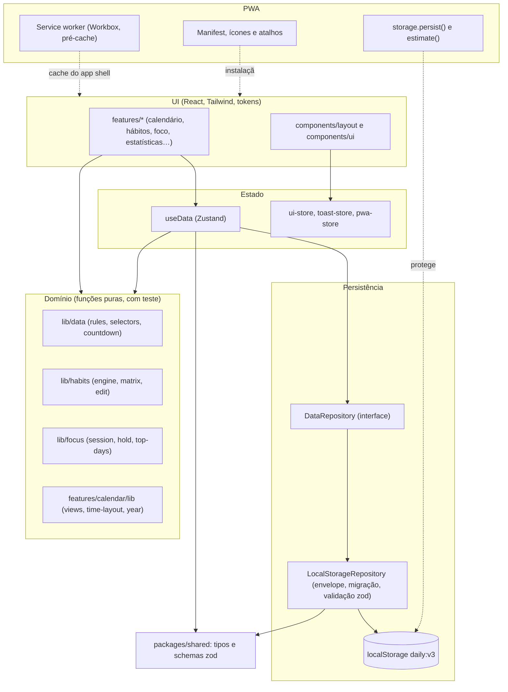

# Arquitetura

O Daily é um front-end estático (React + Vite) que guarda os dados no navegador. Não há back-end: a UI nunca fala com o `localStorage` diretamente, e sim com um store que usa um repositório. Trocar o armazenamento por uma API é trocar o adaptador.

## Camadas

## Fluxo de uma ação

1. O componente chama uma ação do store (`useData.getState().createEvent(...)`).
2. O store valida a regra de domínio (funções puras), grava pelo `DataRepository` e atualiza o estado.
3. O `LocalStorageRepository` serializa num envelope versionado (`daily:v3`), mantém uma cópia do último estado válido e, se a gravação falhar, o estado continua em memória e a UI avisa.
4. O evento `storage` mantém várias abas sincronizadas (a última escrita vence).

## Decisões principais

| Decisão                                                  | Motivo                                                                                                                                                       |
| -------------------------------------------------------- | ------------------------------------------------------------------------------------------------------------------------------------------------------------ |
| Dados só no navegador atrás de um `Repository`           | Zero custo de hospedagem e privacidade total; a troca por uma API é trocar o adaptador. O `Repository` é síncrono hoje; uma API exigirá torná-lo assíncrono. |
| Lógica de domínio em funções puras com relógio injetável | Testável sem mocks de tempo; as fixtures e os testes e2e usam datas fixas.                                                                                   |
| Regras de hábito versionadas                             | Editar repetição, meta ou horário vale a partir de hoje; o histórico nunca é reescrito.                                                                      |
| Tokens de design obrigatórios (`tokens.css`)             | Nenhum valor visual fora de um arquivo; o tema do Tailwind apenas mapeia os tokens.                                                                          |
| Classes do Tailwind sempre literais                      | O Tailwind só gera o que aparece por extenso no código; cores e densidades usam mapas literais ou variáveis CSS.                                             |
| Visão e data do calendário na URL                        | Recarregar, voltar e compartilhar preservam o estado.                                                                                                        |
| Grade de horas em porcentagem do intervalo               | O layout acompanha a altura disponível; `layoutSobreposicoes` distribui simultâneos em colunas.                                                              |
| Altura numa camada só (`--ds-viewport-h`)                | O AppShell preenche a janela e é o único que rola; o documento nunca rola (ver relatório 05.1).                                                              |
| PWA com `registerType: 'prompt'`                         | O usuário decide quando atualizar, e a oferta some enquanto há sessão de foco rodando, pausada ou travada.                                                   |
| CSP sem `unsafe-inline` e sem `unsafe-eval`              | Superfície mínima; o JIT do zod é desligado porque usa `new Function`.                                                                                       |
| Fixtures só em desenvolvimento                           | `import.meta.env.DEV` vira `false` no build e remove as fixtures do bundle de produção.                                                                      |

## Testes

- **Unidade (Vitest):** domínio, repositório, migrações, layout do calendário, política de atualização.
- **e2e (Playwright):** fluxos por feature e o projeto "pwa", que roda o build de produção com as regras de `vercel.json` (manifest, service worker, offline, CSP, fixtures sem efeito).
- **Visual:** scripts `pnpm visual:*` e `pnpm media:capture` geram capturas reproduzíveis.
- **CI:** lint, tipos, testes, build e e2e a cada push (`.github/workflows/ci.yml`).

## Deploy

Veja [`deploy.md`](deploy.md): Vercel, `apps/web/vercel.json` (rewrites, cache e cabeçalhos de segurança) e o risco de `main` ser produção.
