# Daily — Design System (v1.6)

Fonte de verdade para os tokens em `apps/web/src/styles/tokens.css` (variáveis com prefixo `--ds-`, ex.: `--ds-color-bg`).
Referência: mockup de calendário de terceiros (808×609 px, com moldura de dispositivo), usado só como guia visual e não incluído no repositório.

## Como a referência foi medida

- A tela útil da referência vai de x≈23 a x≈790 (**767 px**) e de y≈22 a ≈597. Ela equivale a **1440 px** de largura, logo **escala ≈ 1,877** (referência → app). A altura equivalente seria ~1080 px; o app-alvo tem 900 px, então **alturas** de linhas do grid e dos chips são comprimidas (ver “Decisões de altura”).
- Cores foram amostradas com PIL (pixels da imagem); dimensões, por medição de linhas/bordas e por comparação lado a lado com capturas do app (material de trabalho, fora do repositório).
- Legenda: **ajustado** = revisado e comparado com a referência (v0.2); **estimado** = valor da v0.1 não contradito pela comparação.

Tema: **somente escuro** (a referência não tem tema claro).

## 1. Paleta

| Token                       | Valor          | Status                                                                               | Antes (v0.1)       |
| --------------------------- | -------------- | ------------------------------------------------------------------------------------ | ------------------ |
| `--ds-color-bg`             | `#131313`      | ajustado — a tela da referência é `#131313`; `#0C0C0C` é só a moldura                | `#0B0B0C`          |
| `--ds-color-surface`        | `#1B1B1D`      | ajustado (trilho do segmentado, selects, botões de ícone)                            | `#141416`          |
| `--ds-color-surface-raised` | `#1E1F23`      | ajustado (popover; amostra `#1E1F23`)                                                | `#1C1C1F`          |
| `--ds-color-border`         | branco a 8 %   | ajustado (linha do grid `#262626` sobre `#131313` = 8 %)                             | igual              |
| `--ds-color-border-strong`  | branco a 16 %  | estimado                                                                             | —                  |
| `--ds-color-hover`          | branco a 6 %   | ajustado (item ativo `#222124`, campo do popover `#2B2C30`)                          | igual              |
| `--ds-color-accent`         | `#F5E94B`      | estimado                                                                             | —                  |
| `--ds-color-accent-soft`    | amarelo a 15 % | ajustado (selo “NEW” é amarelo translúcido com texto amarelo)                        | novo               |
| `--ds-color-accent-fg`      | `#0B0B0C`      | estimado                                                                             | —                  |
| `--ds-color-badge`          | `#FF3DA3`      | estimado; clareado na 13.1 (`#FF2D9B` caía a 4,48:1 sob a sombra do menu Criar)      | —                  |
| `--ds-color-badge-fg`       | `#0B0B0C`      | ajustado (texto escuro sobre rosa na referência; contraste 5,72:1)                   | `#FFFFFF` (3,44:1) |
| `--ds-color-fg`             | `#FFFFFF`      | ajustado                                                                             | —                  |
| `--ds-color-fg-soft`        | `#B0B0B6`      | ajustado — itens de menu, números dos dias, selects (referência `#A0A0A0`–`#E1E1E1`) | novo               |
| `--ds-color-fg-muted`       | `#92929B`      | ajustado; clareado na 13.1 (`#8A8A93` ia a 4,14:1 nos cartões do Perfil): 6,02:1     | —                  |
| `--ds-color-fg-subtle`      | `#808089`      | ajustado por contraste (dias de outros meses): 4,75:1                                | `#55555C` (2,51:1) |
| `--ds-color-white-pill`     | `#FFFFFF`      | estimado (botão “Criar”, texto `#0B0B0C`)                                            | —                  |
| `--ds-event-chip-alpha`     | 10 %           | ajustado (fundos de chip na referência equivalem a ~9–10 %)                          | 15 %               |

Cores de evento (chip = cor a 10 % no fundo + borda esquerda de 2 px na cor cheia), todas estimadas: prova `#FF4D5E`, estudo `#3B82F6`, entrega `#FF9F1C`, revisão `#2FD16B`, especial `#E23FD8`. Contraste do rótulo colorido sobre o fundo do chip: 4,55:1 (estudo, o mínimo) a 7,87:1.

### Contraste (WCAG AA, 4,5:1 para texto normal)

| Par                                   | Razão            | Resultado                      |
| ------------------------------------- | ---------------- | ------------------------------ |
| `fg-muted` sobre `bg` / `raised`      | 6,02 / 5,34      | passa                          |
| `fg-soft` sobre `bg`                  | 8,61             | passa                          |
| `fg-subtle` sobre `bg`                | 4,75             | passa (antes 2,51 — reprovava) |
| texto escuro sobre `accent` / `badge` | 15,59 / 6,04     | passa                          |
| anel de foco `accent` sobre `bg`      | 14,72 (mín. 3:1) | passa                          |

Exceção documentada: chips de **dias de outros meses** têm `opacity-dimmed` (0,45) — é estado “inativo”, que o WCAG isenta de contraste mínimo.

## 2. Tipografia

Família: **Inter** (`@fontsource-variable/inter`), fallback `system-ui, sans-serif`. A comparação lado a lado mostra formas de letra equivalentes (`a`, `g`, `R`, `y`); **Inter foi mantida**, sem diferença clara de forma que justifique outra família. A referência parece ligeiramente mais larga nos itens de menu — compensado com 16 px.

| Papel                          | Tamanho       | Peso      | Altura de linha | Caixa / tracking             | Status                              |
| ------------------------------ | ------------- | --------- | --------------- | ---------------------------- | ----------------------------------- |
| Cabeçalho DOM–SÁB              | 11 px         | 700       | 14 px           | MAIÚSCULAS, +0,01 em, branco | ajustado (era 500, cinza, +0,08 em) |
| Rótulo de grupo (“Menus”)      | 13 px         | 500       | 20 px           | +0,01 em                     | ajustado (era 12 px)                |
| Número do dia (`01`…)          | 11 px         | 700       | 14 px           | com zero à esquerda          | ajustado (era 12 px/500)            |
| Chip — rótulo de tipo          | 10 px         | 500       | 12 px           | minúsculo                    | ajustado                            |
| Chip — título                  | 12 px         | 600       | 14 px           | normal                       | ajustado (lh 16 → 14)               |
| Chip — horário                 | 10 px         | 400       | 12 px           | intervalo “09:30 – 10:30”    | ajustado                            |
| Item de menu / CTA / “Criar”   | 16 px         | 500 / 600 | 20 px           | normal                       | ajustado (era 14 px)                |
| Selects, segmentado            | 14 px         | 400 / 500 | 20 px           | normal                       | ajustado (era 14/500, bold)         |
| Badge contador / NEW           | 11 px / 10 px | 600 / 700 | —               | NEW em MAIÚSCULAS            | estimado                            |
| Campos do popover              | 13 px         | 400 / 500 | 20 px           | normal                       | ajustado                            |
| Data/horário do popover        | 14 px         | 400       | 20 px           | normal                       | ajustado (era 13 px)                |
| Título do popover              | 19 px         | 600       | 24 px           | −0,01 em                     | ajustado (era 18 px)                |
| Título de página (placeholder) | 24 px         | 600       | 32 px           | −0,02 em                     | estimado                            |
| Logo “Daily.”                  | 22 px         | 700       | 28 px           | −0,02 em                     | estimado                            |

## 3. Espaçamento, raios, bordas, sombras

- Unidade base **4 px**. Valores intermediários usados: 6 px (padding da célula), 14 px (`--ds-sidebar-inset`), 18 px (padding do ícone do item).
- Raios: `sm 4 px` (chips), `md 8 px`, `lg 12 px`, `xl 24 px` (popover; era 16 px — ajustado), `full`.
- Bordas: 1 px branco 8 %; acento lateral do chip 2 px; barra do item ativo 3 px (ajustado: encostada na borda direita da sidebar).
- Sombra do popover: `0 24px 48px rgb(0 0 0 / 55 %)` + anel 1 px 8 % (estimado). Foco: anel amarelo 2 px com offset 2 px.

## 4. Dimensões (1440×900)

| Elemento                      | Dimensão                                                                                             | Status                                  |
| ----------------------------- | ---------------------------------------------------------------------------------------------------- | --------------------------------------- |
| Sidebar                       | 248 px (recolhida 72 px)                                                                             | ajustado (era 264)                      |
| Cabeçalho da sidebar / topbar | 78 px, conteúdo centralizado abaixo de 12 px de respiro superior; borda inferior em ambos            | ajustado (era 72, sem borda na sidebar) |
| Botão “Criar”                 | 152 × 44 px, alinhado à esquerda, 14 px de inset                                                     | ajustado (era largura total)            |
| Item da sidebar               | 38 px de altura, inset 14 px, raio esquerdo 8 px, ícone 16 px (traço 1,5), gap 12 px                 | ajustado (era 40 / 18 px)               |
| Badge contador / NEW          | 20 px de altura                                                                                      | ajustado (era 18)                       |
| Avatar + seletor de matéria   | círculo de 40 px + pílula de 36 px × 192 px, sem borda                                               | ajustado (era pílula única com borda)   |
| Botões de ícone da topbar     | 40 px, círculo preenchido (`surface`), sem borda                                                     | ajustado                                |
| Barra de controles            | 68 px                                                                                                | ajustado (era 64)                       |
| Segmentado                    | trilho de 40 px sem borda; itens com largura mín. 78 px; “Hoje” dentro do trilho (ação, nunca ativa) | ajustado                                |
| Selects mês / ano             | 36 px de altura; 124 px / 88 px; texto 14 px                                                         | ajustado (era 40 px; 128 / 96)          |
| CTA “+ Nova Prova”            | 40 px, texto 16 px semibold                                                                          | ajustado                                |
| Cabeçalho dos dias            | 28 px                                                                                                | ajustado (era 36)                       |
| Célula do calendário          | linha mínima 144 px; padding 6 px (esq.) / 12 px (dir.)                                              | ajustado                                |
| Chip                          | 3 linhas, ~44 px (referência: ~56 px), raio 4 px                                                     | ajustado (era 2 linhas)                 |
| Dia atual                     | círculo de 20 px, amarelo                                                                            | ajustado (era 24)                       |
| Popover                       | 288 px, raio 24 px, padding 16 px                                                                    | ajustado                                |
| Botões do popover             | quadrados arredondados de 24 px, fundo `hover`, sem borda                                            | ajustado (eram círculos de 28 px)       |
| Campos do popover             | rótulo 56 px; valor 24 px de altura, gap 4 px, raio 8 px                                             | ajustado (28 / 8 px)                    |
| Barra de progresso, checkbox  | 6 px; 16 px                                                                                          | estimado                                |

### Decisões de altura

A referência equivale a 1440×1080; o alvo é 1440×900. Larguras seguem a escala 1,877. Com topbar 78 + controles 68 + cabeçalho 28 sobram 726 px: **5 semanas × 145 px**. Um chip de 3 linhas na escala exata teria ~56 px; isso não cabe (2 chips + “+N mais” exigem ≥ 172 px). Regra adotada: chip compacto de ~44 px (linhas de 12/14/12 px) → **2 chips completos + “+N mais” cabem em 142 px** e a altura mínima da linha é 144 px (`--ds-cell-min-h`).
Se a janela for menor (1280×720/800) ou o mês tiver 6 semanas, as linhas **não encolhem abaixo de 144 px** e a área do grid rola verticalmente; nada é cortado. Mais de 2 eventos num dia: o link “+N mais” expande a célula.

## 5. Adaptação ao domínio de estudos

Eventos: prova, estudo, entrega, revisão, especial. “Matéria” substitui “Artista”, “Status” substitui o estágio de negociação. Provas exibem checklist de conteúdos com barra de progresso.

## 6. Diferenças intencionais em relação à referência

- Logo textual “Daily.”; ícones lucide (a referência usa outro conjunto).
- Sem moldura de dispositivo, cursor ou botão “Chat with Eva” (vira “Modo Foco”).
- Chips ~44 px em vez de ~56 px (ver acima); chips da referência aparecem “esmaecidos” em parte dos dias — aqui só os dias de outros meses são esmaecidos.
- O seletor de matéria mantém a seta (é um `<select>` funcional).

## 7. Componentes da v0.2 (formulários, menus, avisos e estados)

Todos usam apenas utilitários derivados de tokens; nenhum valor visual literal.

### Botões (`ui/Button`)

| Variante    | Uso                                    | Tokens principais                                             |
| ----------- | -------------------------------------- | ------------------------------------------------------------- |
| `primary`   | Ação principal (amarelo)               | `accent`, `accent-fg`, `text-nav` 16 px semibold, `h-control` |
| `secondary` | Ação secundária contornada             | `border-strong`, `text-md` 14 px                              |
| `outline`   | Contornado de 13 px (Modo Foco, toast) | igual ao secundário com `text-base`                           |
| `pill`      | “Criar” da sidebar                     | `white-pill`, `create-w` × `create-h`                         |
| `icon`      | Círculo preenchido (topbar, sidebar)   | `surface`; tamanhos `xs 24 / sm 32 / md 40`                   |
| `tile`      | Quadrado arredondado (popover, modal)  | `hover`, `radius-md`; tamanho `xs` 24 px                      |

Acessibilidade: botões só com ícone **exigem** `aria-label` (garantido pelo tipo); foco visível via anel amarelo global; `disabled` reduz a opacidade.

### Modal (`ui/Modal`)

- Camada: `scrim` (preto a 40 %) cobrindo a tela; painel `surface-raised`, `radius-xl`, `shadow-popover`, largura `--ds-modal-w` (32 rem), altura máxima `--ds-modal-max-h` (90 dvh) com rolagem interna.
- Estrutura: título `text-title` semibold + botão `tile` “Fechar”; corpo com `px-6`; rodapé alinhado à direita com `gap-2` (Cancelar `secondary`, Salvar `primary`).
- Acessibilidade: `role="dialog"`, `aria-modal`, `aria-labelledby`; foco preso (Tab/Shift+Tab), foco inicial em `[data-autofocus]` (ou no primeiro controle), **Esc fecha** e o foco volta a quem abriu (hook `useFocusScope`, também usado pelo popover).

### Menu (`ui/Menu`)

- Painel `surface-raised` com `border-hair`, `radius-lg`, `shadow-popover`, largura `--ds-menu-w` (13 rem); itens de `h-select` (36 px), `text-md`, ícone de 16 px em `muted`; hover/foco com `hover`.
- Fica logo após o gatilho no DOM (sem portal), por isso funciona dentro do popover.
- Acessibilidade: gatilho com `aria-haspopup="menu"`, `aria-expanded`, `aria-controls`; painel `role="menu"`, itens `role="menuitem"`; foco no primeiro item ao abrir; ↑/↓ circulam, Home/End vão às pontas, **Esc fecha só o menu** e devolve o foco ao gatilho, Tab e clique fora fecham.

### Toast (`ui/ToastRegion`)

- Cartão `surface-raised`, `radius-lg`, `shadow-popover`, largura máxima `--ds-toast-w` (26 rem), centralizado na base; mensagem `text-md` e botão `outline` “Desfazer”.
- Duração: 6 s com “Desfazer” (`UNDO_MS`); avisos simples, 4 s.
- Acessibilidade: a região é `role="status"` com `aria-live="polite"`, então cada toast é anunciado; o botão é alcançável por teclado.

### Formulários (`ui/Field`)

| Componente      | Controle                                                                                           |
| --------------- | -------------------------------------------------------------------------------------------------- |
| `TextField`     | Input de `h-select` (36 px), `surface`, `border-hair`, `radius-md`, `text-md`, placeholder `muted` |
| `TextAreaField` | Mesmo estilo, altura mínima `--ds-textarea-h` (5 rem), redimensionável na vertical                 |
| `SelectField`   | `<select>` nativo estilizado (`ui/Select`) com seta                                                |

- Rótulo acima (`text-base` medium, `soft`), **sempre** associado por `htmlFor`/`id`; ajuda em `text-sm muted`; erro em `text-sm danger` (`--ds-color-danger`, 5,4:1 sobre o painel), no `role="alert"`.
- Campo inválido: `aria-invalid="true"` + `aria-describedby` para a mensagem + borda `danger`; ao enviar com erro o foco vai ao primeiro campo inválido.
- Datas e horários usam os controles nativos (`color-scheme: dark`). `radio`/`checkbox` nativos usam `accent-color` amarelo.
- Mensagens de erro em pt-BR, geradas pelos schemas zod.

### Lista de conteúdos (`forms/ContentsEditor`)

> **v4:** substituída pela lista de subtarefas do painel de tarefa (`features/tasks/SubtaskList`); ver a seção 16.

- Linha: input (`h-select`) + três botões `tile` `xs` (subir, descer, remover) com `gap-1`; “Adicionar conteúdo” em `secondary`. Enter na última linha cria outra.
- Acessibilidade: cada controle tem `aria-label` com o número (“Mover conteúdo 2 para cima”); subir/descer ficam `disabled` nas pontas; reordenar não exige arrastar.
- No popover (`EventPopover`): checkbox por conteúdo (riscado e `muted` quando concluído), contador `done/total`, `ProgressBar` (`role="progressbar"`, `aria-valuenow`) e input “Adicionar conteúdo” de 24 px (`h-field`) com botão `tile`.

### Abas (`ui/Tabs`) e estado vazio (`ui/EmptyState`)

- Abas: trilho igual ao segmentado (`surface`, ativo amarelo); `role="tablist"/"tab"/"tabpanel"`, ←/→ movem a seleção, `tabIndex` roving.
- Estado vazio: borda `hair`, `radius-xl`, ícone de 32 px `muted`, título `text-lg`, texto `text-md muted` (largura máx. do modal), ações centralizadas.

### Estados de evento (`concluído` e `cancelado`)

> **v4:** os status agora têm cores reservadas; ver a seção 16.

| Estado                 | Chip (calendário e listas)                              | Token                      |
| ---------------------- | ------------------------------------------------------- | -------------------------- |
| pendente, em andamento | normal                                                  | —                          |
| concluído              | esmaecido + título riscado                              | `--ds-opacity-done` 0,55   |
| cancelado              | igual ao concluído (a diferença é o rótulo “Cancelado”) | `--ds-opacity-done`        |
| dia de outro mês       | esmaecido (já existia)                                  | `--ds-opacity-dimmed` 0,45 |

O estado nunca depende só da cor/opacidade: o status aparece por extenso no popover, nas listas e no formulário.

### Cores de matéria

> **v4:** a paleta mudou (sem vermelho, verde, amarelo e laranja); ver a seção 16.

Paleta fixa de 8 cores (`--ds-color-subject-vermelho … rosa`); aparece como ponto de `--ds-dot` (10 px) nas listas e como seletor de `--ds-swatch` (28 px) no formulário (`role="radiogroup"`, cada cor com `aria-label` e `aria-checked`).

### Tokens adicionados na v0.2 (0.2.0 e 0.2.1)

| Token                     | Valor                      | Uso                                      |
| ------------------------- | -------------------------- | ---------------------------------------- |
| `--ds-color-danger`       | `#FF6B78`                  | erros de formulário/alertas              |
| `--ds-color-subject-*`    | 8 cores                    | paleta de matérias                       |
| `--ds-opacity-done`       | 0,55                       | chips concluídos/cancelados              |
| `--ds-modal-w` / `-max-h` | 32 rem / 90 dvh            | modal                                    |
| `--ds-menu-w`             | 13 rem                     | menu suspenso                            |
| `--ds-toast-w`            | 26 rem                     | toast                                    |
| `--ds-page-max-w`         | 56 rem                     | largura do conteúdo das páginas de lista |
| `--ds-textarea-h`         | 5 rem                      | altura mínima do textarea                |
| `--ds-chip-pad-y`         | 3 px (4 px em telas altas) | respiro vertical do chip                 |

## 8. Telas altas (segunda tela em 1920×1080)

Com `min-height: 1000px` (`@media` em `tokens.css`): `--ds-chip-pad-y` sobe de 3 px para 4 px e `--ds-cell-min-h` de 9 rem para 9,4 rem.

| Medida (Nov/2026, dados de exemplo)                  | Antes (1920×1080) | Depois (1920×1080)          | 1440×900 (inalterado) |
| ---------------------------------------------------- | ----------------- | --------------------------- | --------------------- |
| Altura do chip                                       | 46 px             | **48 px**                   | 46 px                 |
| Linha do grid, mês de 5 semanas                      | 181 px            | 181 px (preenche a tela)    | 145 px                |
| Linha do grid, mês de 6 semanas                      | 151 px            | 151 px (≥ mínimo de 150 px) | 144 px (rola)         |
| Conteúdo necessário por célula (2 chips + “+N mais”) | 142 px            | 150 px                      | 142 px                |

Regra: o chip só cresce até o ponto em que **2 chips + “+N mais” ainda cabem numa linha de mês de 6 semanas** (a pior hipótese em 1080 px). Em meses de 5 semanas sobra ~30 px abaixo dos chips; aceitável, e o grid continua ocupando toda a altura.

Capturas das telas: veja o [README](../../README.md).

## 9. Dashboard (Estatísticas)

Fonte: mockup de terceiros de um painel de estatísticas, não incluído no repositório (1187×896; a página de **Estatísticas**, não o Modo Foco). Ignoramos a moldura do aparelho, o fundo texturizado, a barra de navegação, a marca, os logotipos, os avatares e os textos. **Todos os valores abaixo são estimados** (amostras de pixel da imagem e medição de bordas; escala ≈ 1,12 da imagem para o app, onde o conteúdo tem no máximo 72 rem).

### Adaptações obrigatórias

- O destaque é o **amarelo do Daily** (`--ds-color-accent`), nunca o verde-limão da referência (`#D1F85C`).
- A água usa **índigo/roxo** (tokens novos `--ds-color-water*`), no lugar do azul-arroxeado da referência.
- Sem marca, logotipos, avatares ou textos da referência; conteúdo 100 % do domínio de estudos.

### Superfícies

| Item                      | Valor estimado                                                                                                        | Token                                   |
| ------------------------- | --------------------------------------------------------------------------------------------------------------------- | --------------------------------------- |
| Página                    | `#131313` (igual ao app); a referência usa `#171717` com cartões `#2A2A2A`                                            | `--ds-color-bg`                         |
| Cartão “glass”            | gradiente diagonal (145°) de branco 7 % → 2,5 %, borda 1 px branca a 8 %, realce interno de 1 px no topo (branco 6 %) | `--ds-glass-bg`, `--ds-glass-highlight` |
| Raio do cartão grande     | 32 px (referência ≈ 30 px na imagem)                                                                                  | `--ds-radius-card`                      |
| Raio de itens flutuantes  | 20 px (cartões da agenda, pílulas)                                                                                    | `--ds-radius-card-sm`                   |
| Padding do cartão         | 24 px                                                                                                                 | `--ds-card-pad`                         |
| Espaço entre cartões      | 16 px (referência ≈ 13 px)                                                                                            | `--ds-card-gap`                         |
| Brilho do cartão de metas | gradiente radial no canto inferior direito, amarelo a 28 % → transparente (60 %)                                      | `--ds-glow-accent`                      |

### Proporções do grid (4 colunas × 2 linhas)

| Cartão                 | Colunas | Linhas | Largura na referência | Fração       |
| ---------------------- | ------- | ------ | --------------------- | ------------ |
| Semana (barras)        | 1       | 1      | 248 px                | `1.5fr`      |
| Anel (preparação/foco) | 2       | 1      | 248 px                | `1.5fr`      |
| Água                   | 3       | 1      | 161 px                | `1fr`        |
| Metas do dia           | 4       | 1–2    | 336 px                | `2fr`        |
| Agenda                 | 1–3     | 2      | 683 px                | `4fr` (soma) |

Alturas: linha 1 ≈ 288 px na imagem (≈ 20 rem no app); linha 2 ≈ 230 px (≈ 14,5 rem). O cartão de metas atravessa as duas linhas (≈ 530 px na imagem). Abaixo de 1100 px de largura o grid vira 2 colunas e, abaixo de 700 px, 1 coluna.

### Tipografia

| Papel                                   | Estimado                         | Token                  |
| --------------------------------------- | -------------------------------- | ---------------------- |
| Saudação (“Olá, Nome”)                  | 36 px, peso 400, nome em amarelo | `--ds-text-display`    |
| Título do cartão                        | 20 px, peso 400                  | `--ds-text-card-title` |
| Número grande (8h, 10 km, 40 %)         | 30 px, peso 400, `tabular-nums`  | `--ds-text-stat`       |
| Rótulo pequeno (Total, Meta, Concluído) | 14 px, `muted`                   | `--ds-text-md`         |
| Rótulos de eixo (Seg, Ter…)             | 11 px                            | `--ds-text-xs`         |

### Componentes do dashboard

- **Barras da semana:** 7 barras verticais em pílula (≈ 20 px de largura, ≈ 110 px de altura, vão ≈ 8 px). Trilha `--ds-color-chart-track`; o **planejado** é um hachurado índigo (`--ds-hatch-planned`) e o **concluído** é preenchido de baixo para cima em amarelo; o dia atual tem a trilha clara (`--ds-color-chart-track-strong`) e o rótulo em pílula.
- **Anel:** diâmetro ≈ 136 px (≈ 150 px no app), espessura ≈ 18 px (≈ 13 % do diâmetro), extremidades arredondadas, trilha `--ds-color-chart-track`, arco amarelo; valor no centro.
- **Cartão de água:** metade de cima na superfície do cartão, metade de baixo em gradiente índigo (`--ds-water-gradient`), com **onda** (path SVG) de transição em tom mais claro; valor grande (ex.: `0,7 L`) e botão circular “+” (branco a 20 %, ≈ 32 px) no canto inferior.
- **Metas do dia:** linhas de ≈ 63 px com ícone em círculo de 40 px (superfície clara), título, círculo de verificação de 24 px (amarelo com visto escuro quando cumprida, vazio escuro quando não); metas cumpridas ficam esmaecidas e riscadas; separadores tracejados; barra de progresso de 12 px (trilha clara, preenchimento amarelo) e “Concluído NN %”.
- **Agenda:** chips de data e de mês em pílula (`surface`), botão de calendário circular; horários à esquerda com linhas tracejadas; **cartões flutuantes** escuros (`--ds-radius-card-sm`, sombra `--ds-shadow-popover`) sobrepostos e deslocados; botão de ação circular amarelo de 48 px com brilho.

### Tokens previstos (definidos em `tokens.css`)

`--ds-radius-card`, `--ds-radius-card-sm`, `--ds-card-pad`, `--ds-card-gap`, `--ds-glass-bg`, `--ds-glass-highlight`, `--ds-glow-accent`, `--ds-color-water`, `--ds-color-water-deep`, `--ds-color-water-wave`, `--ds-water-gradient`, `--ds-color-chart-track`, `--ds-color-chart-track-strong`, `--ds-hatch-planned`, `--ds-text-display`, `--ds-text-card-title`, `--ds-text-stat`.

### 9.1 Implementação (v0.6) e “Análises”

> **v4:** a seção “Análises” e o cartão “Sequência” foram removidos; a página virou o **Perfil** (`/perfil`).

- **Página** (`features/stats`): saudação, seção “Hoje” (grid de 4 colunas a partir de 80 rem; 2 colunas abaixo) e seção “Análises”; rola na vertical, com conteúdo de até `--ds-container-stats`.
- **Análises (v0.7: 5 cartões):** `surface-glass` em 2 colunas (1 abaixo de 80 rem); o cartão “Metas” ocupa as duas colunas da última linha, sem buraco. A água fica **só** em “Hoje”. Gráficos em **SVG próprio** (`features/stats/charts.tsx`): barras (trilha `chart-track-strong` = planejado, amarelo = realizado), barras horizontais na cor da matéria e mapa de calor de 12 semanas (opacidade do amarelo de `--ds-heat-min` a 1, ∝ % de metas). Alturas por tokens (`h-chart`, `h-stat-bar`).
- **Acessibilidade dos gráficos:** barras têm tabela `sr-only` com legenda; o mapa de calor é `role="img"` com resumo; todos os cartões vazios mostram “Ainda não há dados neste período”.
- **Água:** onda animada (`animate-wave`) com a altura proporcional à meta; `prefers-reduced-motion` desliga a animação e a transição.
- **Agenda:** linha do tempo 06h–23h rolada até o horário atual, cartões que se escalonam quando se sobrepõem (`lib/stats/agenda.ts`), linha de “agora”.
- **Preparação (v0.7):** o nome da matéria quebra em até 2 linhas (reticências depois) e o nome completo vai no `title`; o contador desce para a linha de baixo quando não cabe ao lado.
- **Contraste (v0.7, `node apps/web/scripts/contrast-audit.mjs`):** texto medido contra o fundo renderizado (WCAG AA). Estatísticas: menor razão 4,71:1 (127 textos, nenhum abaixo de 4,5:1). Mapa de calor: nível mais baixo de 0,2 → `--ds-heat-min` = 0,4 de opacidade, o que sobe o contraste não textual contra o cartão de ≈ 1,76:1 para ≈ 3,2:1. As barras “planejado” (branco a 16 %) são decorativas: o valor também está em texto e na tabela oculta.
- **Diferenças restantes em relação à referência:** a referência não tem a coluna de origem das metas automáticas; os cartões flutuantes da agenda não têm avatares (não usamos imagens da referência); o fundo texturizado da moldura não é reproduzido.
- **Capturas:** veja a tela de Estatísticas no [README](../../README.md).

## 10. Cronômetro do Modo Foco

> **v0.5 (03.1):** o cronômetro foi redesenhado para ser minimalista. **Os valores da tabela abaixo (v0.4) foram substituídos pelos da seção 10.1**, que traz o antes/depois. A tabela fica como histórico.

Especificação visual **estimada** no mesmo sistema (a referência não tem cronômetro). Rota `/foco`: página limpa, só o anel, os dígitos e os controles, centralizados.

| Item                      | Valor                                                                                                                                                                                           | Token                                  |
| ------------------------- | ----------------------------------------------------------------------------------------------------------------------------------------------------------------------------------------------- | -------------------------------------- |
| Anel                      | diâmetro 320 px (20 rem), traço de 14 px com pontas arredondadas; a trilha é o círculo inteiro                                                                                                  | `--ds-timer-size`, `--ds-timer-stroke` |
| Cor da trilha             | branco a 10 %                                                                                                                                                                                   | `--ds-color-timer-track`               |
| Cor do progresso          | amarelo do Daily (rodando)                                                                                                                                                                      | `--ds-color-timer-progress`            |
| Pausado                   | arco em cinza claro (`fg-soft`) e dígitos em `soft`                                                                                                                                             | `--ds-color-timer-paused`              |
| Concluído                 | arco cheio em verde (cor de “revisão”)                                                                                                                                                          | `--ds-color-timer-done`                |
| Dígitos                   | 72 px (4,5 rem), peso 300, `tabular-nums`, altura de linha 1, `mm:ss` (ou `h:mm:ss`)                                                                                                            | `--ds-text-timer`                      |
| Botão/“puxador” do ajuste | círculo de 24 px na posição do ângulo escolhido, só no estado ocioso                                                                                                                            | `--ds-timer-knob`                      |
| Faixa de ajuste           | 1 a 180 min; o anel inteiro = 180 min; 1 min por passo                                                                                                                                          | constantes em `lib/focus`              |
| Progresso rodando         | o arco **diminui** do cheio até zero                                                                                                                                                            | —                                      |
| Estados                   | **ocioso** (arco = duração/180 + puxador), **rodando** (amarelo), **pausado** (cinza), **concluído** (verde, tela de resumo), **travado** (selo “Tela travada”, controles de navegação ocultos) | —                                      |
| Movimento                 | transições do arco desligadas com `prefers-reduced-motion`                                                                                                                                      | —                                      |
| Hold-to-unlock            | botão `outline` com anel de progresso que preenche em 3 s                                                                                                                                       | `HOLD_TO_UNLOCK_MS`                    |

Acessibilidade do anel: `role="slider"` (`aria-valuemin=1`, `aria-valuemax=180`, `aria-valuenow`, `aria-valuetext` “25 minutos”), teclado (setas ±1, PageUp/PageDown ±5, Home/End), arraste por ponteiro (mouse e toque). Os dígitos têm `role="timer"` e não são anunciados a cada segundo (sem `aria-live`).

### 10.1 Cronômetro minimalista (v0.5) — antes/depois

Princípio: o anel com o tempo dentro, e quase mais nada. Sem cartões, sem textos auxiliares; as explicações vão para `aria-describedby`, tooltips (`title`) e README. Valores **estimados**.

| Item                                                                                       | Antes (v0.4)                                                  | Depois (v0.5)                                                                  | Token                          |
| ------------------------------------------------------------------------------------------ | ------------------------------------------------------------- | ------------------------------------------------------------------------------ | ------------------------------ |
| Diâmetro do anel                                                                           | 320 px (20 rem)                                               | **352 px (22 rem)**                                                            | `--ds-timer-size`              |
| Espessura do traço                                                                         | 14 px (4,375 un. do viewBox)                                  | **≈ 5 px (1,5 un.)**                                                           | `--ds-timer-stroke`            |
| Anel ocioso                                                                                | arco = duração/180 + alça arrastável                          | **anel completo, neutro** (branco a 28 %)                                      | `--ds-color-timer-idle` (novo) |
| Alça (bolinha) e arrastar                                                                  | sim                                                           | **removidos** (o anel só indica progresso)                                     | —                              |
| Dígitos                                                                                    | 72 px, peso 300, `tabular-nums`                               | igual (72 px, 300, tabulares) — mais respiro ao redor                          | `--ds-text-timer`              |
| Largura do campo de tempo                                                                  | —                                                             | 288 px (18 rem), centralizado                                                  | `--ds-timer-input-w` (novo)    |
| Controles dentro do anel                                                                   | Iniciar/Pausar/Reiniciar/Encerrar em botões com texto, abaixo | **só ícones** dentro do anel, abaixo dos dígitos                               | `Button variant="icon"`        |
| Atalhos de tempo (15–90), −5/+5, seletor “Estudando”, parágrafo da trava, “Segure por 3 s” | visíveis                                                      | **removidos da tela**                                                          | —                              |
| Cadeado (travar ao iniciar)                                                                | caixa de seleção com texto                                    | ícone pequeno discreto sob o anel (`aria-pressed`), só com o cronômetro parado | —                              |
| Posição do anel                                                                            | no fluxo, empurrado pelos controles                           | **centralizado** na área útil; o que fica abaixo é posicionado fora do fluxo   | —                              |

Estados (v0.5):

| Estado                        | Anel                   | Dentro do anel                                                                                              | Sob o anel                       |
| ----------------------------- | ---------------------- | ----------------------------------------------------------------------------------------------------------- | -------------------------------- |
| Ocioso                        | completo, neutro       | tempo **editável** + play (amarelo)                                                                         | cadeado                          |
| Rodando (sem trava)           | amarelo, diminui       | tempo + pausar                                                                                              | —                                |
| Pausado (sem trava)           | cinza claro, congelado | tempo **piscando** (`animate-pulse`, desligado com `prefers-reduced-motion`) + retomar, reiniciar, encerrar | —                                |
| Rodando/pausado **com trava** | amarelo / cinza        | só o tempo                                                                                                  | só “Segurar para destravar”      |
| Concluído                     | completo, verde        | “Concluído” + duração focada + nova sessão                                                                  | link discreto “Ver estatísticas” |

Campo de tempo: `<input>` sem caixa nem borda (apenas sublinhado sutil de 1 px no hover e no foco, cursor amarelo); aceita só dígitos e “:”; `25` = 25 min, `25:30`, `1:30:00`, `90` = 1 h 30; Enter e sair confirmam, Esc cancela, ↑/↓ ±1 min (Shift ±5); mínimo 1 min, máximo 3 h (valores fora são ajustados com aviso `aria-live`; formato inválido volta ao valor anterior).

### 10.2 Dígitos grandes e painel “Dias de mais foco” (v0.7) — antes/depois

O **anel foi removido**. A composição (adaptada de uma referência de cronômetro com dígitos pesados, fração em cinza no baseline, pílulas e lista à esquerda; sem copiar cores, textos nem layout claro) tem duas colunas centralizadas na área útil: **painel à esquerda, relógio à direita**. Abaixo de 1100 px o painel desce para baixo dos botões. Valores **estimados**.

| Item                 | Antes (v0.5)                                 | Depois (v0.7)                                                                          | Token                                                             |
| -------------------- | -------------------------------------------- | -------------------------------------------------------------------------------------- | ----------------------------------------------------------------- |
| Tempo                | 72 px, peso 300, dentro de um anel de 22 rem | `clamp(5,5 rem, 8 vw, 10 rem)` (≈ 154 px em 1920, ≈ 102 px em 1280), peso 800, tabular | `--ds-text-focus`, `--ds-weight-extrabold`                        |
| Fração (milésimos)   | —                                            | `clamp(1,5 rem, 2,6 vw, 3 rem)`, peso 500, `fg-muted`, no baseline; só rodando         | `--ds-text-focus-frac`, `--ds-color-focus-frac`                   |
| Posição da fração    | —                                            | largura zero, ao lado dos dígitos (não os desloca; ficam centralizados com as pílulas) | —                                                                 |
| Anel / alça          | anel de 22 rem, traço de 5 px                | **removido**                                                                           | (tokens `--ds-timer-*` e `--ds-color-timer-*` removidos)          |
| Botões               | ícones dentro do anel                        | **pílulas** de 52 px com ícone + rótulo (amarela = principal; contorno = secundária)   | `--ds-focus-pill-h`, `--ds-focus-pill-px`                         |
| Painel               | —                                            | cartão glass de 320 px; linhas de 56 px com raio de 16 px, alternadas com `hover`      | `--ds-focus-panel-w`, `--ds-focus-row-h`, `--ds-focus-row-radius` |
| Texto secundário     | —                                            | posição e “N sessões” em `fg-soft` (contraste ≥ 4,5:1 sobre as linhas alternadas)      | `--ds-color-focus-sub`                                            |
| Espaço entre colunas | —                                            | `clamp(2,5 rem, 6 vw, 6 rem)`                                                          | `--ds-focus-gap`                                                  |
| Destravar            | botão com barra preenchendo                  | pílula com **anel de progresso** de 28 px em volta do cadeado, enchendo em 3 s         | `--ds-focus-hold-size`, `--ds-focus-hold-ring`                    |

Estados: **parado** (dígitos editáveis; pílulas “Travar” — `aria-pressed` — e “Iniciar”), **rodando/pausado sem trava** (“Reiniciar”, “Encerrar”, “Pausar”/“Retomar”; o alternador “Travar” some), **com trava** (só os dígitos e “Segurar para destravar”; o painel some) e **concluído** (dígitos zerados, “Concluído · 25 min”, “Nova sessão” e “Ver estatísticas”; o painel reaparece atualizado). Pausado, os dígitos piscam (desligado com `prefers-reduced-motion`).

Fração e dígitos: com movimento normal os dígitos **truncam** o segundo (24:59.200, não 25:00) e atualizam por `requestAnimationFrame`, só rodando e com a aba visível; com `prefers-reduced-motion` não há fração e os dígitos arredondam para cima e atualizam uma vez por segundo.

Painel “Dias de mais foco”: lista semântica (`ol`) dos **7 dias com mais tempo focado** em todo o histórico (sessões concluídas e interrompidas, por `actualSec`). Uma sessão conta no **dia local em que começou** (uma sessão que cruza a meia-noite fica inteira no dia do início). Empate: o dia mais recente primeiro. A linha 1 tem o tempo em amarelo; hoje leva um ponto amarelo (`aria-label="hoje"`). Vazio: “Complete uma sessão para ver seus dias de maior foco.”.

## 11. Heatmap de hábitos

Composição inspirada no gráfico de contribuições do GitHub (só a estrutura; sem a marca nem as cores). Valores **estimados**; todos em `tokens.css`.

- **Grade:** semanas em colunas, 7 linhas por semana, semana começando no **domingo** (como o calendário do Daily). Rótulos de mês no topo (na primeira semana do mês) e rótulos de dia à esquerda (Seg, Qua, Sex). Legenda “Menos ▢▢▢▢▢ Mais” abaixo, no canto direito (5 quadrados: `heat-0` e os níveis 1–4).
- **Célula:** quadrada; o tamanho acompanha a largura do cartão (`--ds-heat-cell-max` = 18 px no máximo, sem sobrar espaço vazio); vão `--ds-heat-gap` = 3 px; raio `--ds-heat-radius` = 3 px. Abaixo de 1100 px a grade mantém um tamanho mínimo e **rola na horizontal, começando na semana mais recente**.
- **Estados:** hoje tem contorno (anel de 1 px na cor do hábito); dias futuros ficam esmaecidos (opacidade reduzida); dia não agendado usa `--ds-color-heat-off` (branco a 4 %, mais transparente); agendado e não feito usa `--ds-color-heat-0` (branco a 12 %).
- **Níveis 1–4:** a cor do hábito misturada sobre `heat-0` por `color-mix` (`--ds-heat-mix-1..4` = 30, 52, 76 e 100 %). Check usa só 0 ou 4; quantidade usa 0, ≤ 25 %, ≤ 50 %, < 100 % e ≥ 100 % da meta.
- **Tipografia dos rótulos:** `--ds-text-heat` = 11 px, cor `muted` (contraste AA medido na auditoria).
- **Paleta dos hábitos (7):** `amarelo` (o do Daily), `azul`, `verde`, `laranja`, `rosa`, `violeta`, `turquesa` (`--ds-habit-*`). A cor do hábito entra por `--habit` (utilitários `habit-<cor>`, `habit-text`, `habit-bg`, `heat-lvl-0..4`, `heat-off`).
- **Não depende só da cor:** cada célula tem `aria-label` (“ter., 21 de out. — Musculação: feito”), tooltip no hover e no foco e uma tabela visualmente oculta com o resumo por mês.

### 11.1 Implementação (v0.8)

- **Componente:** `features/habits/HeatGrid.tsx` (grade genérica) com `HabitHeatmap` (um hábito) e `AggregateHeatmap` (consistência na cor do Daily, 52 semanas). `role="grid"` com `role="row"` por dia da semana (7 linhas), foco móvel (← → andam uma semana, ↑ ↓ um dia, Enter abre o dia), tooltip no hover e no foco, resumo mensal em tabela `sr-only`.
- **Largura:** as colunas usam `minmax(--ds-heat-cell-min, 1fr)` e o contêiner tem `max-width` = rótulos + semanas × (`--ds-heat-cell-max` + vão); abaixo disso a grade rola na horizontal, começando na semana mais recente.
- **Contraste (`node apps/web/scripts/contrast-audit.mjs habits`):** 254 textos medidos em `/estatisticas`, `/foco` e `/habitos` (rótulos de mês e dia, legenda, controles); menor razão 4,71:1, nenhum abaixo de 4,5:1 (relatório gerado localmente em `apps/web/.reports/`). As células são gráficos: o nível 0 (`heat-0`, branco a 12 %) é decorativo e a informação nunca depende só da cor (cada dia tem `aria-label`, tooltip e a tabela oculta).
- **Cores dos hábitos:** a classe `habit-<cor>` define `--habit`; ícones usam `habit-bg-soft habit-text`. Mapa literal em `HABIT_COLOR_CLASS` (o Tailwind só gera classes escritas por extenso).
- **Estatísticas:** "Hábitos de hoje" substitui "Metas do dia"; "Consistência" ocupa a última linha inteira das Análises.

## 12. Visões do calendário

O calendário tem quatro visões: **Dia | Semana | Mês | Ano**. O botão “Hoje” é uma pílula ao lado das setas (`‹ ›  Hoje  título do período`) e volta ao período atual **na visão em que se está**. Valores **estimados**; todos em `tokens.css`.

- **Estado na URL:** `/calendario?visao=semana&data=2026-10-29`. Visão e data inválidas caem em Mês e hoje. Os selects de mês e ano seguem a data.
- **Grade de horas (`TimeGrid`, Dia e Semana):** coluna de horas de `--ds-grid-label-w` (56 px) e uma linha por hora de `--ds-grid-hour-h` (72 px). Intervalo padrão 06h–24h, **expandido** em horas cheias quando há evento fora dele. Os blocos são posicionados por **porcentagem do intervalo** (`top` e `height`), nunca por pixels; duração visual mínima de 30 min; eventos que cruzam a meia-noite são cortados em cada dia. Rolagem inicial na hora atual (ou 07h em dias que não são hoje).
- **Linha de agora:** `--ds-color-now` (amarelo do Daily), traço de `--ds-now-line-h` (2 px) e bolinha de `--ds-now-dot` (8 px) no início.
- **Blocos:** mesmo estilo dos chips do mês (fundo tingido e borda esquerda na cor do tipo). Texto por altura: 3 linhas (tipo, título, horário) a partir de 50 min; 2 linhas (título e horário) abaixo disso; 1 linha com `title` em colunas muito estreitas (3 ou mais lado a lado). Eventos concorrentes dividem a largura em colunas (`layoutSobreposicoes`).
- **Hábitos:** na Semana, uma faixa “Hábitos” fixa sob o cabeçalho com pílulas de `--ds-habit-pill-h` (24 px) dos hábitos agendados **sem horário**; os **com horário** viram blocos de borda tracejada (`--ds-habit-block-border`, 2 px) na cor do hábito, usando o mesmo layout de sobreposição.
- **Semana:** 7 colunas (DOM–SÁB), cabeçalho de `--ds-week-head-h` (56 px) com o hoje em amarelo; largura mínima `--ds-week-min-w` (960 px): abaixo disso grade e cabeçalho rolam juntos na horizontal; cabeçalho e faixa ficam fixos na rolagem vertical.
- **Dia:** uma coluna larga e, à direita, o painel de `--ds-day-panel-w` (320 px) com “Hábitos do dia”, “Próxima prova” e “Tarefas do dia”; abaixo de 1100 px o painel vai para cima da grade.
- **Ano:** 12 mini-meses (cabeçalho com a inicial do dia da semana). Colunas: 4×3 a partir de 1600 px, 3×4 a partir de 1100 px e 2×6 abaixo (`--ds-year-gap` entre eles); células de `--ds-year-day` (24 px). Densidade por dia em 4 níveis (`--ds-density-0..3`: 0, 1, 2 e 3 ou mais eventos), marcador vermelho (`--ds-year-exam-dot`, 5 px) nos dias com prova e o hoje com contorno amarelo. Legenda “Menos … Mais”.
- **Atalhos:** `←`/`→` período anterior e seguinte, `T` hoje, `D` `S` `M` `A` trocam a visão; desativados com foco em campo de texto, com modal aberto e com o app travado. Cada botão tem `aria-keyshortcuts` e a dica no `title`.

### 12.1 Implementação (v0.9)

- **Código:** `TimeGrid` (grade), `TimeGridView` (liga eventos, hábitos e relógio), `TimeBlock` (`EventBlock` e `HabitBlock`), `HabitPill`, `WeekView`, `DayView` + `DayPanel` e `YearView`; a lógica pura fica em `features/calendar/lib` (`views`, `time-layout`, `grid-items`, `year`) com testes.
- **Simultâneos:** itens que se encadeiam por sobreposição formam um grupo e dividem as colunas dele; fora do grupo voltam à largura inteira. Hábitos com horário entram no mesmo layout dos eventos.
- **Faixa de hábitos:** uma pílula por linha, na largura da coluna, com “valor/meta” sem unidade (a unidade vai no `aria-label` e no tooltip).
- **Barra de controles:** o segmentado usa a variante `compact` (sem largura mínima) para o título do período caber em 1280 px.
- **Contraste (`node apps/web/scripts/contrast-audit.mjs views`):** 1.107 textos medidos nas 4 visões e nas outras páginas; antes dos ajustes, o texto “valor/meta” das pílulas ficava em 2,9–3,6:1 e os números do nível 2 do Ano em 4,2:1; depois, menor razão **4,55:1** e nenhum abaixo de 4,5:1 (relatório gerado localmente em `apps/web/.reports/`). O nível 2 de densidade passou de 50 % para 38 % do amarelo.
- **Fixture `views`:** quinta-feira 29/10/2026, 10h30; semana densa (três simultâneos, encadeados, prova, evento que cruza a meia-noite, evento às 05h e dias vazios) e um hábito manual sem horário (“Meditação”).

## 13. Layout do AppShell (v0.9.1)

- **Altura numa camada só:** `html`, `body` e `#root` usam `height: var(--ds-viewport-h)` (`100vh`, trocado por `100dvh` onde houver suporte), `overflow: hidden`, `overscroll-behavior: none` e o fundo `--ds-color-bg`. O documento nunca rola.
- **AppShell:** `relative overflow-hidden`; a sidebar vai de cima até o fim da janela (cabeçalho e "Criar" fixos, menus com rolagem interna e "Configurações" ancorada ao fundo) e a topbar fica fixa. Só a área de conteúdo de cada página rola.
- **Texto só para leitor de tela:** nunca aplique `sr-only` direto a uma `<table>` (ela ignora `height` e `overflow`); embrulhe num `
`.

## 14. Responsividade (celular e tablet)

Os valores novos estão em `tokens.css` (bloco "Responsividade") e mapeados no tema em `styles/index.css`.

**Faixas** (definidas em `lib/responsive/breakpoints.ts` e no tema do Tailwind, com teste de espelhamento):

| Faixa    | Condição                                                  | Navegação                                          |
| -------- | --------------------------------------------------------- | -------------------------------------------------- |
| Celular  | largura < 768 px, ou altura ≤ 500 px com toque (paisagem) | barra inferior + botão + flutuante                 |
| Tablet   | 768–1023 px                                               | trilho de ícones; o menu expandido abre sobreposto |
| Notebook | 1024–1279 px                                              | sidebar (lembra recolher/expandir)                 |
| Desktop  | ≥ 1280 px                                                 | sidebar, sem alterações                            |

Variantes do Tailwind: `phone:` (celular), `short:` (paisagem baixa com toque) e `coarse:` (`pointer: coarse`); breakpoints `md:`, `lg:` e `xl:` = 768, 1024 e 1280 px. Classes sempre literais.

**Tokens:** `--ds-touch` (44 px, alvo principal), `--ds-touch-dense` (24 px, WCAG 2.5.8), `--ds-segment-touch-h` (52 px: 44 + respiro do trilho), `--ds-bottom-bar-h` e `--ds-topbar-h-compact` (56 px; 44 px em paisagem), `--ds-fab-size` (56 px), `--ds-sheet-*` (raio, alça, altura máxima, duração), `--ds-safe-top/right/bottom/left` (`env(safe-area-inset-*)`, 0 sem entalhe), `--ds-vv-h`/`--ds-vv-top` (área visível com o teclado aberto), `--ds-text-input-touch` (16 px) e `--ds-text-readable*` (≥ 16 px nas páginas de leitura e formulários do celular), `--ds-week-col-min-w` (7 rem: ~3 dias por tela na Semana) e o heatmap compacto (`--ds-heat-cell-min/max` de 13 px). Fim da página no celular: utilitário `fab-clearance` (altura do + e das folgas).

**Componentes:**

- `BottomSheet` (`components/ui`): `role="dialog"`, foco preso, Esc, botão voltar do aparelho, arrastar a alça para baixo, rolagem interna, respeita a área segura e o teclado. `Popover` e `Menu` viram sheet (ou action sheet) no celular; `Modal` vira tela cheia com cabeçalho e ações fixos.
- Barra inferior (Calendário, Hábitos, Foco, Estatísticas, **Mais**), sheet "Mais" (páginas restantes, conta, instalar e ajuda), botão **+** (menu Criar como action sheet), topbar compacta (título, filtro por matéria em sheet, offline e conta) e `SidebarOverlay` no tablet.
- Calendário: segmentado em largura total, título que abre o seletor de mês e ano, **Mês compacto** (número e até 3 pontos por tipo, agenda do dia abaixo), Semana com rolagem e snap, **Dia** com resumo recolhível, Ano em 3 colunas no tablet (no celular a visão Ano não existe: o padrão é o Mês); Semana compacta no celular (horas de 52 px, colunas de 80 px, hábitos em ícones, simultâneos só como faixa colorida).

**Alvos de toque:** controles principais ≥ 44×44 px; controles **densos** (blocos e pílulas da grade, chips do mês no tablet, número do dia) ≥ 24×24 px com `data-touch="dense"` e sempre com um equivalente maior (agenda do Mês, visão Dia). **Exceção deliberada — heatmap:** em telas de toque ou estreitas as células têm 13 px com vão de 3 px (`--ds-heat-cell-min/max`, `--ds-heat-gap`) para caber o dobro de semanas; levam `data-touch="grid"` e o equivalente é o sheet do dia, com ‹ › de 44 px e a navegação por teclado. Os rótulos de dia ficam numa coluna fora da rolagem (`--ds-heat-label-ext-w`) e a barra de rolagem é fina (`scroll-thin`). Links no meio de uma frase levam `data-touch="inline"` (exceção do WCAG 2.5.8). Campos de texto: 16 px e 44 px de altura em telas de toque (CSS fora das camadas, para vencer os utilitários).

**Sem hover:** nada depende de hover; tooltips têm equivalente (rótulos acessíveis, agenda, sheets). Áreas que rolam na horizontal de propósito levam `data-scroll-x`. Animações respeitam `prefers-reduced-motion`.

**Verificação:** `e2e/responsive` (documento sem rolagem, nada fora da janela, alvos, fontes, CSP, fluxos de toque, área segura e teclado) e `scripts/desktop-regression.mjs` (desktop idêntico à linha de base).

## 15. Água editável e ordenação por arrastar

### Painel de água (`features/water`)

- Popover de `w-popover` no desktop e folha inferior no celular (mesmos componentes `Popover`/`BottomSheet`); nada de overlay novo.
- Estrutura: título, total (`text-stat`), meta, `ProgressBar`, atalhos (`Copo (N ml)` e `Último`), campo "Quantidade personalizada" com botão "Adicionar", campo "Definir o total do dia", lista "Registros" com editar e excluir (`coarse:size-touch`).
- Campos: `h-select` (`coarse:h-touch`), borda `border-danger` quando `aria-invalid`, erro em `text-sm text-danger` ligado por `aria-describedby`; o foco vai ao campo ao abrir e volta ao gatilho ao fechar.
- Sem tokens novos: reaproveita `surface`, `raised`, `text-soft`, `text-muted`, `danger`.

### Alça de arrastar e estados do arrasto (`/habitos`)

- **Alça:** botão redondo `size-control` (`coarse:size-touch`, 44 px), ícone `GripVertical` em `text-soft`, utilitário `drag-handle` (`touch-action: none`, cursor `grab`). Só ela inicia o arrasto. No desktop fica antes do ícone do hábito; no celular, ao fim da linha dos números.
- **Cartão levantado** (`drag-lifted`): `scale: var(--ds-drag-scale)` (1.02), sombra `shadow-popover`, contorno tracejado de destaque (`--ds-drag-outline-w`, 2 px) e `z-index` acima dos vizinhos. Os vizinhos deslizam para abrir o lugar de destino.
- **Movimento:** só no eixo vertical; rolagem automática perto das bordas. Com `prefers-reduced-motion` a regra global zera as transições (o cartão só troca de lugar).
- Tokens novos: `--ds-drag-scale`, `--ds-drag-outline-w`.

## 16. Tarefas, status, tipos e paleta (v4)

### Status (cores reservadas)

| Status    | Token                         | Cor       | Ícone (lucide) | Texto     |
| --------- | ----------------------------- | --------- | -------------- | --------- |
| Pendente  | `--ds-color-status-pendente`  | `#f2c94c` | `CircleDashed` | Pendente  |
| Concluído | `--ds-color-status-concluido` | `#3dd68c` | `CircleCheck`  | Concluído |
| Cancelado | `--ds-color-status-cancelado` | `#ff6b78` | `CircleX`      | Cancelado |

Cada status aparece sempre com ícone e texto (controle de 3 opções no painel); a cor nunca é o único sinal. Amarelo, verde e vermelho ficam **reservados** a status: não entram na paleta de matérias e hábitos. O amarelo de marca (`--ds-color-accent`) continua em botões e navegação.

### Tipos

| Tipo     | Token                      | Cor                 |
| -------- | -------------------------- | ------------------- |
| Tarefa   | —                          | usa a cor do status |
| Prova    | `--ds-color-type-prova`    | `#5c97ff` (azul)    |
| Especial | `--ds-color-type-especial` | `#b48cff` (roxo)    |

### Chips (`lib/event-meta.ts` → `chipStyle`)

- **Tarefa:** pendente = amarelo; concluída = verde, título riscado; cancelada = vermelho, título riscado e esmaecido (60 %).
- **Prova e Especial:** mantêm a cor do tipo; o status aparece por ícone, risco e opacidade, sem mudar a cor.
- Fundo do chip = cor a `--ds-event-chip-alpha` (14 %); faixa lateral e rótulo na cor cheia. Classes sempre literais (mapas em `event-meta.ts`).
- **Concluir com um clique** (`features/tasks/CompleteButton`): círculo de 24 px (`--ds-check-target`), 44 px no toque (`coarse:size-touch`); concluído = círculo verde com check escuro.

### Paleta de matérias e hábitos (`--ds-palette-*`)

Uma paleta só para matérias e hábitos, **sem vermelho, verde, amarelo e laranja** (e vizinhos), e sem repetir o azul da Prova e o roxo do Especial:

| Chave      | Cor       | Contraste sobre `surface` |
| ---------- | --------- | ------------------------- |
| `ciano`    | `#2beeee` | 11,9:1                    |
| `petroleo` | `#53a9c6` | 6,4:1                     |
| `gelo`     | `#c6dfec` | 12,4:1                    |
| `lilas`    | `#e2c6ec` | 11,1:1                    |
| `fucsia`   | `#de2bee` | 4,7:1                     |
| `rosa`     | `#d279a6` | 5,8:1                     |
| `cinza`    | `#a3998f` | 6,2:1 (cinza quente)      |

**Verificação** (`node apps/web/scripts/palette-check.mjs`, e o teste `src/styles/palette.test.ts`, que confere se `tokens.css` bate com o script): CIEDE2000 ≥ 15 entre todas as cores da paleta e entre a paleta e as cores reservadas (status, tipos, marca, chama). Os pares mais próximos: rosa × cancelado 16,0; petróleo × Prova 16,3; fúcsia × Especial 17,3. As cores da paleta só aparecem junto de texto/ícone (nome da matéria, nome do hábito), nunca sozinhas como informação.

Remapeamento v3 → v4 (migração): vermelho → fúcsia, laranja → cinza, amarelo → ciano, verde → gelo, turquesa → ciano, azul → petróleo, violeta → lilás, rosa → rosa; se a cor já foi usada por outro item e ainda há cor livre, usa a primeira livre.

### Chama de sequência (a exceção laranja)

`--ds-color-streak` (`#ff8a3d`) com sequência > 0 e `--ds-color-streak-off` (cinza) com zero, sempre com o número ao lado (`features/habits/StreakFlame`). É a **única** exceção documentada à regra de não usar laranja. Substitui a pílula amarela “Sequência”.

### Dia de descanso

Célula do heatmap listrada (`heat-rest`: `--ds-color-rest` em listras de `--ds-rest-stripe`), com `aria-label` “descanso”. Não é falta nem cumprimento.

### Contraste AA (testado em `src/styles/palette.test.ts`)

- Rótulo colorido de cada status/tipo sobre o próprio chip (fundo `bg` e `surface`): ≥ 4,5:1 (o azul da Prova subiu de `#4d8dff` para `#5c97ff` para passar de 4,44 para 6,0:1).
- Título branco sobre qualquer chip: ≥ 4,5:1; cancelado esmaecido: ≥ 3:1 (texto em negrito do chip).
- Paleta, status, tipos e chama como texto sobre `bg` e `surface`: ≥ 4,5:1.
- Check escuro sobre o verde de concluído: ≥ 4,5:1.

### Painel de tarefa e de hábito

- `Modal variant="side"`: painel alto à direita no tablet e no desktop (`--ds-panel-w` = 34 rem), tela cheia no celular (o comportamento do `Modal`).
- Título grande (`text-display`), linhas de metadado com ícone e rótulo (`ui/MetaRow`, largura do rótulo `--ds-panel-label-w`), descrição em cartão e “Mais opções” recolhido (`MoreOptionsToggle`).
- Filtro por tipo: popover com checkboxes (`--ds-filter-w`), “Todos” e “Limpar”; vira sheet no celular.
- Perfil: foto ou iniciais em `--ds-profile-avatar` (4 rem).

### Foco dentro de painéis, modais, sheets e popovers

O corpo desses componentes rola (`overflow`) e corta tudo que passa da borda; o anel de foco global fica por fora do controle e era cortado (o Título do painel, colado ao cabeçalho, perdia o topo). A utilidade `scroll-body` (aplicada em `Modal`, `BottomSheet` e `Popover`) resolve na raiz:

- anel **interno**: `outline-offset` = `--ds-focus-inset-offset` (−`--ds-focus-w`) e uma faixa escura por dentro (`--ds-color-focus-inner`, `--ds-focus-inner-w`) para o amarelo aparecer também sobre controles selecionados (amarelos);
- `scroll-padding-block: --ds-scroll-pad` para o foco rolado para a vista não encostar nas bordas;
- respiro do corpo por token: `--ds-panel-pad-x` (painel e modal), `--ds-sheet-pad-x` (celular e sheets) e `--ds-panel-pad-top`; cabeçalho, corpo e rodapé usam a mesma margem lateral.

Coberto pelo e2e `panel-focus.spec.ts` (desktop: painel novo e em edição, hábito, matéria, registrar tempo, dia do heatmap) e `responsive/panel-focus-phone.spec.ts` (tela cheia no celular).

## 17. Tarefas recorrentes

Sem tokens novos: tudo usa os existentes (chips de seleção, `MetaRow`, `Modal`, `--ds-touch`).

- **Ícone de repetição** (`ui/RecurrenceIcon`, `Repeat2` do lucide em `size-icon-sm`, `currentColor`): ao lado do rótulo do tipo nos chips e blocos, e antes da regra nas linhas da página Tarefas. É decorativo onde o nome acessível do chip já diz “repete: Toda segunda e quarta”; fora disso tem `role="img"` e `aria-label`.
- **Linha “Repetir”** no painel (Tarefa e Especial): atalhos como chips de seleção (`radiogroup`, um toque), “Personalizado…” abre um `fieldset` com borda fina (`border-hair`, `rounded-card-sm`): “A cada” (número + unidade), dias da semana como chips `aria-pressed` (DOM–SÁB, nome completo no `aria-label`), dia do mês ou “Último dia do mês” e término (Nunca / Em / Após). Embaixo, sempre: o resumo em texto (`text-sm font-medium`), “Próximas: …” (`text-soft`), o erro em `role="alert"` e a dica hábito × tarefa recorrente (`text-muted`, ícone `Info`).
- **Diálogo de escopo** (`features/tasks/ScopeDialog`): `Modal` pequeno por cima do painel (só o diálogo do topo trata Esc e Tab), três opções em cartões com rádio e dica; a escolhida ganha `border-accent`; “Somente esta” fica esmaecida e explicada quando a mudança vale para a série. Botões Voltar (secundário) e Salvar/Excluir (primário).
- **Página Tarefas:** sem campo de entrada rápida (removido no Prompt 17); “+ Nova tarefa” é um `Button` primário no cabeçalho, igual a “Novo hábito”.
- **Contraste:** o horário nos chips e blocos passou de `text-muted` para `text-soft` (era 4,06:1 sobre os fundos suaves de status). Medido nas visões Semana e Mês, na página Tarefas, no painel com “Personalizado” aberto e no diálogo de escopo: tudo ≥ 4,5:1.

| Repetir no painel                                       | Escopo da edição                                       |
| ------------------------------------------------------- | ------------------------------------------------------ |
| 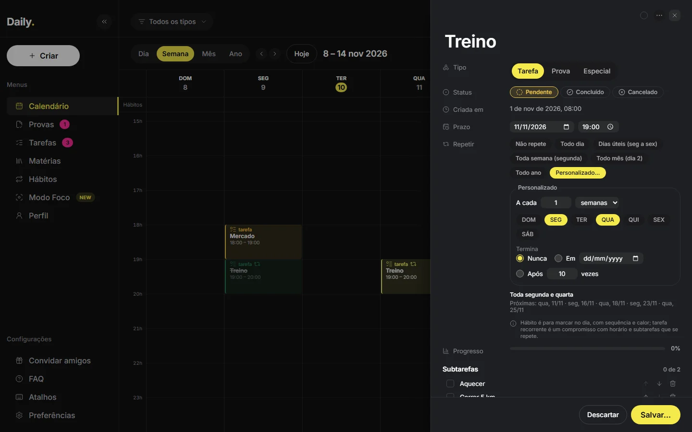 | 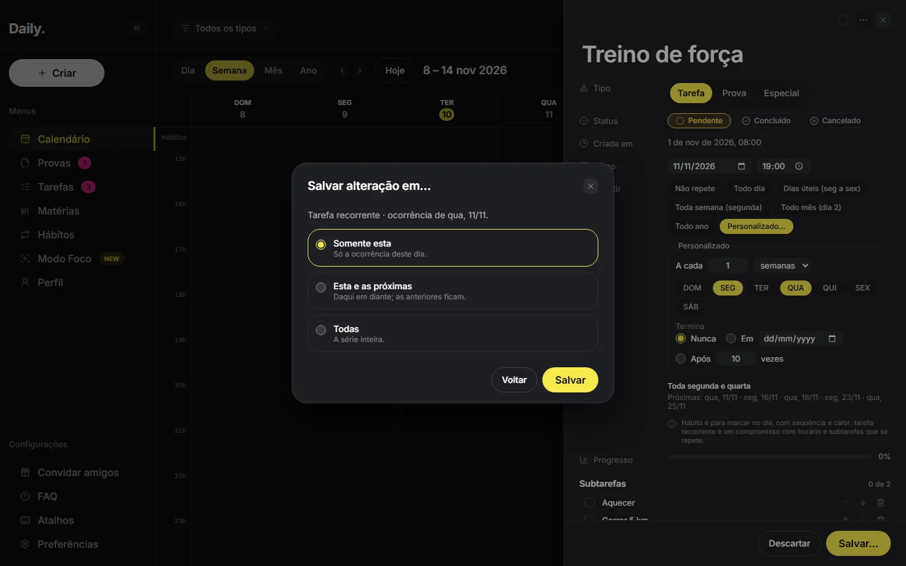 |
| 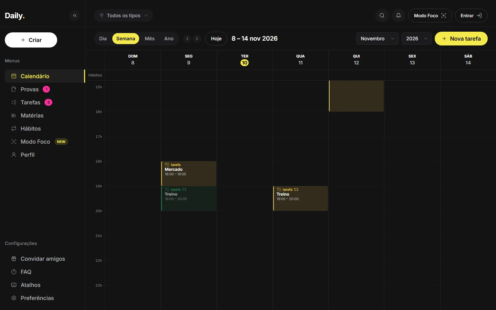        | 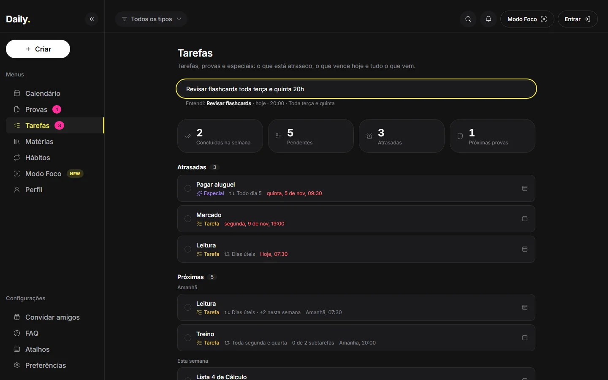         |

## 18. Tema claro (v1.3)

Os dois temas usam **os mesmos tokens**. O escuro fica em `:root`; o claro sobrescreve os valores em `:root[data-theme='light']` (com `color-scheme: light`, para barras de rolagem e campos nativos). O atributo vem de `public/theme-init.js`, antes da primeira pintura, e de `lib/theme` depois. O escuro não mudou nenhum pixel: está provado por `scripts/theme-regression.mjs compare dark`.

### Papéis de cor

Uma cor clara serve de preenchimento e de texto no escuro; no claro, não serve (amarelo sobre branco tem 1,2:1). Por isso cada uso declara o seu papel:

| Papel                     | Utilitários                                            | Escuro     | Claro             |
| ------------------------- | ------------------------------------------------------ | ---------- | ----------------- |
| Preenchimento da marca    | `bg-accent`                                            | `#f5e94b`  | `#f5e94b` (igual) |
| Tinta da marca            | `text-/border-/stroke-/outline-/accent-accent-ink`     | = `accent` | `#6b5d00`         |
| Anel de foco              | `outline-focus-ring`, foco global, contorno de arrasto | = `accent` | `#6b5d00`         |
| Marca sobre o amarelo     | `text-accent-fg`                                       | `#0b0b0c`  | `#0b0b0c`         |
| Marca sobre status sólido | `text-on-status` (check sobre o verde)                 | `#0b0b0c`  | `#ffffff`         |
| Marca sobre hábito sólido | `text-on-habit`                                        | `#0b0b0c`  | `#ffffff`         |
| Texto na cor do hábito    | `habit-text` (`habit-ink-mix` de tinta)                | 0 %        | 20 %              |

### Tokens dos dois temas

| Token                                                      | Escuro                                                                      | Claro                                                                       |
| ---------------------------------------------------------- | --------------------------------------------------------------------------- | --------------------------------------------------------------------------- |
| `bg` / `surface` / `surface-raised`                        | `#131313` / `#1b1b1d` / `#1e1f23`                                           | `#f4f4f6` / `#ffffff` / `#f7f7f9`                                           |
| `border` / `border-strong` / `hover`                       | branco 8 % / 16 % / 6 %                                                     | preto 8 % / 16 % / 5 %                                                      |
| `scrim`                                                    | preto 40 %                                                                  | preto 30 %                                                                  |
| `fg` / `fg-soft` / `fg-muted` / `fg-subtle`                | `#fff` / `#b0b0b6` / `#92929b` / `#808089`                                  | `#141416` / `#45454d` / `#5f5f68` / `#696972`                               |
| `accent-soft`                                              | amarelo 15 %                                                                | `#fbf6c4`                                                                   |
| `white-pill` / `-fg` (Criar)                               | branco / `#0b0b0c`                                                          | `#141416` / branco                                                          |
| `status-pendente` / `-soft`                                | `#f2c94c` / 14 %                                                            | `#8a6100` / `#fbf0c4`                                                       |
| `status-concluido` / `-soft`                               | `#3dd68c` / 14 %                                                            | `#16794a` / `#dcf2e5`                                                       |
| `status-cancelado` / `-soft`                               | `#ff6b78` / 14 %                                                            | `#c22a3b` / `#fbe2e5`                                                       |
| `type-prova` / `-soft`                                     | `#5c97ff` / 14 %                                                            | `#2458c9` / `#e1e9fc`                                                       |
| `type-especial` / `-soft`                                  | `#b48cff` / 14 %                                                            | `#7545d6` / `#ece4fb`                                                       |
| `streak` (chama) / `danger`                                | `#ff8a3d` / `#ff6b78`                                                       | `#b04f09` / `#c22a3b`                                                       |
| paleta (ciano, petróleo, gelo, lilás, fúcsia, rosa, cinza) | `#2beeee`, `#53a9c6`, `#c6dfec`, `#e2c6ec`, `#de2bee`, `#d279a6`, `#a3998f` | `#007d77`, `#177692`, `#4c575e`, `#7a5a86`, `#9a1686`, `#bd3f71`, `#72685c` |
| `heat-0` / `heat-off` / `rest`                             | branco 12 % / 4 % / 22 %                                                    | preto 9 % / 4 % / 20 %                                                      |
| `density-0…3` (Ano)                                        | branco 4 %, amarelo 22/38/85 %                                              | preto 5 %, `accent-ink` 18/34/70 %                                          |
| `chart-track` / `-strong`                                  | branco 10 % / 16 %                                                          | preto 8 % / 14 %                                                            |
| `water` / `-deep` / `-wave`                                | `#5b4fe0` / `#3b32a8` / `#7a70f0`                                           | `#a49cf7` / `#8c83ef` / `#bcb6fb` (texto escuro lê sobre a onda)            |
| `habit-soft-mix` / `habit-block-mix`                       | 18 % / 14 %                                                                 | 14 % / 8 %                                                                  |
| `glass-bg` / `glass-highlight`                             | gradiente branco / brilho interno                                           | `surface` / sombra `0 1px 2px` preto 6 %                                    |
| `glow-accent`                                              | amarelo 28 %                                                                | amarelo 22 %                                                                |
| `shadow-popover`                                           | preto 55 % + anel branco 8 %                                                | `0 12px 32px` preto 12 % + anel preto 8 %                                   |
| `color-scheme`                                             | `dark`                                                                      | `light`                                                                     |

### Regras

- Componente novo funciona nos dois temas e usa só tokens semânticos; `pnpm check:tokens` (CI) recusa cor literal fora de `tokens.css`.
- Cor de significado sempre com ícone e texto. No claro, status e tipos têm tinta escura e fundo suave próprio.
- Paleta clara: AA (≥ 4,5:1) sobre o fundo e a superfície e **ΔE ≥ 14** (no escuro, ≥ 15). Com AA no fundo claro, o máximo possível para 7 cores ao lado das 7 reservadas fica perto de 14,5.
- A troca de tema anima só cores, por 200 ms (`--ds-theme-transition`), e nada anima com `prefers-reduced-motion`.

### Contraste medido (`scripts/contrast-audit.mjs --all`)

Todas as rotas, a página inteira (sidebar, topbar, painéis) e os estados painel aberto, menu Criar, foco pelo teclado, hover, toast, modal e popover do dia, no desktop (1920×1080) e no celular (390×844):

| Tema   | Textos medidos       | Abaixo de AA                                                                                      | Menor razão                        |
| ------ | -------------------- | ------------------------------------------------------------------------------------------------- | ---------------------------------- |
| Claro  | 2549 + 715 (celular) | 0                                                                                                 | 4,73:1 (desktop), 4,79:1 (celular) |
| Escuro | 2549 + 715 (celular) | 0 (desde a 13.1: `fg-muted` `#92929B`, contador `#FF3DA3` e o tracejado da agenda depois da hora) | 4,59:1 (desktop e celular)         |

| Calendário no claro                                 | Perfil no claro                             | Celular                                       |
| --------------------------------------------------- | ------------------------------------------- | --------------------------------------------- |
| 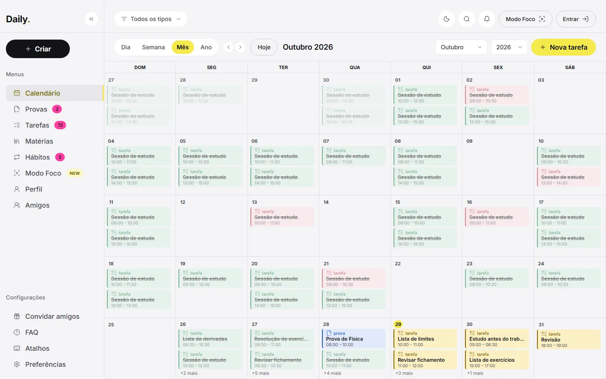 | 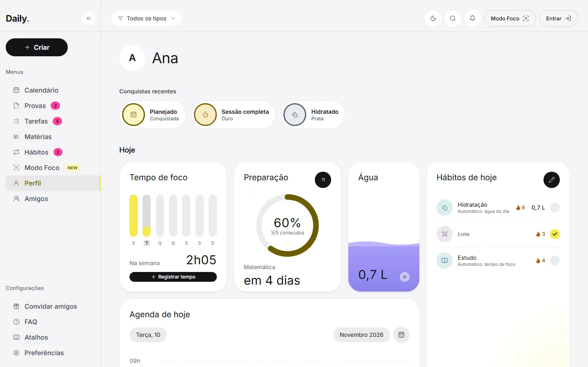 | 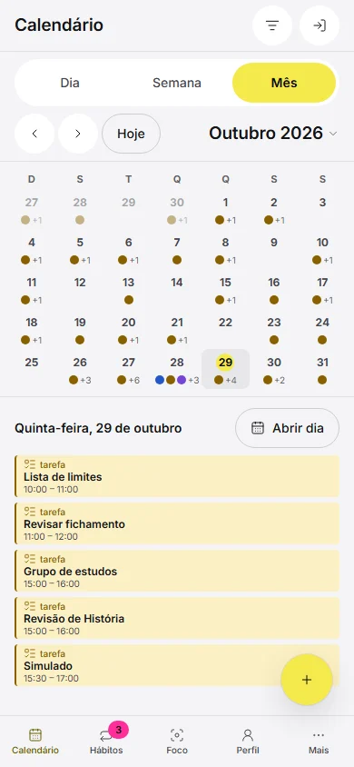 |

## 19. Medalhas (v1.4)

### Tokens de nível (dois temas)

| Token                                              | Escuro                         | Claro                 | Contraste da tinta (pior caso)                     |
| -------------------------------------------------- | ------------------------------ | --------------------- | -------------------------------------------------- |
| `--ds-tier-bronze` / `-soft`                       | `#e09a6a` / 16 % sobre o fundo | `#8e4c1c` / `#f7e5d8` | 5,5:1 (escuro, no disco) · 5,4:1 (claro, no disco) |
| `--ds-tier-silver` / `-soft`                       | `#c3cad4` / 16 %               | `#56606c` / `#e8ecf1` | 7,2:1 · 5,4:1                                      |
| `--ds-tier-gold` / `-soft`                         | `#ecc94b` / 16 %               | `#7d5f00` / `#f8edc4` | 7,4:1 · 5,1:1                                      |
| `--ds-tier-single` / `-soft`                       | `accent-ink` / `accent-soft`   | idem                  | (nível único)                                      |
| `--ds-medal` / `--ds-medal-lg` / `--ds-medal-ring` | 3,5 rem / 5 rem / 3 px         | —                     | —                                                  |

AA testado em `src/styles/palette.test.ts` (tinta sobre superfície, fundo e o próprio disco). O ouro fica perto do amarelo de “pendente”, mas o nível aparece sempre com ícone (estrelas) e texto, nunca só pela cor.

### Componente

- **Medalha** (`features/profile/achievements/Medal.tsx`): disco no fundo suave do nível, anel do nível (`border-medal`) e o ícone lucide da medalha na tinta do nível. Bloqueada: silhueta (anel tracejado `line-strong`, fundo `hover`, ícone `fg-subtle`). Decorativa: o nome acessível fica no botão do cartão (“Mãos à obra, prata, 167 de 200 tarefas”).
- **Cartão**: medalha, título, nível com estrelas e texto (Bronze/Prata/Ouro, Conquistada ou Bloqueada em `fg-soft`), barra de progresso e “Desde …”. No celular a medalha vai acima do título. Grade: 2 colunas no celular, 3 a partir de 768 px, 4 a partir de 1280 px.
- **Detalhe** no `Modal` (tela cheia no celular); **vitrine** em pílulas no topo do Perfil.
- **Aviso**: o toast existente, com “Ver”; sem animação nova.

| Conquistas (escuro)                      | Conquistas (claro)                                      | Celular                                       |
| ---------------------------------------- | ------------------------------------------------------- | --------------------------------------------- |
| 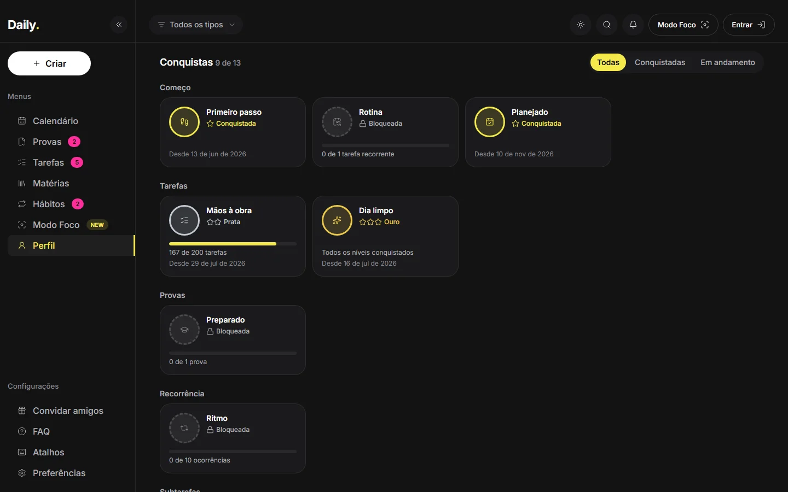 | 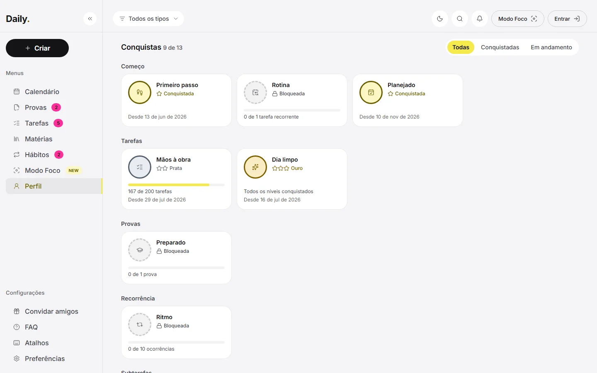 | 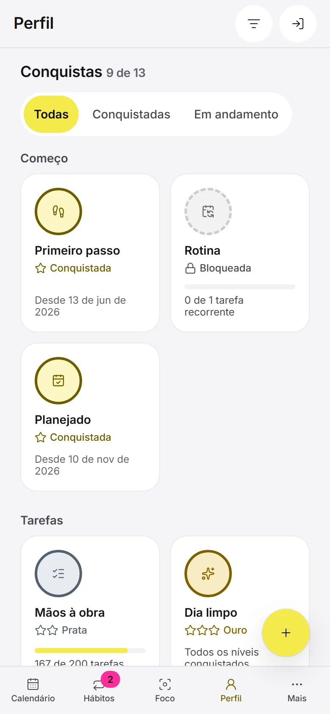 |

## 20. Perfil social (v1.5)

Sem cores novas: usa os tokens existentes nos dois temas. Token novo só de tamanho: `--ds-crop` (16 rem, a prévia do recorte; `size-crop` e `max-w-crop`).

- **Avatar social** (`features/social/SocialAvatar.tsx`): foto por `blob:` em círculo (`size-avatar-sm`, `size-avatar-md` ou `size-profile-avatar`), ou as iniciais em `bg-surface` com borda fina. Decorativo (o nome acessível fica no botão ou no texto ao lado).
- **Assistente** (`ActivationWizard`): o `Modal` (diálogo no desktop, tela cheia no celular, botões no rodapé), “Passo N de 6” anunciado, Voltar/Continuar; o aviso para 14 a 17 anos em `bg-accent-soft`; “Ninguém além de você vê seu perfil por enquanto” em `bg-hover`.
- **Campo do @** (`SocialFields.tsx`): prefixo “@”, anel de foco único no contorno do campo, situação ao vivo (`aria-live`): “Verificando…”, “Disponível” (`text-concluido` com ícone) ou o problema (`text-danger`), e as regras sempre visíveis.
- **Recorte da foto** (`AvatarPicker`): prévia circular em canvas, focável, que se move pelas setas (Shift = mais rápido) e por arrasto; zoom num controle deslizante (`accent-accent-ink`).
- **Privacidade:** caixas de seleção `plain`; para 14 a 17 anos, as travadas ficam `opacity-dimmed`, com a explicação.
- **Contraste** (auditoria `--social`, controles desabilitados fora, como a WCAG permite): escuro 4,81:1 e claro 5,07:1 no pior caso, no desktop e no celular.

| Gerenciar (escuro)                         | Assistente (claro)                                     | Celular                                          |
| ------------------------------------------ | ------------------------------------------------------ | ------------------------------------------------ |
| 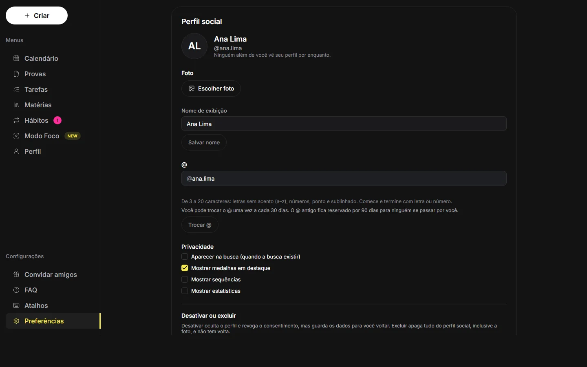 | 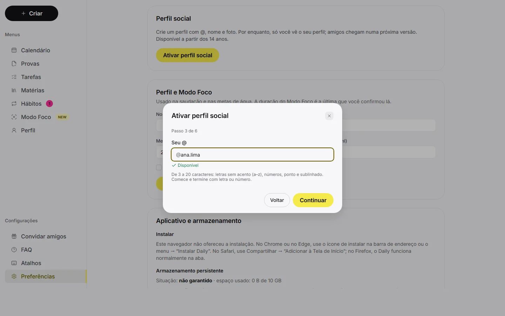 | 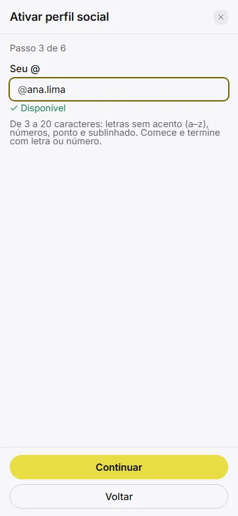 |

## 21. Amigos (v1.6)

Sem tokens novos: só os semânticos existentes, nos dois temas.

- **Linha de pessoa** (`features/friends/PersonRow.tsx`): avatar (`SocialAvatar`, foto só de amigos; senão as iniciais), nome em `text-fg`, @ em `text-muted`, ações à direita e o menu “…” (`Menu`, que vira sheet no celular). Com várias ações (pedido recebido), no celular as ações descem para a linha de baixo (`stackOnPhone`).
- **Busca** (`PeopleSearch` no `Modal` “Buscar pessoas”): campo com lupa, situação ao vivo (`aria-live`), resultados sem foto; ação por relação: “Adicionar” (secundário), “Aceitar” (primário), “Pendente” (`text-muted` com relógio) e “Amigos” (`text-concluido` com check).
- **Página Amigos:** `Tabs` com `fillOnPhone` (no celular as abas ocupam a largura, em `text-sm`, sem quebrar); estados vazios com `EmptyState`; carregamento com `Loader2` (`motion-safe:animate-spin`).
- **Confirmações** (`ConfirmDialog`): desfazer amizade, bloquear e recusar; cancelar e desbloquear usam o toast com “Desfazer”.
- **Denúncia** (`ReportDialog`): rádios `accent-accent-ink`, detalhe com contador `n/500`, “Bloquear também” (`Checkbox plain`) marcado.
- **Distintivo:** o contador rosa existente (`Badge counter`) no item Amigos e no botão “Mais”, com texto só para leitor de tela (“N solicitações recebidas”).
- **Contraste** (auditoria `--social`): escuro 4,81:1 e claro 5,07:1 no pior caso, no desktop e no celular, sem reprovações.

| Pedidos (escuro)                 | Busca (claro)                         | Celular                                   |
| -------------------------------- | ------------------------------------- | ----------------------------------------- |
| 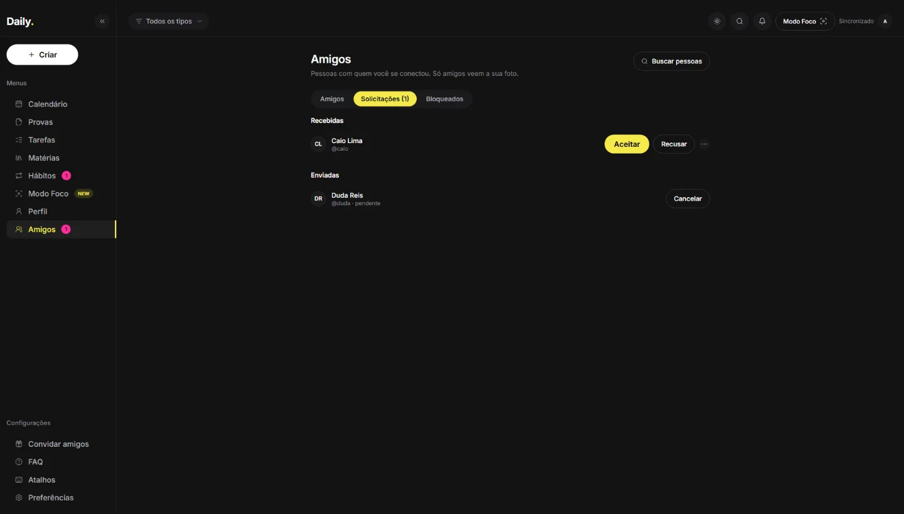 | 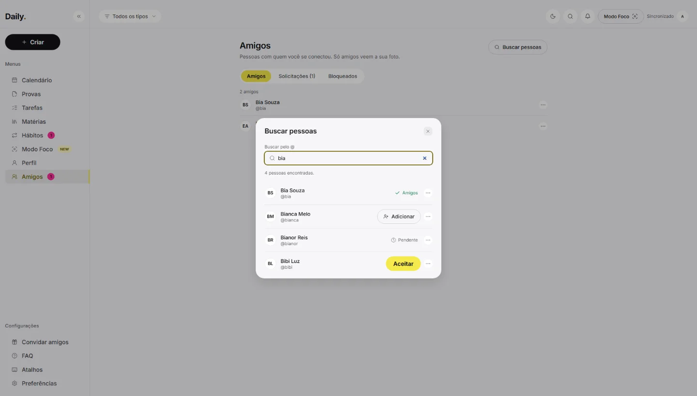 | 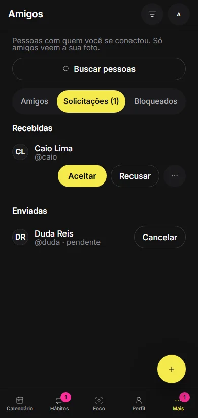 |

## 22. Concluir pelo chip (v1.7)

Sem tokens novos. O chip e o bloco do calendário viram um **contêiner com duas áreas irmãs**: o botão principal (abre o painel; o rótulo tem tipo, título, horário, regra e “concluída” ou “cancelada”) e o controle de concluir (`ChipComplete` → `CompleteButton`, com `aria-pressed` e “Concluir/Reabrir “título””). Nunca um botão dentro do outro. Tab vai do principal ao controle; Espaço e Enter funcionam nos dois.

| Onde                                                      | Tamanho (`ChipSize`) | Como aparece                                                                            |
| --------------------------------------------------------- | -------------------- | --------------------------------------------------------------------------------------- |
| Lista “+N mais”, agenda do Mês no celular, agenda de hoje | `list`               | Sempre (24 px no mouse, 44 px no toque)                                                 |
| Bloco de Dia/Semana com 2 ou 3 linhas e a coluna inteira  | `block`              | Sempre com mouse; no toque some (conclui-se pelo painel)                                |
| Chip da grade do Mês; bloco de 1 linha ou dividido        | `compact`            | Ao passar o mouse ou focar pelo teclado, por cima do canto (`bg-raised`); some no toque |
| Bloco reduzido à faixa (simultâneos no celular)           | `tiny`               | Não existe                                                                              |

- **Prova** nunca ganha o controle (prepara-se pelos conteúdos). **Cancelada** mostra um “×” (`text-cancelado`) onde há folga, sem ação; reabrir fica no painel.
- **Ocorrência de série** conclui só a si mesma (id `serie@data`), sem perguntar escopo.
- Toast “Desfazer” (`toggleDoneWithUndo`) e medalhas avaliadas como em qualquer conclusão. O Ano não tem chips (só densidade).

## 23. Cabeçalho de página mínimo (v1.8)

- `PageShell` tem só **título** (`h1`, `text-xl`; no celular `sr-only`, porque a topbar já mostra o nome) e **ações** à direita, alinhados ao centro. Não há subtítulo descritivo: a página se explica pelo título, pelas seções e pelos rótulos.
- A ação principal de criar é um `Button` primário com `Plus` e o nome da coisa (“Novo hábito”, “Nova tarefa”); no celular ocupa a largura do cabeçalho, com alvo de 44 px.
- Texto explicativo só onde ele muda o que a pessoa faz: estados vazios (`EmptyState`), diálogos e confirmações, avisos, Entrar e Privacidade.
